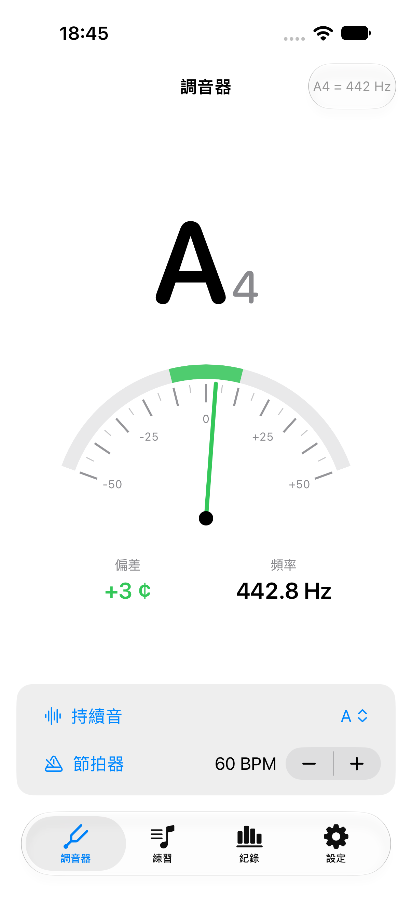
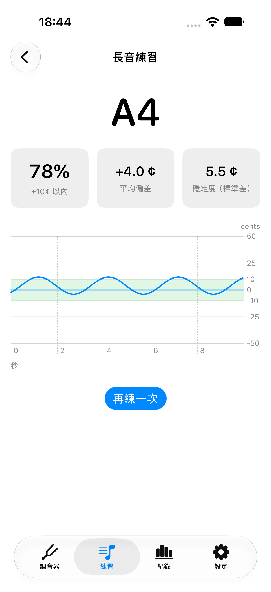
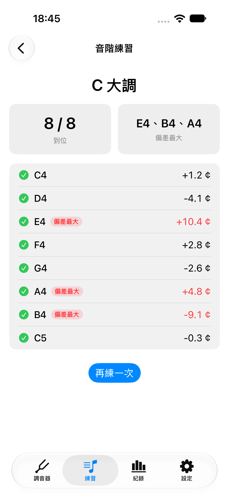
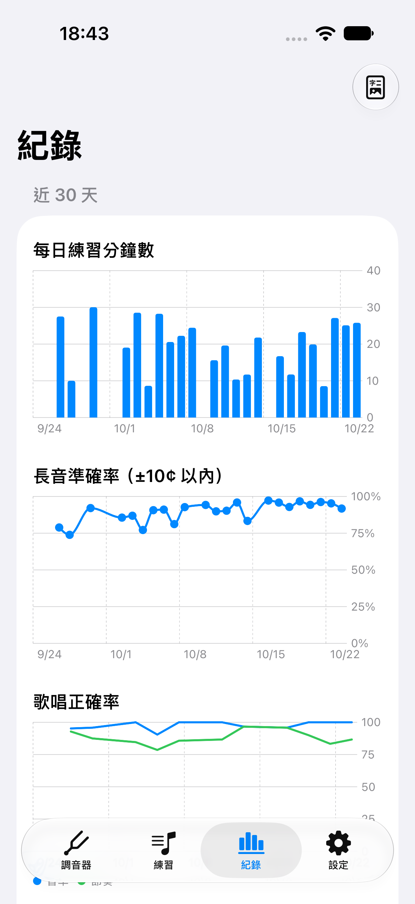
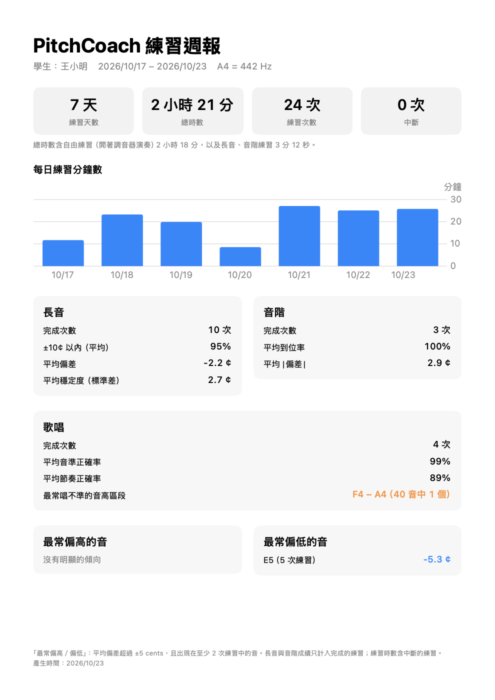
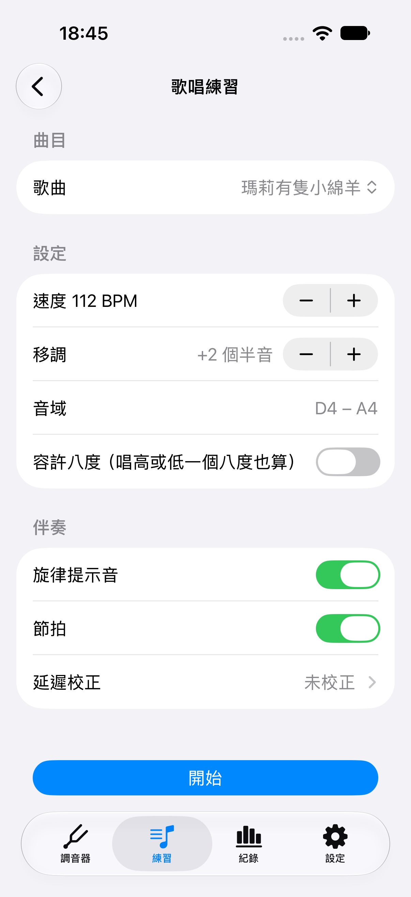
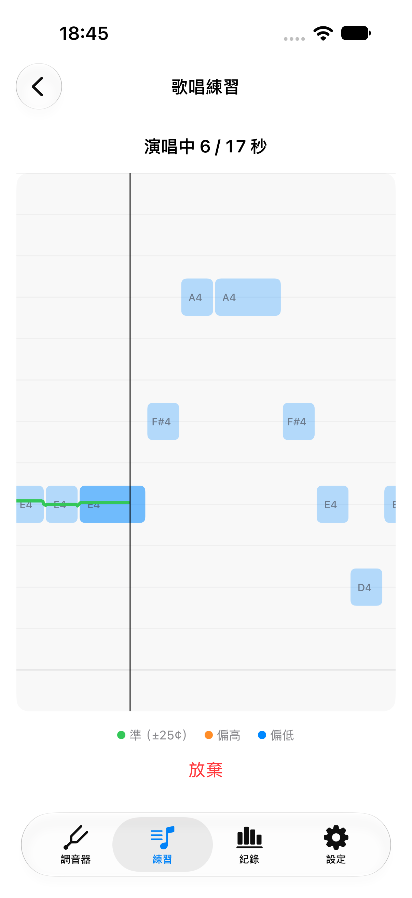
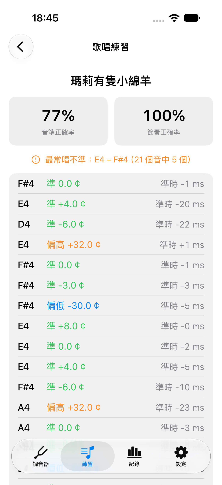
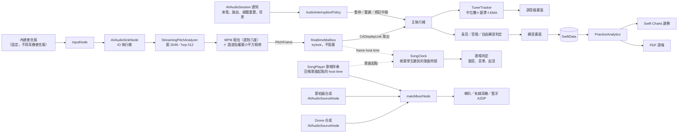

# PitchCoach 音準練習教練

[](https://github.com/hn83320589/PitchCoach/actions/workflows/ci.yml)

給兒童小提琴與長笛學生的 iPhone 音準練習 App：即時調音器、長音與音階練習、跟著伴奏唱歌的歌唱模式、練習紀錄與趨勢，並能產生 PDF 週報分享給老師。

- **平台**：iOS 17 以上、iPhone 直向
- **技術**：SwiftUI、AVAudioEngine、AVAudioSession、SwiftData、Swift Charts、Accelerate/vDSP
- **相依**：無第三方套件、無後端
- **音高偵測**：自行實作（McLeod Pitch Method ＋ 諧波加權最小平方精修）

| 調音器 | 長音結果 | 音階結果 | 近 30 天趨勢 | PDF 週報 |
|---|---|---|---|---|
|  |  |  |  |  |

| 歌唱設定 | 歌唱中（KTV 音高條） | 歌唱結果 |
|---|---|---|
|  |  |  |

> 截圖由 UI 測試以合成訊號自動產生（`scripts/export-screenshots.sh`），PDF 為示範資料實際輸出的頁面。實機截圖見[實機驗收](#實機驗收)。

---

## 目錄

1. [執行方式](#執行方式)
2. [專案結構](#專案結構)
3. [音訊流程架構](#音訊流程架構)
4. [音高偵測演算法](#音高偵測演算法)
5. [測試訊號與精度量測](#測試訊號與精度量測)
6. [延遲量測](#延遲量測)
7. [練習判定規則](#練習判定規則)
8. [歌唱模式](#歌唱模式)
9. [測試](#測試)
10. [實機驗收](#實機驗收)
11. [已知限制](#已知限制)

---

## 執行方式

**需求**：Xcode 16 以上（開發環境為 Xcode 27），iOS 17 以上的模擬器或實機。

```sh
git clone https://github.com/hn83320589/PitchCoach.git
open PitchCoach/PitchCoach.xcodeproj
```

1. 選擇 `PitchCoach` scheme 與 iPhone 模擬器，⌘R 執行。
2. 實機執行：在 Signing & Capabilities 選擇自己的 Team，並把 Bundle Identifier 改成自己的。
3. 第一次啟動會詢問麥克風權限。

模擬器的麥克風即 Mac 的麥克風，可對著 Mac 演奏或播放測試音（`python3 scripts/make-test-tone.py 442`）。

**命令列**

```sh
# 核心邏輯（macOS 上執行，不需模擬器）
swift test --package-path Packages/PitchCoachKit

# App 單元測試與 UI 測試
xcodebuild test -project PitchCoach.xcodeproj -scheme PitchCoach \
  -destination 'platform=iOS Simulator,name=iPhone 18 Pro'

# 以 UI 測試重新產生 README 截圖
scripts/export-screenshots.sh
```

GitHub Actions（macOS runner）會在每次 push 執行 `swift test` 並建置 App（`.github/workflows/ci.yml`）。

---

## 專案結構

```
PitchCoach/
├── PitchCoach/                      # App（SwiftUI）
│   ├── App/                         # 進入點、分頁、設定
│   ├── Audio/                       # AudioPipeline、中斷策略、即時擷取、合成輸入（UI 測試）
│   ├── Features/                    # 調音器、練習、紀錄、週報、設定
│   └── Persistence/                 # SwiftData 模型、Repository、示範資料（DEBUG）
├── PitchCoachTests/                 # App 單元測試（Swift Testing）
├── PitchCoachUITests/               # UI 測試（XCUITest，合成訊號驅動）
├── Packages/PitchCoachKit/          # 獨立 Swift Package（不依賴 UIKit／SwiftUI）
│   ├── Sources/MusicTheory/         # 基準音、音名、cents、大調音階
│   ├── Sources/PitchDetection/      # MPM、諧波精修、串流切窗、即時信箱
│   ├── Sources/PracticeEngine/      # 調音器平滑、長音／音階／自由練習判定、生命週期、統計
│   ├── Sources/SingingEngine/       # 旋律格式、內建旋律、時間軸、顫音、歌唱判定、起音、延遲校正
│   ├── Sources/Accompaniment/       # drone、節拍器與歌唱伴奏（SongPlayer）合成器
│   └── Sources/SignalKit/           # 測試訊號產生（固定種子）、人聲模擬（共振峰＋顫音）
├── docs/ARCHITECTURE.md             # 系統分析與架構設計（含所有設計決策）
├── docs/SINGING_MODE.md             # 歌唱模式的系統分析與架構設計
├── docs/DEVICE_TESTING.md           # 實機驗收步驟
└── scripts/                         # 截圖匯出、測試音產生
```

所有「判定」與「統計」都在 Package 內，App 只負責 I/O（音訊、儲存、畫面、PDF），因此長音指標、到位規則、週報數字都能在 macOS 上以 `swift test` 驗證。

---

## 音訊流程架構



**AVAudioSession**：`.playAndRecord`、`.measurement` mode（關閉 AGC）、`.defaultToSpeaker`、`.allowBluetoothA2DP`，IO buffer 5 ms。**不使用 HFP**：HFP 會把收音切到藍牙耳機並降到 16 kHz。收音固定使用內建麥克風，有線／藍牙耳機只負責播放伴奏，三種路由的讀數因此一致。

**執行緒**：偵測直接在 IO 執行緒執行（每 hop 約 0.27 ms，所有緩衝預先配置、不配置記憶體），結果經 `OSAllocatedUnfairLock` 的 trylock 交給主執行緒；拿不到鎖時暫存在生產者端，IO 執行緒永不等待。

**中斷處理**：系統通知轉成純值事件，由 `AudioInterruptionPolicy`（純函式，有單元測試）決定動作：

| 事件 | 動作 |
|---|---|
| 來電、鬧鐘、其他 App 佔用音訊 | 練習標記中斷 → 暫停引擎；結束且系統建議恢復時重建 |
| 插拔有線耳機、藍牙連線變化 | 練習標記中斷 → 300 ms debounce 後重建引擎（取樣率可能改變）；拔除時暫停伴奏 |
| 媒體服務重置 | 練習標記中斷 → 重建 |
| App 進入背景／回到前景 | 練習標記中斷 → 停止引擎／重建 |

---

## 音高偵測演算法

兩階段：**MPM 負責選對八度，諧波擬合負責精度**（設計文件 §4）。

### 1. McLeod Pitch Method（粗估）

1. 取最近 2,048 個樣本，去除直流；RMS 低於 −50 dBFS 視為靜音。
2. 以 vDSP FFT 計算自相關 r(τ)，以平方前綴和計算 m(τ)，得正規化平方差函數 **n(τ) = 2r(τ) / m(τ)**。
3. 每個正值區間取一個 key maximum，**選第一個 ≥ 0.9 × 最高峰者**，拋物線插值。
4. 峰值（clarity）< 0.85 視為沒有明顯音高（白噪音約 0.1–0.4，SNR 20 dB 的正弦約 0.98）。

### 2. 諧波加權最小平方精修

模型 x ≈ c + Σₕ aₕcos(hωj′) + bₕsin(hωj′)（h ≤ 16，j′ 以窗中心為原點），以 Brent 法求投影能量 J(ω) 的最大值。

- 對 16 個諧波以內的週期訊號，真實頻率處殘差為 0 → 沒有插值偏差；白噪音下接近最大概似估計。
- **權重用 sine 窗**：矩形權重時，弓弦（鋸齒波）的高次泛音在低頻洩漏，65 Hz 偏差 9.4 cents；Hann 權重洩漏最小但噪音誤差逼近 3 cents；sine 窗兩者兼顧。
- 以窗中心為原點時 cos／sin 欄正交，Gram 矩陣由 Dirichlet kernel 的封閉解查表，每次評估只需 O(W·H) 的向量內積。
- 兩段搜尋：先用主瓣仍寬的諧波（容忍粗估誤差），再用全部諧波小範圍精修，避免跳到旁瓣。

| 參數 | 值 | 理由 |
|---|---|---|
| 窗長 | 2,048 樣本 | 最低 65 Hz 週期 738 樣本（48 kHz），需 ≤ 窗長的一半；約 43 ms |
| Hop | 512 樣本（約 11 ms） | 約 90 frames/s |
| MPM k | 0.90 | 見下方八度錯誤推導 |
| clarity 門檻 | 0.85 | 區分噪音與音高 |
| 精修諧波數 | ≤ 16 | 低頻涵蓋到約 1 kHz 以上的泛音 |

### 防止八度錯誤

1. **k = 0.9 門檻**：基頻 + a 倍強的二次泛音時，n(T/2) ≈ (a² − 1)/(a² + 1)。a = 2（長笛高音區）→ 0.6 < 0.9，不會選到半週期（八度偏高）；a ≥ 4.4 才會誤判。
2. **選「第一個」而非「最高」**：週期訊號在 2T、3T 的 n 值和 T 幾乎一樣，只取最高峰會隨機落在倍數週期（八度偏低）。
3. **精修只在粗估附近搜尋**：搜尋範圍限制在主瓣內，不會跳到 ω/2 或 2ω。
4. **調音器顯示層**：3 frame 中位數濾波去除單一 frame 的跳動。


---

## 歌唱模式

設計與決策見 [docs/SINGING_MODE.md](docs/SINGING_MODE.md)。練習分頁 →「歌唱練習」。

### 判定規則

**每個音符的音高**
1. 取該音符樂譜期間的 frame（時間已換算成學生聽到的歌曲時間，見下方「時間對齊」）。
2. 去掉頭尾各 15%，只用中間 70%。前 20% 從 −100¢ 滑上來的滑音，被去掉了大半，剩下的只占中段約 7%，不影響中位數。
3. 中段做顫音偵測：偵測到顫音時取擬合出的**中心音高**，否則取**中位數**。
4. |偏差| ≤ 25¢ 為「準」，否則依方向標示「偏高」或「偏低」；整個音符都沒有音高為「沒唱」。中段有效 frame 少於 3 個時改用整個音符期間。

**顫音偵測**：對中段的 cents 序列擬合 c(τ) ≈ α + βτ + a·cos(2πfτ) + b·sin(2πfτ)，在 3–9 Hz 搜尋殘差最小的 f。
- 判定為顫音的條件：擬合解釋 ≥ 50% 的變異、幅度 ≥ 15¢、中段涵蓋 ≥ 1.5 個週期。
- 中心音高取 α，不用中位數：顫音只涵蓋非整數個週期時，中位數會偏向多出來的半個週期。
- 偵測器的分析窗（43 ms）會平均掉部分顫音，幅度以該窗的振幅響應補償（由窗形推導，5.5 Hz 約 0.95）。

**容許八度**：開啟時每個 frame 先換算到離目標最近的八度（±1 個八度）再判定；關閉時整首唱低八度會得到約 −1200¢，判定為偏低。

**節奏判定**：在樂譜起點 ±min(250 ms, 半個音符間隔) 內找起音，依可靠度取用三種線索。
1. 換氣後發聲：無音高 ≥ 40 ms 後出現音高。
2. 音高穿越前後目標音的中點：連唱換音時，分析窗橫跨兩音，常有 1–3 個無音高的 frame，因此容許 ≤ 80 ms 的空檔並內插。
3. 電平上升 ≥ 6 dB：同音重複時重新咬字，取上升過中點的時間。

起音差 ≤ ±80 ms 為「準時」，否則為「提早」或「延遲」。時間一律以分析窗**中心**計，用窗尾會讓起音晚約 21 ms。

**結果**：音準與節奏正確率都以全部音符為分母（沒唱算不準、不準時）。「最常唱不準的音高區段」是在 5 個半音寬的滑動區段中，找不準比例最高、至少 3 個音者。結果存入紀錄，並納入趨勢圖（歌唱正確率）與 PDF 週報（歌唱區塊）。

### 自訂旋律格式

```
C4:1 D4:1 E4:2 R:1 F#4:0.5 Bb4:1.5
```

- 以空白或換行分隔，每個音符為 `音名[升降]八度:拍數`。
- 音名 A–G（大小寫皆可），升降記號 `#`、`b`、`♯`、`♭`，八度為整數，拍數為大於 0、不超過 16 的數字（可有小數）。
- `R:拍數` 為休止符。
- 可用範圍 C2–C7；移調（±6 個半音）後必須仍在偵測範圍內。
- 速度（BPM，40–208）在畫面上設定。
- 格式錯誤時會指出第幾個音符與原因，例如：`第 3 個音符「H4:1」：無法辨識的音名「H」（請用 A–G，或 R 表示休止符）`。

### 伴奏與收音的時間對齊

伴奏（輸出）與收音（輸入）以 **mach host time** 為共同時鐘：

| 事件 | 計算 |
|---|---|
| 歌曲起點被播放 | SongPlayer 在預備拍結束的那個樣本，回報該 buffer 的 `AudioTimeStamp.mHostTime` ＋ 樣本偏移 |
| 學生聽到歌曲起點 | 上述時間 ＋ `AVAudioSession.outputLatency`（喇叭約 10 ms、藍牙 A2DP 約 150–250 ms） |
| 一個 frame 的聲音到達麥克風 | 分析窗中心的 host time − `AVAudioSession.inputLatency` |
| 該 frame 的歌曲時間 | 到達麥克風 − 聽到歌曲起點 − 依路由的校正值 |

學生跟著**聽到的**伴奏唱就會判定為準時，不論用喇叭還是藍牙耳機。

**延遲校正**：iOS 回報的藍牙延遲是估計值。歌唱設定 →「延遲校正」會以目前的路由播放 8 個 A4 提示音，由麥克風收音（用耳機時把耳機貼近麥克風），取起音偏移的中位數作為該路由的校正值，依裝置分別儲存。

**喇叭外放**：喇叭播放伴奏時啟用 Apple 的 voice processing 回音消除（關閉 AGC），避免偵測器聽到的是提示音而非學生的聲音；提示音是快速衰減的鋼琴式音色。啟用失敗時記錄錯誤並退回不消除的模式。

### 內建旋律（皆為公有領域）

只使用旋律，不含歌詞（中文歌詞的翻譯可能仍有著作權）。

| 曲名 | 原曲 | 年代 | 來源 |
|---|---|---|---|
| 小星星 | Ah! vous dirai-je, maman（法國民謠） | 1761 年已有出版紀錄 | [Wikipedia](https://en.wikipedia.org/wiki/Ah!_vous_dirai-je,_maman) |
| 兩隻老虎 | Frère Jacques（法國民謠） | 18 世紀 | [Wikipedia](https://en.wikipedia.org/wiki/Fr%C3%A8re_Jacques) |
| 小蜜蜂 | Hänschen klein（德國民謠） | 19 世紀 | [Wikipedia](https://en.wikipedia.org/wiki/H%C3%A4nschen_klein) |
| 瑪莉有隻小綿羊 | Mary Had a Little Lamb（旋律 Lowell Mason） | 1830 年代 | [Wikipedia](https://en.wikipedia.org/wiki/Mary_Had_a_Little_Lamb) |
| 倫敦鐵橋 | London Bridge Is Falling Down（英國傳統童謠） | 17 世紀以前 | [Wikipedia](https://en.wikipedia.org/wiki/London_Bridge_Is_Falling_Down) |
| 歡樂頌 | 貝多芬第九號交響曲第四樂章主題 | 1824 年 | [Wikipedia](https://en.wikipedia.org/wiki/Ode_to_Joy) |

### 量測結果

測試訊號由 `VoiceSynthesizer` 產生：1/h 遞減的泛音經母音共振峰（/a/ /i/ /u/，男、女、童聲）塑形，可加顫音、滑音與音量包絡，並走完整條處理鏈（合成 → 串流偵測 → 歌曲時鐘 → 判定）。

**AC-15**：人聲模擬加上 5.5 Hz ±60¢ 的顫音。

| 訊號 | 中心音高誤差 | 顫音速度 | 顫音幅度 | 門檻 |
|---|---|---|---|---|
| 男聲 /a/ E3 | +0.02¢ | 5.500 Hz | 60.08¢ | 中心 < 5¢、速度 < 0.5 Hz、幅度 < 10¢ |
| 女聲 /i/ A4 | +0.05¢ | 5.500 Hz | 60.04¢ | |
| 童聲 /u/ E5 | +0.05¢ | 5.500 Hz | 60.03¢ | |

**AC-18**：〈小星星〉開頭 7 個音，每個音的實際起音時間已知，涵蓋換氣、同音重複與連唱換音。

| 音符 | 情況 | 實際起音差 | 偵測 | 誤差 |
|---|---|---|---|---|
| 1 C4 | 從靜音起音 | 0 ms | +1.3 ms | +1.3 ms |
| 2 C4 | 同音重複（電平上升） | +50 ms | +43.0 ms | −7.0 ms |
| 3 G4 | 換氣後起音 | −40 ms | −46.7 ms | −6.7 ms |
| 4 G4 | 同音重複 | +120 ms | +117.0 ms | −3.0 ms |
| 5 A4 | 連唱換音（音高穿越） | 0 ms | −3.7 ms | −3.7 ms |
| 6 A4 | 同音重複 | −90 ms | −95.2 ms | −5.2 ms |
| 7 G4 | 連唱換音 | +30 ms | +32.9 ms | +2.9 ms |

最大誤差 7.0 ms，門檻 30 ms。另外，共振峰的風險也一併驗證過：3 種聲音 × 3 個母音 × 各自音域的每個半音，共 171 組，皆無八度錯誤、誤差 < 1¢。偵測器不需修改。

**AC-19（實機）**：見 [docs/DEVICE_TESTING.md](docs/DEVICE_TESTING.md)。以「延遲校正」畫面讓伴奏本身當「完美的範唱」，分別用內建喇叭與藍牙耳機（貼近麥克風）量每個提示音的起音偏移；再由真人跟同一首歌各唱 3 次。結果：**待實機量測**。

---

## 測試訊號與精度量測

測試訊號由 `SignalKit` 以固定種子產生（SplitMix64 亂數、Box–Muller 高斯白噪音），內部以 Double 計算、輸出 Float，可重現。

- **純正弦**：65·2^(k/12) Hz，k = 0…60，外加 2,100 Hz，共 62 個頻率；每個頻率不同的固定初始相位。
- **二次泛音強 2 倍**：基頻振幅 0.25、二次泛音 0.5。
- **白噪音 SNR 20 dB**：以實際量到的 RMS 調整噪音，使訊雜比恰為 20 dB（誤差 < 0.1 dB，有測試）。
- **性質測試**：500 組，基頻 65–2,100 Hz 對數均勻、取樣率隨機、2–8 次泛音振幅 U[0, 1]、相位隨機。
- **鋸齒波**（弓弦振動模型，驗收標準以外）：泛音一路到 Nyquist，振幅 1/h。

**量測結果**（單一 frame，誤差單位 cents）：

| 訊號 | 44.1 kHz 最大／平均 | 48 kHz 最大／平均 | 驗收門檻 |
|---|---|---|---|
| 純正弦（62 個頻率） | 0.001 / 0.0002 | 0.001 / 0.0002 | < 1 |
| 二次泛音強 2 倍 | 0.0007 / 0.0002（八度錯誤 0） | 0.0005 / 0.0001（八度錯誤 0） | 不可八度錯誤 |
| SNR 20 dB（測試用種子） | 0.81 / 0.16 | 1.53 / 0.17 | < 3 |
| SNR 20 dB 壓力測試（1,240 次） | 2.08 / 0.19 | 2.36 / 0.21 | < 3 |
| 性質測試 500 組 | 最大 0.001，八度錯誤 0 | （兩種取樣率混合） | < 5、八度錯誤 0 |
| 鋸齒波 | 0.18 / 0.007 | 0.11 / 0.006 | — |
| 靜音、極小訊號、150 段白噪音 | 皆無輸出 | 皆無輸出 | 不輸出音高 |

> 只用 MPM 拋物線插值時，SNR 20 dB 低頻誤差達 8 cents、性質測試達 4 cents；加入諧波精修後才達到上表（設計文件 §4.5 有各變體比較）。

---

## 延遲量測

**目標**：從聲音開始到畫面顯示讀數 ≤ 150 ms。

### 方法一：內部時間戳（App 內建）

每個分析 frame 記錄「分析窗最後一個樣本」對應的 host time（由 `AudioTimeStamp.mHostTime` 與樣本偏移推算），在 `CADisplayLink` 取出時與該幀的 `targetTimestamp`（預計顯示時間）相減。設定 → 開啟「顯示延遲資訊」即可在調音器下方看到 P50／P95、硬體輸入延遲與取樣率。

端到端估計 = 硬體輸入延遲 ＋ 分析窗填入新聲音（最長 42.7 ms）＋ 等待 hop（最長 10.7 ms）＋ 上述 P95。

| 環境 | 管線 P50 | 管線 P95 | 硬體輸入 | 端到端估計（最壞） |
|---|---|---|---|---|
| iPhone 18 Pro 模擬器（iOS 27、M4 Pro） | 11–12 ms | 18–29 ms | 2.8 ms | 約 85 ms |
| 實機 | 待量測 | 待量測 | 待量測 | 待量測 |

### 方法二：外部慢動作錄影

以另一支手機 240 fps 慢動作錄影，同時拍到發聲（撥弦或音叉）與 PitchCoach 螢幕，逐格計算音軌波形起點到讀數出現的影格數（每格 4.17 ms），重複 20 次取 P50／P95。步驟見 [docs/DEVICE_TESTING.md](docs/DEVICE_TESTING.md)。結果：**待實機量測**。

---

## 練習判定規則

詳細定義與理由見設計文件 §6、§7。

**調音器**：起音需 2 個有效 frame；保持讀數直到連續 8 個無效 frame 才回到「—」；相對目前顯示的音超過 65 cents 立即換音，50–65 cents 需持續 100 ms 才換；cents 以 EMA（50 ms）平滑。

**長音（10 秒）**：從按下開始後第一個有音高的 frame 起算；偏差相對目標音；±10 cents（含邊界）以內的比例分母為全部 frame（含無音高與錯音）；平均與母體標準差只用 |偏差| ≤ 50 cents 的 frame。

**音階到位**：有音高且 |偏差| ≤ 15.0 cents，從第一個在範圍內的 frame 起持續 ≥ 300 ms 即到位（299 ms 不算、300 ms 算）。**抖動規則**：範圍外（含無音高）的空檔 ≤ 50 ms 不重設計時，> 50 ms 才重設；只在範圍內的 frame 上到位。每音平均偏差只計 |偏差| ≤ 50 cents 的 frame；偏差最大 3 音以音高合併上下行。

**自由練習**：調音器畫面開著且偵測到演奏的時間；停頓 ≤ 5 秒計入、> 60 秒結束一段、少於 30 秒不記錄。只計入練習分鐘數，不計成績。

**中斷**：練習進行中遇到上表任一事件即標記「中斷」並保留已完成的部分；趨勢中的分鐘數與各音偏差計入中斷練習，長音準確率只用完成的練習。

**週報「最常偏高／偏低」**：區間內 frame 加權平均偏差超過 ±5 cents，且出現在至少 2 次練習中的音，各取前 3。

---

## 測試

共 **182 個測試**，全數通過（題目要求 ≥ 55）。

| 套件 | 數量 | 重點 |
|---|---|---|
| `MusicTheoryTests` | 18 | A4 = 442／440 驗收案例、[-50, 50) 歸屬、12 調拼寫、起始八度範圍 |
| `SignalKitTests` | 7 | 種子決定性、SNR 混合精度、人聲模擬的共振峰與顫音 |
| `PitchDetectionTests` | 24 | 純正弦、二次泛音、SNR 20 dB、靜音與噪音、500 組性質測試、鋸齒波、共振峰人聲 171 組與顫音追蹤、串流切窗與電平、即時信箱 |
| `AccompanimentTests` | 13 | 節拍器拍點精準不漂移、click 不被當成音高、drone、SongPlayer 預備拍／提示音／歌曲起點 host time |
| `SingingEngineTests` | 36 | 旋律格式錯誤（AC-20）、時間軸與移調（AC-21）、內建旋律、顫音分析、去頭尾中位數、滑音（AC-16）、容許八度（AC-17）、人聲顫音完整鏈（AC-15）、起音 < 30 ms（AC-18）、±80 ms 邊界、時鐘、延遲校正 |
| `PracticeEngineTests` | 49 | 調音器平滑、長音手算 fixture、到位 299／300 ms 與 ±15 抖動邊界、生命週期、自由練習、趨勢與週報（含歌唱） |
| `PitchCoachTests`（App） | 28 | 中斷策略與通知轉換、SwiftData 往返（含歌唱）、PDF 文字抽取、設定、延遲校正儲存、伴奏樂譜轉換 |
| `PitchCoachUITests` | 7 | 合成訊號驅動：調音器、長音、音階、背景中斷與恢復、自由練習、趨勢與週報分享、歌唱（移調音域同步、唱完整首、KTV 音高條） |

UI 測試以啟動參數 `-syntheticScenario` 讓收音管線改吃合成訊號（只在 DEBUG 組態編譯），偵測、判定、儲存與畫面皆走正式路徑；`-uiTesting` 使用記憶體內儲存。

---

## 實機驗收

需要實機與耳機的項目，步驟見 [docs/DEVICE_TESTING.md](docs/DEVICE_TESTING.md)。

| 驗收項目 | 狀態 |
|---|---|
| 內建麥克風／有線耳機／藍牙耳機（開啟伴奏）讀數差 ±3 cents，附截圖 | 待實機測試 |
| 延遲 ≤ 150 ms（慢動作錄影） | 待實機測試（模擬器內部時間戳估計約 85 ms） |
| 練習中來電、鬧鐘、插拔耳機不當機、恢復偵測、標記中斷 | 策略有單元測試、背景中斷有 UI 測試；實機待測 |
| PDF 透過分享選單存到「檔案」 | 模擬器已驗證分享選單；實機待測 |
| 歌唱：內建喇叭與藍牙耳機的節奏判定一致、起音誤差 ±80 ms（AC-19） | 待實機測試（回授自我測試＋真人演唱） |
| 歌唱：喇叭外放時 voice processing 回音消除對歌聲的影響 | 待實機驗證 |

---

## 已知限制

- **PDF 複製文字的部首問題**：PingFang 的部分字形（音、生、小、高…）同時對應康熙部首碼位，從 PDF 複製或搜尋時會得到部首字元（例如「⾳」U+2FB3 而非「音」U+97F3）。**畫面顯示完全正確**，僅影響複製與搜尋；測試以 NFKC 正規化驗證。
- **喇叭外放持續音會被麥克風收到**：未使用回音消除（voice processing 的降噪可能壓抑持續音），以喇叭播放持續音時 App 會提示戴耳機。
- **音階每音平均含滑音的過渡 frame**：換音瞬間分析窗橫跨兩個音，偏差在 ±50 cents 內的過渡 frame 會被計入，使平均略往鄰音方向稀釋（合成測試中 +12 cents 顯示為 +10.4 cents）。
- **諧波模型上限 16 個諧波**：泛音極豐富的低音會有微小偏差（鋸齒波最大 0.18 cent）；強烈非諧和的音色未驗證。
- **只處理單音**：不支援雙音與和弦（題目假設）。
- **藍牙耳機的麥克風不會被使用**（設計如此）；A2DP 的輸出延遲（約 150–250 ms）會讓聽到的節拍器較晚，但不影響偵測。
- **`.measurement` mode 的喇叭音量**尚未在實機確認；若伴奏過小，可改用 `.default` mode。
- **進入背景即暫停**，不支援背景收音（題目要求）。
- **週報與趨勢的音名一律用升記號**（例如 A#4），音階練習畫面則依調號拼寫（B♭4）。
- **iOS 27 模擬器**：`simctl privacy grant` 無法預先授予麥克風權限，第一次需手動按「允許」；模擬器的延遲數字不代表實機。
- **歌唱模式**：
  - KTV 音高曲線比「現在」線晚約 50–80 ms 出現（偵測需要一整個分析窗）；判定不受影響，因為判定以換算後的歌曲時間進行。
  - 喇叭外放時的回音消除效果尚未在實機驗證；耳機演唱最可靠。
  - 用耳機做延遲校正時需把耳機貼近麥克風；沒有校正的藍牙耳機只依 iOS 回報的延遲補償，可能差數十 ms。
  - 每個音符太短（中段不足 1.5 個顫音週期）時不分析顫音，改用中位數。
- 只支援 iPhone 直向與繁體中文。
