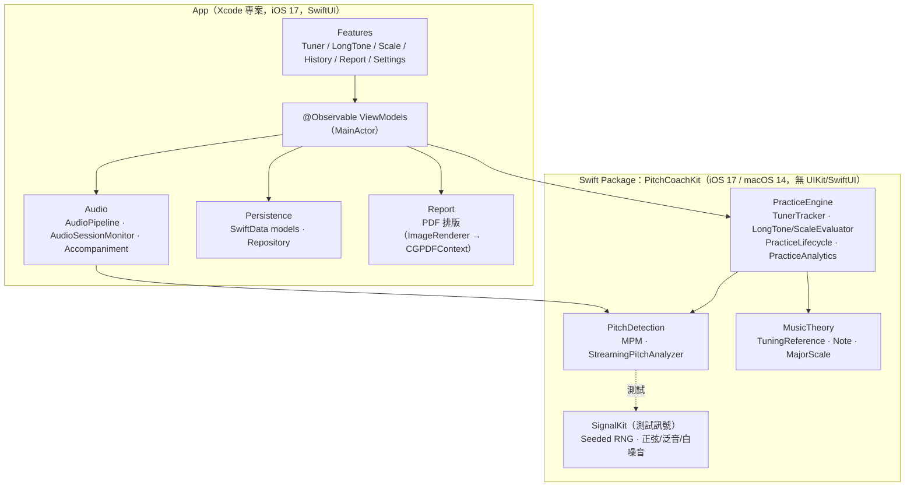
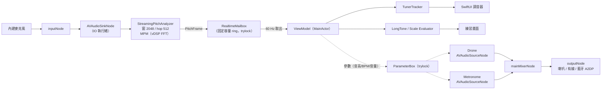
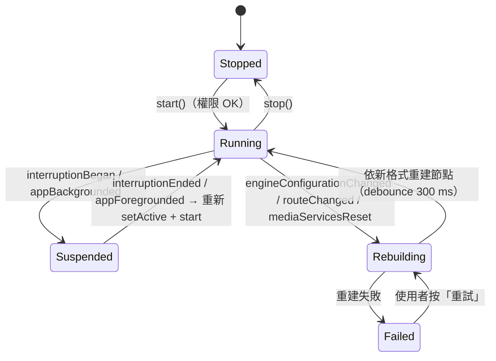
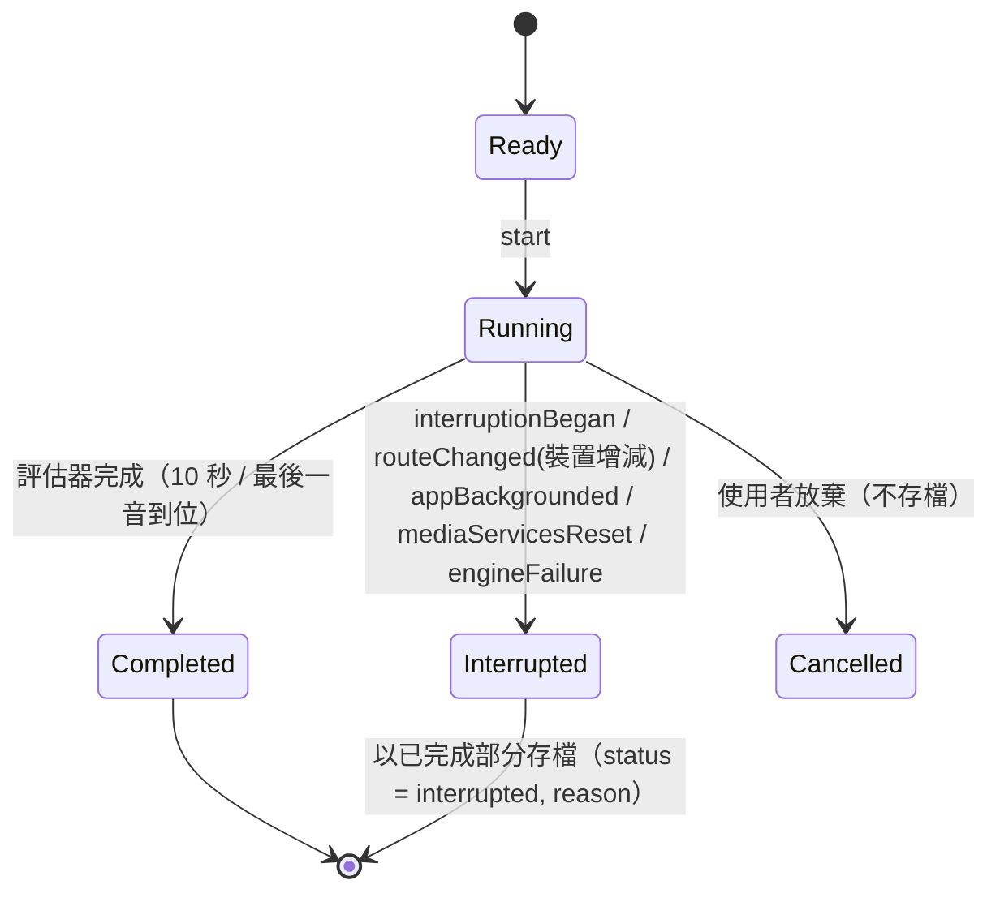

# PitchCoach 系統分析與架構設計

> 狀態：**v1.0（2026-10-23 已確認，§16 所有決策採用「建議」欄）**
> 本文件為開發前的系統分析與架構設計。標記 🔶 的項目為曾經討論的決策，彙整於 [§16 待討論決策](#16-待討論決策)。

---

## 1. 需求分析

### 1.1 使用者與使用情境

| 角色 | 情境 | 關鍵需求 |
|---|---|---|
| 學生（兒童，小提琴／長笛） | 在家用家長的 iPhone 練習，常戴藍牙耳機聽伴奏 | 讀數穩定好懂、操作簡單、不會因來電或拔耳機而當掉 |
| 家長 | 協助開 App、傳報告 | 一鍵產生 PDF 並分享 |
| 老師 | 上課時看 PDF 週報 | 看得出哪些音總是偏高或偏低、練習量是否足夠 |

### 1.2 功能需求拆解

| 編號 | 功能 | 核心邏輯位置 | 備註 |
|---|---|---|---|
| FR-01 | 即時調音器：65–2,100 Hz 基頻偵測 | Package `PitchDetection` | 自行實作 MPM |
| FR-02 | 顯示音名＋八度、cents（±50）、Hz（小數一位） | `MusicTheory` + `PracticeEngine.TunerTracker` | |
| FR-03 | 指針平滑、不在相鄰兩音間跳動 | `PracticeEngine.TunerTracker` | 中位數濾波＋雙重遲滯＋EMA |
| FR-04 | 音量太小或無明顯音高顯示「—」 | `PitchDetection`（gate）＋ Tracker（hold/release） | |
| FR-05 | A4 基準 415–466 Hz，預設 442 Hz | `MusicTheory.TuningReference` | 整數 Hz 🔶 |
| FR-06 | 長音練習 10 秒：準確率、平均偏差、標準差、曲線 | `PracticeEngine.LongToneEvaluator` | 指標定義見 §7.1 🔶 |
| FR-07 | 音階練習：12 個大調、起始八度、上行／上下行；±15 cents 持續 300 ms 到位 | `PracticeEngine.ScaleEvaluator` | 抖動規則見 §7.2 🔶 |
| FR-08 | 音階結果：每音平均偏差、偏差最大 3 音 | `ScaleEvaluator` | |
| FR-09 | 伴奏：drone（主音）、節拍器 40–208 BPM，與收音同時運作 | App `Audio/Accompaniment` | AVAudioSourceNode 合成 |
| FR-10 | 進入背景時暫停 | App `AudioPipeline` | 不開背景音訊模式 |
| FR-11 | 練習紀錄存 SwiftData | App `Persistence` | |
| FR-12 | 近 30 天趨勢（每日分鐘數、長音準確率、各音平均偏差） | `PracticeEngine.PracticeAnalytics`（計算）＋ App Swift Charts（呈現） | |
| FR-13 | 日期區間 PDF 週報＋分享選單 | `PracticeAnalytics.weeklyReport`（計算）＋ App `Report`（排版） | |
| FR-14 | 音訊中斷不當機、可恢復；練習中被中斷標記「中斷」並保留已完成部分 | `PracticeEngine.PracticeLifecycle`（狀態機）＋ App `AudioSessionMonitor` | |

### 1.3 非功能需求

| 編號 | 項目 | 目標 |
|---|---|---|
| NFR-01 | 精度 | 純正弦 < 1 cent；SNR 20 dB < 3 cents；隨機泛音 < 5 cents 且八度錯誤率 0 |
| NFR-02 | 延遲 | 聲音到畫面 ≤ 150 ms |
| NFR-03 | 穩定性 | 中斷／路由變更／媒體服務重置皆不當機 |
| NFR-04 | 可測試性 | 核心邏輯在獨立 Swift Package，不依賴 UIKit／SwiftUI，可在 macOS `swift test` |
| NFR-05 | 平台 | iOS 17+、iPhone 直向、繁體中文 |
| NFR-06 | 相依 | 零第三方套件、無後端 |

### 1.4 驗收標準追溯表

| # | 驗收標準 | 驗證方式 | 位置 |
|---|---|---|---|
| AC-01 | Xcode 開啟即可建置（模擬器／實機） | CI build ＋ 手動 | App |
| AC-02 | 純正弦 65–2,100 Hz 每半音、44.1k／48k，誤差 < 1 cent | 單元測試（參數化） | `PitchDetectionTests` |
| AC-03 | 二次泛音強 2 倍不發生八度錯誤 | 單元測試 | `PitchDetectionTests` |
| AC-04 | 白噪音 SNR 20 dB 誤差 < 3 cents | 單元測試（固定種子） | `PitchDetectionTests` 🔶 |
| AC-05 | 靜音／純噪音不輸出音高 | 單元測試 | `PitchDetectionTests` |
| AC-06 | ≥ 500 組隨機頻率＋隨機泛音性質測試 | 性質測試（固定種子） | `PitchDetectionPropertyTests` 🔶 |
| AC-07 | A4=442 → 442 Hz 為 A4 0 cents；A4=440 → +7.85 cents | 單元測試 | `MusicTheoryTests` |
| AC-08 | 延遲 ≤ 150 ms 並說明量測方式 | 內部時間戳＋外部慢動作錄影（§3.4） | README（需實機） |
| AC-09 | 長音指標與手算一致 | 單元測試（手算 fixture） | `LongToneEvaluatorTests` |
| AC-10 | 到位判定 299／300 ms 邊界、±15 抖動規則 | 單元測試 | `ScaleEvaluatorTests` |
| AC-11 | 內建麥克風／有線耳機／藍牙耳機讀數差 ±3 cents，附截圖 | 實機手動 | README（**需你的 iPhone 與耳機**） |
| AC-12 | 模擬來電／插拔耳機不當機、可恢復、標記中斷 | 狀態機單元測試＋實機手動 | `PracticeLifecycleTests` ＋ README |
| AC-13 | PDF 數據與紀錄一致、中文正常、可存到「檔案」 | 報告資料單元測試＋PDF 文字抽取測試＋手動 | `PracticeAnalyticsTests`、App 測試 |
| AC-14 | 測試 ≥ 40 個全數通過 | `swift test` ＋ App 測試 | 規劃約 70 個（§12） |

### 1.5 需要實機或人工參與的項目

以下項目我無法在本機獨立完成，需要你協助（我會提供量測腳本／步驟清單）：

1. AC-08 延遲的實機量測（慢動作錄影）。
2. AC-11 三種音訊路由的實機比對與截圖。
3. AC-12 實機來電／插拔耳機測試與錄影。
4. README 中的畫面截圖（模擬器截圖我可以做，但含麥克風讀數的畫面需實機）。

---

## 2. 系統架構總覽

### 2.1 分層



**相依規則**

- `MusicTheory`：無相依（純數學）。
- `PitchDetection`：只依賴 `Accelerate`。
- `PracticeEngine`：依賴 `MusicTheory`、`PitchDetection`（只用到 `PitchFrame` 型別）。
- `SignalKit`：只供測試（以及 App 的 Debug 自我測試畫面，選用）。
- `Accompaniment`（M5 新增）：drone 與節拍器合成器、`RealtimeParameter`。原設計放在 App 層，因合成邏輯（樣本精準的拍點、淡入淡出）值得在 macOS 上測試而移入 Package；無相依。
- App 只透過 Package 的 public API 使用核心邏輯；**所有「判定」與「統計」都在 Package 內**，App 只負責 I/O（音訊、儲存、畫面、PDF）。

> 這個切分讓 AC-09、AC-10、AC-12、AC-13 的「數字正確性」都能在 macOS 上用 `swift test` 驗證，不需要模擬器。

### 2.2 Repo 結構

```
PitchCoach/
├── PitchCoach.xcodeproj
├── PitchCoach/                      # App target
│   ├── App/                         # PitchCoachApp、AppEnvironment、TabView
│   ├── Audio/                       # AudioPipeline、AudioSessionMonitor、Accompaniment、RealtimeMailbox
│   ├── Features/
│   │   ├── Tuner/
│   │   ├── LongTone/
│   │   ├── Scale/
│   │   ├── History/                 # Swift Charts 趨勢
│   │   ├── Report/                  # 週報預覽、PDF 排版、ShareLink
│   │   └── Settings/
│   ├── Persistence/                 # SwiftData @Model、Repository、Record ↔ Summary 轉換
│   └── Resources/                   # Assets、Info.plist（NSMicrophoneUsageDescription）
├── PitchCoachTests/                 # App 層測試（通知轉換、SwiftData 轉換、PDF 文字抽取）
├── Packages/PitchCoachKit/
│   ├── Package.swift
│   ├── Sources/{MusicTheory,PitchDetection,PracticeEngine,SignalKit}/
│   └── Tests/{MusicTheoryTests,PitchDetectionTests,PracticeEngineTests}/
├── docs/                            # 本文件、延遲量測紀錄
├── .github/workflows/ci.yml
└── README.md
```

🔶 **Xcode 專案產生方式**：本機沒有 XcodeGen／Tuist，依規範不擅自引入新工具。建議手寫 `project.pbxproj`，使用 Xcode 16+ 的 **資料夾同步群組（PBXFileSystemSynchronizedRootGroup）**，新增檔案不需修改專案檔，pbxproj 很小、好維護；Package 以 local package reference 加入。

---

## 3. 音訊管線設計

### 3.1 AVAudioSession 設定

| 設定 | 值 | 理由 |
|---|---|---|
| Category | `.playAndRecord` | 伴奏與收音同時 |
| Mode | `.measurement` | 關閉 AGC 等系統處理，讀數一致（實機驗證輸出音量，若過小改 `.default`） |
| Options | `.defaultToSpeaker`、`.allowBluetoothA2DP` | 無耳機時從喇叭出聲；藍牙走 A2DP 高音質輸出 |
| **不**使用 | `.allowBluetooth`（HFP） | HFP 會把麥克風切到耳機、取樣率降到 16 kHz、音質差 |
| Preferred input | **固定內建麥克風** 🔶 | 三種路由（內建／有線／藍牙）都用同一顆麥克風收音 → AC-11 讀數一致 |
| Preferred IO buffer | 0.005 s（≈256 frames @48k） | 降低延遲 |
| Preferred sample rate | 不強制；Detector 依實際取樣率參數化 | 支援 44.1k／48k |

> 🔶 關鍵設計：**輸出可以走耳機，輸入永遠是內建麥克風**。這樣「有線耳機」「藍牙耳機」兩種情況只改變伴奏從哪裡出聲，不改變收音路徑，最能確保三種情況讀數差 ±3 cents 以內。

### 3.2 引擎圖



### 3.3 執行緒模型 🔶

| 執行緒 | 工作 | 限制 |
|---|---|---|
| IO（即時）執行緒 | SinkNode 收樣本 → 累積 hop → 執行 MPM → 把 `PitchFrame` 推進 mailbox；SourceNode 合成伴奏 | **不配置記憶體、不鎖等待**：所有緩衝預先配置（`UnsafeMutablePointer`、vDSP FFT setup 於 init 建立）；與主執行緒交換資料只用 `OSAllocatedUnfairLock.withLockIfAvailable`（trylock，拿不到就下次再推，不阻塞） |
| Main（MainActor） | 每個 display frame 取出 mailbox 中所有 frame，依序餵 Tracker / Evaluator，更新 UI；處理 session 通知 | 判定用的時間來自音訊樣本位置，與主執行緒取用的時間抖動無關 |

**為什麼用 `AVAudioSinkNode` 而不是 `installTap`**：iOS 上 `installTap(bufferSize:)` 常忽略指定大小，實際給約 100 ms 一包（4,410／4,800 frames），單這一項就吃掉 2/3 的延遲預算。SinkNode 依 IO buffer（約 5 ms）回呼。

**為什麼直接在 IO 執行緒做 MPM**：每 hop 的計算量是一次 4,096 點實數 FFT + 逆 FFT + 線性掃描，約數十 µs，IO 預算 5.3 ms；省掉跨執行緒喚醒，延遲最低。若實機 profiling 發現 overrun，退路是改成 ring buffer + 分析執行緒（介面不變）。

**時間戳**：`PitchFrame.time` 以 `Duration` 表示（由 SinkNode 的 `mSampleTime` / sampleRate 換算）。測試中可直接以毫秒建構，299 ms／300 ms 邊界比較是精確的整數比較，不受浮點誤差影響。

### 3.4 延遲預算與量測

| 階段 | 估計 |
|---|---|
| 硬體輸入＋IO buffer（256 @48k） | 5–10 ms |
| 分析窗填入足夠新聲音（clarity 過門檻約需窗的一半以上） | 25–43 ms |
| 等待下一個 hop | 0–11 ms |
| MPM 計算 | < 1 ms |
| Tracker 起音確認（2 frames）＋中位數濾波 | 11–22 ms |
| 主執行緒取用（60 Hz） | 0–17 ms |
| SwiftUI 繪製＋螢幕掃描 | 17–33 ms |
| **合計** | **約 60–135 ms**（目標 ≤ 150） |

**量測方式（README 會寫）**

1. **內部時間戳**：記錄 onset 所在 buffer 的 `AVAudioTime.hostTime` ＋ 樣本偏移 → frame 產生時間 → `CADisplayLink` 提交時間，加上 `session.inputLatency`，統計 P50／P95。
2. **外部端到端**：用另一支手機 240 fps 慢動作錄影，對著撥弦（或音叉）與 PitchCoach 螢幕；在剪輯軟體中以音軌波形 onset 為起點，數到讀數出現的影格。每種情況量 20 次取 P50／P95。

### 3.5 中斷與路由變更

App 層把系統通知轉成純值事件，交給 Package 內的狀態機處理：

```swift
// App 層：Notification → 事件（可測試的純函式）
enum AudioSessionEvent {
    case interruptionBegan
    case interruptionEnded(shouldResume: Bool)
    case routeChanged(RouteChangeReason)   // newDeviceAvailable / oldDeviceUnavailable / ...
    case mediaServicesReset
    case engineConfigurationChanged         // AVAudioEngineConfigurationChange
    case appBackgrounded, appForegrounded
}
```

**音訊引擎狀態機（App `AudioPipeline`）**



- `mediaServicesReset`：整個 `AVAudioEngine` 重新建立。
- `engineConfigurationChanged`：取樣率可能改變（例如接上藍牙 44.1k → 48k），Analyzer 依新取樣率重建。
- `oldDeviceUnavailable`（拔耳機）：依 iOS 慣例**暫停伴奏**，避免突然從喇叭放出聲音；偵測繼續。
- 所有失敗都有明確錯誤狀態與訊息，不吞例外。

**練習生命週期（Package `PracticeLifecycle`）**



中斷後**練習不續接**（存為「中斷」），但**調音器偵測會自動恢復**，使用者可重新開始一次練習。

### 3.6 背景

不開 `UIBackgroundModes: audio`。`scenePhase == .background` 時停止引擎（含伴奏）；回到前景時若先前在執行則自動重啟。練習中進入背景視為中斷。

---

## 4. 音高偵測演算法

### 4.1 選擇：McLeod Pitch Method（MPM）🔶

| | YIN | **MPM（建議）** |
|---|---|---|
| 核心函數 | 累積平均正規化差分 d′(τ) | 正規化平方差函數 NSDF n(τ) ∈ [-1, 1] |
| 峰值選擇 | 第一個低於絕對門檻的谷 | 第一個 ≥ k × 最高峰的 key maximum |
| 信心值 | d′ 谷值（越小越好） | NSDF 峰值（clarity，越接近 1 越好），直接當「有無明確音高」的判準 |
| 純正弦精度 | 好 | **NSDF 對純正弦在 τ = T 處恰為 1**（窗內樣本數不整除週期也成立），峰值無偏 |
| vDSP 加速 | 可 | 可（自相關用 FFT） |

選 MPM 的主因：clarity 天然提供 FR-04 所需的「無明顯音高」判準；對純正弦峰值無偏，有利於達成 < 1 cent。

### 4.2 流程（每個 hop）

1. 取最近 W = 2,048 個樣本（減去平均值去 DC）。
2. RMS gate：低於 −50 dBFS → 無音高（帶 3 dB 遲滯，避免門檻附近閃爍）。
3. 以 vDSP FFT（4,096 點，零填充）計算自相關 r(τ)；以前綴平方和 O(1) 求 m(τ) = Σ(x²ⱼ + x²ⱼ₊τ)。
4. n(τ) = 2r(τ) / m(τ)，只在 τ ∈ [fs/2200, fs/62] 範圍內搜尋。
5. Key maxima：每段「正值區間」（正向穿零到負向穿零）中的最大值。
6. 取最大 key maximum nₘₐₓ；選**第一個** ≥ k · nₘₐₓ 的 key maximum。
7. 拋物線插值求次樣本峰值 τ̂ 與 clarity。
8. clarity < 0.85 → 無音高；f = fs / τ̂，超出 [65, 2100] 半個半音以外 → 無音高。

### 4.3 參數

| 參數 | 值 | 依據 |
|---|---|---|
| 窗長 W | 2,048（44.1k／48k 皆同） | 最低 65 Hz 週期 = 738 樣本 @48k，需 τₘₐₓ ≤ W/2 = 1,024；窗長 ≈ 43–46 ms 兼顧延遲 |
| Hop | 512（≈ 11 ms） | 約 90 frames/s，足夠平滑與 300 ms 判定解析度 |
| k（峰值門檻） | 0.90 | 見 §4.4 推導，以測試微調 |
| clarity 門檻 | 0.85 | 20 dB SNR 正弦 clarity ≈ 0.98；白噪音 ≈ 0.1–0.4 |
| RMS gate | −50 dBFS（±3 dB 遲滯） | 實機調整，設定頁可不開放 |
| 搜尋範圍 | 62–2,200 Hz | 讓 65／2,100 Hz 邊界附近 ±50 cents 仍可偵測 |

### 4.4 防止八度錯誤

1. **k 門檻（主要）**：x = sin(ωt) + a·sin(2ωt) 時，在 τ = T/2 基頻反相、二次泛音同相，n(T/2) ≈ (a² − 1)/(a² + 1)。a = 2（題目條件）→ 0.6 < 0.9，不會選到 T/2（八度偏高）。要 a ≥ 4.4 才會誤判。
2. **「第一個」而非「最高」**：避免選到 2T、3T（八度偏低）——週期訊號在 2T 的 n 值和 T 幾乎一樣高，只取最高峰會隨機落在倍數週期。
3. **搜尋範圍限制**：τ 只搜到 fs/62，不會選到低於範圍的次諧波。
4. **時間域（Tracker）**：3-frame 中位數濾波去除單一 frame 的八度跳動（只影響顯示，不影響 Detector 測試）。

### 4.5 精度：兩階段估計（2026-10-23 實作後修訂）

原設計只用 MPM 的拋物線插值。實作後實驗發現兩個問題：

| 問題 | 實測 | 原因 |
|---|---|---|
| SNR 20 dB 誤差 | 低頻單 frame 最差 8 cents；即使取 9 frames 中位數仍有 5.4 cents | NSDF 只用單一 lag 的重疊段，雜訊交叉項直接推動峰值；效率約為 CRLB 的 1/8 |
| 高頻多泛音 | 性質測試最大 4.15 cents | 泛音使 NSDF 峰值變尖，拋物線插值偏差變大 |

因此改為**兩階段**：

1. **MPM**：只負責得到八度正確的粗估（§4.4 的防八度錯誤機制不變）。
2. **諧波加權最小平方擬合**（`HarmonicFrequencyRefiner`）：模型 x ≈ c + Σₕ aₕcos(hωj′) + bₕsin(hωj′)，h ≤ 16；以 Brent 法求投影能量 J(ω) 的最大值。
   - 對 H 以內的週期訊號，真實頻率處殘差為 0 → 無插值偏差；白噪音下接近最大概似估計。
   - **權重用 sine 窗**：矩形權重時，鋸齒波（弓弦振動模型）在 65 Hz 偏差 9.4 cents（H 以外的泛音洩漏）；Hann 權重偏差最小但噪音誤差逼近 3 cents；sine 窗兩者兼顧。
   - 以窗中心為原點時 cos/sin 欄正交，Gram 矩陣由 Dirichlet kernel 封閉解查表，每次評估 O(W·H)。
   - 兩段搜尋：先用主瓣仍寬的諧波（容忍粗估誤差），再用全部諧波小範圍精修，避免跳到旁瓣。

| 變體（48 kHz） | 鋸齒波 <200 Hz 偏差 | 20 dB SNR 最差（610 次） |
|---|---|---|
| 只用 MPM | 0.2 cents（高頻 2.3） | 8.4 cents |
| 矩形權重 H=10 | 9.43 | 1.62 |
| Hann H=10 | 0.28 | 2.66 |
| **sine 窗 H=16（採用）** | **0.11** | **1.93** |

效能：每次偵測約 0.27 ms（M 系列 Mac release），每 hop（≈11 ms）一次，可留在 IO 執行緒。

### 4.6 SNR 20 dB 的驗證層級（D7 修訂）

兩階段估計後，**單一 frame 即可在 65–2,100 Hz 全範圍達到 < 3 cents**，不再需要 Tracker 層的中位數輔助。AC-04 測試直接在 Detector 層以單 frame、全部半音驗證。

---

## 5. 音名換算（MusicTheory）

```swift
public struct TuningReference: Sendable, Equatable {
    public static let allowedRange: ClosedRange<Double> = 415...466
    public static let `default` = TuningReference(uncheckedA4: 442)
    public let a4: Double
    public init(a4: Double) throws(TuningReferenceError)
}

public struct Note: Hashable, Sendable, Comparable {
    public let midi: Int                    // A4 = 69
    public var pitchClass: PitchClass { get }
    public var octave: Int { get }          // 科學音高記號：C4 = 中央 C
    public func name(spelling: Spelling = .sharps) -> String   // "C#5" / "D♭5"
}

public enum NoteConverter {
    /// 最近的音與偏差 cents，cents ∈ [-50, 50)
    public static func reading(frequency: Double, reference: TuningReference) -> (note: Note, cents: Double)
    public static func frequency(of note: Note, reference: TuningReference) -> Double
    public static func cents(frequency: Double, relativeTo note: Note, reference: TuningReference) -> Double
}
```

- 公式：`midiFloat = 69 + 12·log₂(f / a4)`，`note = round(midiFloat)`，`cents = 100·(midiFloat − note)`。
- 恰好 +50 cents 的歸屬：以半開區間 [-50, 50) 定義（+50 歸上一個音），有測試。
- 調音器一律用升記號（題目範例 C#5）；音階畫面依調號拼寫（F 大調顯示 B♭）。12 個調：C、G、D、A、E、B、F#、D♭、A♭、E♭、B♭、F（皆 ≤ 6 個升降記號）。

---

## 6. 調音器顯示平滑（TunerTracker）

純值型別，輸入 `PitchFrame`，輸出 `TunerDisplayState`（`.silent` 顯示「—」，或 `.reading(note, cents, frequency)`）。

| 機制 | 規則 | 目的 |
|---|---|---|
| 起音確認 | 連續 2 個有效 frame（≈ 22 ms）才顯示讀數 | 不讓雜音閃出讀數 |
| 保持與釋放 | 無效 frame 時保持上一個讀數，連續 8 個（≈ 90 ms）才回到「—」 | 換弓、換氣時不閃爍 |
| 中位數濾波 | 最近 3 個 frame 的音高（cents 域）取中位數 | 去除單 frame 八度跳動 |
| 音名雙重遲滯 | 相對目前顯示的音 \|c\| > 65 cents → 立即換音；50 < \|c\| ≤ 65 → 持續 100 ms 才換 | 在兩音邊界附近不來回跳 |
| 數值平滑 | cents 以 EMA（τ ≈ 50 ms）平滑；換音或起音時重設 | 指針平順；UI 再加 SwiftUI spring 動畫補間到 60/120 fps |

顯示的 cents 截在 ±50；Hz 顯示平滑後頻率，小數一位。

---

## 7. 練習判定（PracticeEngine）

所有評估器都是**純值、決定性**的狀態機：輸入帶時間戳的 frame，輸出進度事件與結果。

### 7.1 長音練習 🔶

```swift
public struct LongToneEvaluator {
    public init(target: Note, reference: TuningReference, duration: Duration = .seconds(10))
    public mutating func process(_ frame: PitchFrame) -> LongToneProgress   // .waitingForSound / .running(elapsed, currentCents) / .finished
    public func result() -> LongToneResult          // 完成或中斷時呼叫，計算已收集部分
}
public struct LongToneResult {
    public let inToleranceRatio: Double             // ±10 cents 以內時間比例
    public let meanCents: Double?                   // 平均偏差（帶正負號）
    public let standardDeviationCents: Double?      // 穩定度
    public let curve: [Double?]                     // 降採樣到 20 Hz 的偏差曲線，nil = 無音高
    public let voicedRatio: Double
    public let analyzedDuration: Duration
}
```

**建議的指標定義（待確認）**

| 項目 | 建議 | 理由 |
|---|---|---|
| 計時起點 | 按「開始」後，**第一個有音高的 frame** 起算 10 秒 | 不把反應時間與起音前的空白算進去 |
| 偏差基準 | 相對**目標音**（不是最近的音） | 長音的目的就是對準目標 |
| ±10 判定 | \|c\| ≤ 10.0（含邊界） | |
| 準確率分母 | 10 秒內**全部** frame（無音高與錯音都算「不在範圍」） | 中途停掉不該拿高分 |
| 平均／標準差 | 只用有音高且 \|c\| ≤ 50 的 frame；\|c\| > 50 視為「吹／拉成別的音」排除 | 避免一個錯音把平均拉到數百 cents |
| 標準差 | 母體標準差（÷N） | 描述這 10 秒本身的穩定度，非估計母體 |
| 時間權重 | frame 等間隔，比例 = frame 數比例 | 與時間比例等價，手算容易 |

### 7.2 音階練習 🔶

```swift
public struct MajorScale {
    public init(key: PitchClass, startOctave: Int, direction: ScaleDirection, reference: TuningReference) throws(ScaleError)
    public let steps: [Note]          // 上行 8 音；上下行 15 音（頂端主音不重複）
}
public struct ScaleEvaluator {
    public init(scale: MajorScale, tolerance: Double = 15, holdDuration: Duration = .milliseconds(300), gapTolerance: Duration = .milliseconds(50))
    public mutating func process(_ frame: PitchFrame) -> ScaleEvent      // .holding(progress) / .advanced(to:) / .finished
    public mutating func skipCurrent()
    public func result() -> ScaleResult
}
```

- 起始八度的可選範圍由 Package 依 A4 基準計算，所有音都必須落在 65–2,100 Hz（例如 A4 = 415 時 C2 ≈ 61.7 Hz，不可選）。

**到位判定規則**

1. 在範圍內：該 frame 有音高且相對目標音 \|c\| ≤ 15.0（含邊界；15.01 不算）。
2. 一段「持續」從第一個在範圍內的 frame（時間 t₀）開始。
3. 當前 frame 在範圍內且 `t − t₀ ≥ 300 ms` → 到位，跳下一音。⇒ 299 ms 不算、300 ms 算。
4. **抖動規則（建議）**：在範圍外（含無音高）的空檔若 ≤ 50 ms，視為抖動，**不重設**計時（空檔時間照算）；空檔 > 50 ms 才重設，必須重新累積 300 ms。
5. 到位必須發生在「在範圍內」的 frame 上（不能在空檔中途到位）。

> 為什麼要容忍 50 ms：兒童的音在 ±15 邊界附近（例如 14 ↔ 16 cents）抖動很常見。若任何一個 frame 超出就重設，學生可能「明明很準卻一直不跳」。50 ms ≈ 4–5 個 frame，夠吸收抖動，又短到不會讓明顯飄走的音也過關。替代方案是嚴格重設（實作更簡單、對學生較嚴苛），請選擇。

**每音平均偏差**：該音為目標期間、有音高且 \|c\| ≤ 50 的 frame（排除從上一音滑過來的過渡）。結果畫面依步驟列出；「偏差最大 3 音」以音高合併（上下行同一音合併後以 \|平均\| 排序）。
**跳過**：卡住時可按「跳過」，該音標記為未到位，已收集的 frame 仍計入統計。

### 7.3 中斷時保留的資料

- 長音：以已經過的時間計算指標，`analyzedDuration < 10 s`，status = interrupted。
- 音階：已到位的音完整保留；當前音若有資料也保留（標記未到位）。

---

## 8. 伴奏

| | Drone | 節拍器 |
|---|---|---|
| 實作 | `AVAudioSourceNode` 即時合成：基音＋柔和的 2、3 次泛音，起停淡入淡出 20 ms | `AVAudioSourceNode` 以樣本數計拍（`fs·60/BPM`），**樣本精準** |
| 音高 | 目標調性主音（長音練習＝目標音的音級），預設放在第 3 八度；隨 A4 基準改變 | — |
| 範圍 | 音量 0–100% | 40–208 BPM |
| 聲音設計 | — | 用**短促的噪音型 click**（指數衰減的濾波噪音），而非正弦嗶聲 → 沒有明確週期，不會被偵測器當成音高 |

**喇叭外放時伴奏漏進麥克風** 🔶：戴耳機時沒有問題；用喇叭播 drone 時，麥克風會同時收到 drone 與樂器。建議第一版：偵測到輸出路由是內建喇叭且 drone 開啟時，顯示「建議戴耳機」提示、drone 預設音量偏低；實機評估後再決定是否加入 voice processing（AEC）實驗開關（AEC 的降噪可能會壓抑持續音，需實測）。

---

## 9. 資料模型（SwiftData）

```swift
@Model final class PracticeSessionRecord {
    @Attribute(.unique) var id: UUID
    var kindRaw: String                 // "longTone" | "scale"
    var statusRaw: String               // "completed" | "interrupted"
    var interruptionReasonRaw: String?
    var startedAt: Date
    var activeDuration: Double          // 秒，實際練習時間
    var referenceA4: Double
    // 長音
    var targetMidi: Int?
    var inToleranceRatio: Double?
    var meanCents: Double?
    var standardDeviationCents: Double?
    var curveData: Data?                // [Float32]，20 Hz，NaN = 無音高
    // 音階
    var scaleKeyRaw: Int?
    var startOctave: Int?
    var directionRaw: String?
    var reachedSteps: Int?
    var totalSteps: Int?
    @Relationship(deleteRule: .cascade, inverse: \NoteStatRecord.session)
    var noteStats: [NoteStatRecord] = []
}

@Model final class NoteStatRecord {
    var midi: Int
    var stepIndex: Int?                 // 音階步驟；長音為 nil
    var meanCents: Double
    var frameCount: Int                 // 加權平均用
    var reached: Bool
    var session: PracticeSessionRecord?
}
```

- 列舉以 raw string 儲存：SwiftData 的 `#Predicate` 對自訂 enum 支援不穩定，raw 值最可靠。
- 長音也寫一筆 `NoteStatRecord`，讓「各音平均偏差」可以同時統計長音與音階資料。
- App 把 Record 轉成 Package 的值型別 `SessionSummary`／`NoteStat`，**所有統計在 Package 內計算**。
- 學生姓名（選填，顯示在 PDF 標題）與 A4 基準存在 `@AppStorage`。🔶

---

## 10. 趨勢與報告

### 10.1 PracticeAnalytics（Package，純函式，注入 `Calendar` 以便測試時區）

| 函式 | 定義 |
|---|---|
| `dailyMinutes(sessions, days: 30, endingAt:, calendar:)` | 依**開始時間**所在的本地日分桶，加總 `activeDuration`（含中斷的練習與自由練習，見 D13）🔶 |
| `longToneAccuracyTrend(...)` | 每日「已完成」長音的 `inToleranceRatio` 平均（中斷的不計入，避免短時間扭曲）🔶 |
| `noteDeviations(...)` | 每個 MIDI 音的 frame 加權平均偏差（含中斷練習中已完成的部分） |
| `weeklyReport(sessions, range:, calendar:)` → `WeeklyReport` | 練習天數、總時數、長音（次數／平均準確率／平均偏差／平均標準差）、音階（次數／平均到位率／平均 \|偏差\|）、最常偏高與偏低的音 |

**「最常偏高／偏低的音」定義** 🔶：區間內每個音的 frame 加權平均偏差；平均 > +5 cents 取前 3 名為偏高、< −5 cents 取前 3 名為偏低；該音須出現在至少 2 次練習中（避免單次偶發）。

### 10.2 呈現

- **Swift Charts**：每日分鐘數（BarMark）、長音準確率（LineMark＋PointMark，0–100%）、各音平均偏差（橫向 BarMark，正負兩色，依音高排序）。
- **PDF**：週報頁面以 SwiftUI View 排版 → `ImageRenderer.render` 畫進 `CGContext(PDF)`（向量輸出、文字可選取），A4 尺寸，多頁時逐頁 `beginPDFPage`。系統字型（PingFang TC）直接支援中文。
- **一致性**：週報預覽畫面與 PDF 共用同一個 `WeeklyReport` 值，數字只計算一次。
- **分享**：寫到暫存資料夾 `PitchCoach_週報_2026-10-17_2026-10-23.pdf`，以 `ShareLink` 開啟分享選單 → 可「儲存到檔案」或傳 LINE／郵件。

---

## 11. 畫面與導覽

```
TabView
├── 調音器    大字音名＋八度、±50 cents 指針（±10 綠區）、cents 數值、Hz；底部伴奏控制列
├── 練習
│   ├── 長音    選目標音 → 開始 → 10 秒進度＋即時偏差 → 結果（準確率／平均／標準差／曲線）
│   └── 音階    選調／起始八度／方向 → 逐音引導（目前音高亮、到位進度環）→ 結果（每音偏差、最差 3 音標紅）
├── 紀錄      近 30 天三張趨勢圖、練習列表（中斷標籤）、「產生週報」→ 選日期區間 → 預覽 → 分享
└── 設定      A4 基準（415–466，預設 442）、學生姓名、伴奏預設音量
```

伴奏控制列（drone 開關＋音、節拍器開關＋BPM）在調音器與兩種練習畫面共用。麥克風權限被拒時顯示說明與「前往設定」按鈕。

---

## 12. 測試策略

測試框架：**Swift Testing**（`import Testing`）。測試訊號由 `SignalKit` 以固定種子產生（自寫 SplitMix64 亂數，Box–Muller 產生高斯白噪音），結果可重現。

| 套件 | 測試（預計數量） | 重點 |
|---|---|---|
| `MusicTheoryTests` | ~12 | A4=442/440 驗收案例、基準範圍驗證、八度邊界 B3/C4、±50 歸屬、頻率往返、12 調音程與拼寫、起始八度範圍 |
| `SignalKitTests` | ~3 | 種子決定性、SNR 混合誤差 < 0.1 dB、泛音合成 |
| `PitchDetectionTests` | ~12 | 每半音純正弦 @44.1k/@48k（< 1 cent）、振幅 −40～0 dBFS、二次泛音 2 倍 @兩種取樣率、SNR 20 dB、靜音、極小訊號、白噪音（多種子）、超出範圍、DC 偏移、clarity |
| `PitchDetectionPropertyTests` | ~2 | 500 組隨機頻率（對數均勻 65–2,100）＋隨機泛音：八度錯誤 0、誤差 < 5 cents |
| `StreamingAnalyzerTests` | ~3 | hop 時間戳正確、任意分塊餵入結果與一次餵入相同、不連續時重設 |
| `TunerTrackerTests` | ~7 | 「—」、起音確認、保持／釋放、八度 blip 濾除、邊界抖動不換音、65/100 ms 換音規則、EMA 收斂與重設 |
| `LongToneEvaluatorTests` | ~8 | 手算 fixture（比例／平均／母體標準差）、±10 含邊界、無音高計入分母、錯音排除、起點與 10 秒終點、中斷部分結果、曲線降採樣 |
| `ScaleEvaluatorTests` | ~12 | 299 ms 不到位／300 ms 到位、15.0 算／15.01 不算（正負兩側）、50 ms 空檔不重設／51 ms 重設、無音高視為範圍外、只在範圍內 frame 到位、每音平均排除 > 50、最差 3 音合併上下行、15 步完成、跳過、中斷保留 |
| `PracticeLifecycleTests` | ~4 | 執行中中斷 → interrupted；閒置時事件忽略；完成後事件忽略；中斷理由正確 |
| `PracticeAnalyticsTests` | ~6 | 本地日分桶（跨午夜）、30 天邊界、準確率排除中斷、frame 加權平均、週報偏高／偏低與最少次數門檻、空區間 |
| `PitchCoachTests`（App） | ~4 | Notification → `AudioSessionEvent` 轉換、Record ↔ Summary、PDF 頁數與 PDFKit 抽出文字含「練習天數」 |
| **合計** | **約 73** | 驗收要求 ≥ 40；每個測試為獨立 `@Test` 函式（不靠參數化灌數量） |

🔶 **性質測試的隨機泛音分佈**（題目未定義，需約定）：基頻振幅 1.0；2–8 次泛音振幅各取 U[0, 1]，相位隨機；低於 Nyquist 的 90% 才加入；不加噪音。另有獨立測試涵蓋「二次泛音 = 2 倍」的極端情況。若希望更嚴苛（例如泛音可大於基頻），請告知，k 值需要再驗證。

---

## 13. CI

`.github/workflows/ci.yml`：`macos-15` runner，`swift test --package-path Packages/PitchCoachKit`（加分項），另一個 job 以 `xcodebuild build -scheme PitchCoach -destination 'generic/platform=iOS Simulator'` 確認 App 可建置。
Package 使用 `swift-tools-version: 6.0`，避免使用 Swift 6.2 以後才有的功能，確保 CI 上的 Xcode 16 也能編譯（本機為 Xcode 27 / Swift 6.4）。

---

## 14. 開發里程碑

每個里程碑結束時可編譯、測試全過、單獨 commit。

| 里程碑 | 內容 | 預估 |
|---|---|---|
| M0 | git init、Package 骨架、Xcode 專案（同步資料夾）、CI、空測試通過 | 3 h |
| M1 | MusicTheory ＋ 測試 | 4 h |
| M2 | SignalKit、MPM Detector、StreamingAnalyzer ＋ 精度／泛音／噪音／性質測試 | 10 h |
| M3 | TunerTracker、LongTone／Scale Evaluator、PracticeLifecycle、PracticeAnalytics ＋ 測試 | 9 h |
| M4 | App 音訊層（Session、SinkNode、Mailbox）＋ 調音器畫面＋設定 → **實機量延遲（早期驗證最大風險）** | 7 h |
| M5 | 伴奏（drone／節拍器）、中斷／路由／背景處理 | 7 h |
| M6 | 長音與音階練習畫面、SwiftData 存檔 | 8 h |
| M7 | 趨勢圖、週報預覽、PDF、分享 | 7 h |
| M8 | 實機驗收（需你協助）、README、截圖、已知限制 | 5 h |
| | **合計** | **約 60 h** |

---

## 15. 風險

| 風險 | 影響 | 對策 |
|---|---|---|
| ~~低頻 SNR 20 dB 單 frame 誤差接近 3 cents~~（已以兩階段估計解決，最差 1.93 cents） | AC-04 | §4.5–4.6 |
| 延遲預算偏緊 | AC-08 | M4 就實機量測；退路：hop 256、起音確認改 1 frame、120 Hz ProMotion |
| 喇叭外放 drone 被麥克風收到 | 讀數受干擾 | 耳機提示、低預設音量、AEC 實驗開關 |
| `.measurement` mode 喇叭音量偏小 | 伴奏聽不清楚 | 實機驗證，必要時改 `.default` |
| SwiftData 對 enum／複雜 predicate 支援 | 查詢錯誤 | raw string、統計在記憶體中由 Package 計算 |
| Swift 6 嚴格併發與 AVFoundation | 編譯警告／錯誤 | `@preconcurrency import`、IO 端型別集中在少數 `@unchecked Sendable` 類別並註明擁有權 |
| 實機驗收依賴硬體 | AC-08/11/12 | 提供步驟清單，由你在 iPhone 上執行 |

---

## 16. 待討論決策

| # | 決策 | 建議 | 替代方案 |
|---|---|---|---|
| D1 | 偵測演算法 | **MPM** | YIN |
| D2 | 音訊擷取與執行緒 | **AVAudioSinkNode，在 IO 執行緒做 MPM，trylock mailbox** | installTap（延遲大）；ring buffer ＋ 分析執行緒 |
| D3 | 麥克風路由 | **固定內建麥克風；藍牙只用 A2DP** | 跟隨系統（有線耳機時改用耳機麥克風） |
| D4 | 長音指標定義 | §7.1 表格（首個有音高 frame 起算、分母含無音高、\|c\| > 50 排除於平均） | 按下開始即計時；分母只算有音高時間 |
| D5 | 音階抖動規則 | **≤ 50 ms 空檔不重設** | 任何超出即重設 |
| D6 | 性質測試的泛音分佈 | §12（2–8 次泛音 U[0,1]） | 更嚴苛分佈 |
| D7 | SNR 20 dB 驗證層級 | ~~Detector 單 frame（中高頻）＋ Tracker 層（全範圍）~~ → 兩階段估計後改為 **Detector 單 frame 全範圍**（§4.6） | 低頻加長窗，全範圍單 frame |
| D8 | 中斷練習在趨勢中的處理 | 分鐘數與各音偏差計入；長音準確率不計入 | 全部計入／全部排除 |
| D9 | Xcode 專案產生 | **手寫 pbxproj（同步資料夾）** | 引入 XcodeGen |
| D10 | 「最常偏高／偏低」定義 | 加權平均 \|±5\| cents 以上、至少 2 次練習、各取前 3 | 以「偏高次數」計 |
| D11 | 選配功能 | 學生姓名（PDF 標題）、音階「跳過」按鈕 | 不做 |
| D12 | GitHub repo | 需要你提供或建立 remote（CI 加分項） | 先只在本機 |
| D13 | 「練習分鐘數」的定義（M7 後新增） | **記錄自由練習**：調音器畫面開著且偵測到演奏的時間（停頓 ≤ 5 秒計入、> 60 秒結束一段、< 30 秒不記錄），存成 `freePractice` 練習類型，只計時間不計成績 | 只計長音／音階（一次約 10 秒，分鐘數失去意義）；計 App 開啟時間（高估） |
