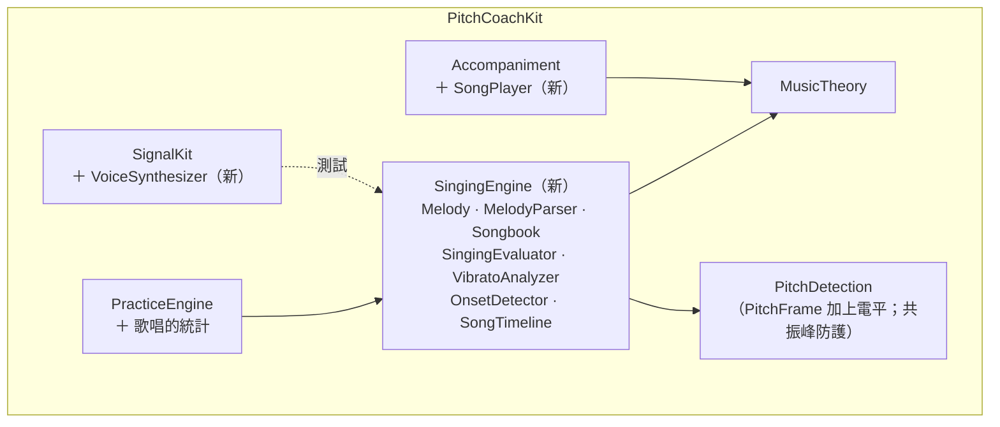

# 歌唱模式：系統分析與架構設計

> 狀態：**v1.0（2026-10-23 已確認，§12 所有決策採用「建議」欄）**
> 本文件是 [ARCHITECTURE.md](ARCHITECTURE.md) 的增補，只描述歌唱模式新增或改動的部分。標記 🔶 的項目需要確認，彙整於 [§12 待討論決策](#12-待討論決策)。

---

## 1. 需求分析

### 1.1 歌聲與樂器的差異，以及對設計的影響

| 差異 | 對設計的影響 |
|---|---|
| 顫音：每秒 5–7 次、幅度可達 ±50 cents 以上 | 單一 frame 的音高不能直接拿來判定；需要偵測顫音並取中心音高（§5） |
| 滑音：起音從下方滑進目標音 | 每個音符去掉頭尾各 15% 後取中位數（§4） |
| 八度：男生跟女生範唱會低一個八度 | 「容許八度」選項：以最近的八度折算 cents（§4.3） |
| 母音共振峰：某個高次泛音特別強 | **偵測器可能被強泛音誤導**（選到 T/h 的週期），需要新的防護與測試（§6） |
| 跟著伴奏唱 | 需要伴奏（輸出）與收音（輸入）共用時間軸，並補償藍牙延遲（§7） |
| 喇叭外放伴奏時，麥克風會收到伴奏 | 旋律提示音的音高跟目標一樣，**偵測器可能鎖定提示音而非學生的聲音**（§8） |

### 1.2 新增功能需求

| 編號 | 功能 | 核心邏輯位置 |
|---|---|---|
| FR-15 | 內建 ≥ 5 首公有領域旋律 | Package `SingingEngine.Songbook` |
| FR-16 | 自訂旋律格式 `C4:1 D4:1 E4:2`、可設 BPM，格式錯誤指出第幾個音符與原因 | `SingingEngine.MelodyParser` |
| FR-17 | 旋律提示音與節拍、整首移調 ±6 半音 | `Accompaniment.SongPlayer`（合成）＋ `SingingEngine.Melody.transposed` |
| FR-18 | KTV 音高條：橫軸時間、目標色塊、即時音高曲線 | App `Features/Singing` |
| FR-19 | 音準判定：去頭尾 15% 中位數、顫音中心、±25 cents、偏高／偏低／沒唱、容許八度 | `SingingEngine.SingingEvaluator`、`VibratoAnalyzer` |
| FR-20 | 節奏判定：起音時間差 ±80 ms 準時，否則提早／延遲 | `SingingEngine.OnsetDetector` |
| FR-21 | 結果：音準正確率、節奏正確率、每音偏差、最常唱不準的音高區段；存紀錄、進趨勢與週報 | `SingingEngine` ＋ `PracticeAnalytics` ＋ App |

### 1.3 驗收標準追溯

| # | 驗收標準 | 驗證方式 | 位置 |
|---|---|---|---|
| AC-15 | 人聲模擬訊號（泛音＋共振峰＋5.5 Hz ±60¢ 顫音）：中心音高 < 5¢、顫音速度 < 0.5 Hz、幅度 < 10¢ | 單元測試（訊號 → 串流偵測 → 判定，走完整條鏈） | `SingingEngineTests` |
| AC-16 | 前 20% 從 −100¢ 滑上來仍判定「準」 | 單元測試 | `SingingEvaluatorTests` |
| AC-17 | 容許八度：整首低八度 → 準；關閉 → 偏低 | 單元測試 | `SingingEvaluatorTests` |
| AC-18 | 合成演唱訊號，起音時間誤差 < 30 ms | 單元測試（訊號 → 串流偵測 → 起音偵測） | `OnsetDetectorTests` |
| AC-19 | 實機：內建喇叭與藍牙耳機兩種情況節奏判定一致、起音誤差 ±80 ms | 實機「回授自我測試」＋真人演唱（§7.4） | README（**需你的 iPhone 與藍牙耳機**） |
| AC-20 | 自訂旋律格式錯誤指出第幾個音符與原因、不當機 | 單元測試 | `MelodyParserTests` |
| AC-21 | 移調後目標音高、音高條、判定同步改變 | 單元測試（Melody／判定）＋ UI 測試（音高條） | `SingingEngineTests`、UI 測試 |
| AC-14' | 測試 ≥ 55 個 | — | 目前已有 130 個，預計再增加約 35 個 |

---

## 2. 模組規劃



- 🔶 **新增 Package target `SingingEngine`**：旋律、解析、判定都是純邏輯，放在 Package 才能在 macOS 上測。不放進 `PracticeEngine`，是為了不讓那個模組再膨脹，而且歌唱判定的概念（音符、時間軸、顫音）和樂器練習差很多。
- `SongPlayer` 放 `Accompaniment`：和 drone、節拍器一樣是即時合成，需要樣本精準。
- `VoiceSynthesizer` 放 `SignalKit`：AC-15、AC-18 的測試訊號。

---

## 3. 旋律模型與自訂格式

### 3.1 資料模型

```swift
public struct MelodyNote: Equatable, Sendable {
    public let pitch: Note?          // nil 表示休止符
    public let beats: Double         // 拍數
}

public struct Melody: Equatable, Sendable {
    public let notes: [MelodyNote]
    public func transposed(by semitones: Int) -> Melody      // ±6
}

/// 把拍數換算成秒：音符 i 的樂譜起點、終點。
public struct SongTimeline: Sendable {
    public init(melody: Melody, beatsPerMinute: Int, countInBeats: Int = 4)
    public let events: [ScoredNote]   // 每個非休止音符：pitch、start、end（相對歌曲起點，含預備拍）
}
```

### 3.2 自訂格式 🔶

```
C4:1 D4:1 E4:2 R:1 F#4:0.5 Bb4:1.5
```

- 以空白或換行分隔，每個 token 為 `音名[#|b]八度:拍數`；`R:拍數` 為休止符（題目沒要求，但多數旋律需要換氣）。
- 音名 A–G（不分大小寫），升降記號 `#`／`b`（也接受 `♯`／`♭`），八度為整數，拍數為正數（可有小數，≤ 16）。
- BPM 在畫面上設定（40–208），不放在文字裡。
- 移調後所有音必須落在偵測範圍內（65–2,100 Hz）；超出 C3–C6 只提示「可能超出常見音域」，不擋。

### 3.3 錯誤回報

```swift
public struct MelodyParseError: Error, Equatable {
    public let noteIndex: Int          // 第幾個音符（從 1 起算）
    public let token: String
    public let reason: Reason          // invalidNoteName / missingOctave / invalidOctave
                                       // missingDuration / invalidDuration / outOfRange
    public var message: String         // 例：第 3 個音符「H4:1」：無法辨識的音名「H」
}
```

空白輸入回報「旋律是空的」。解析器不丟出未處理的例外，所有錯誤都是 `MelodyParseError`。

### 3.4 內建旋律（皆為公有領域）🔶

| 曲名 | 原曲 | 來源與年代 |
|---|---|---|
| 小星星 | Ah! vous dirai-je, maman | 法國民謠，18 世紀（1761 年已有出版紀錄） |
| 兩隻老虎 | Frère Jacques | 法國民謠，18 世紀 |
| 小蜜蜂 | Hänschen klein | 德國民謠，19 世紀 |
| 瑪莉有隻小綿羊 | Mary Had a Little Lamb | 美國童謠，旋律 1830 年代 |
| 倫敦鐵橋 | London Bridge Is Falling Down | 英國傳統童謠，17 世紀以前 |
| 歡樂頌 | 貝多芬第九號交響曲第四樂章主題 | 1824 年 |

只用旋律、不含歌詞（中文歌詞的翻譯可能仍有著作權，題目也不需要歌詞）。README 會附上每首的來源連結。

---

## 4. 音準判定

### 4.1 每個音符的音高

1. 取該音符樂譜期間 `[start, end)` 內的 frame（時間已換算成「學生聽到的歌曲時間」，見 §7）。
2. 去掉頭尾各 15%：只用 `[start + 0.15d, end − 0.15d)`。
3. 對中段的 cents 序列做顫音偵測（§5）：
   - 偵測到顫音 → 音高 = 擬合出的**中心值**
   - 否則 → 音高 = **中位數**
4. 偏差 |c| ≤ 25 → 準；否則依正負號標示偏高或偏低。
5. 🔶 整個音符期間（不只中段）都沒有音高 → 沒唱。中段的有效 frame 少於 3 個、但頭尾有音高時，改用整個音符期間的 frame 判定（避免短音符被誤判為沒唱）。

### 4.2 為什麼滑音不影響（AC-16）

前 20% 從 −100¢ 線性滑到 0¢：去掉的 15% 涵蓋了 −100¢ 到 −25¢ 的部分，剩下 15%–20% 的 frame 介於 −25¢ 到 0¢，只占中段的 5/70 ≈ 7%，中位數不受影響。

### 4.3 容許八度（AC-17）

開啟時，對每個 frame 的偏差取最近的八度：c′ = c − 1200·k，k ∈ {−1, 0, +1} 取使 |c′| 最小者，再做 §4.1 的中位數或顫音分析。先折算再取中位數，避免同一個音符內八度跳動造成的偏差。關閉時不折算，整首低八度會得到約 −1200¢，判定為偏低。🔶 預設關閉。

---

## 5. 顫音偵測（AC-15）🔶

對音符中段的 cents 序列 c(t)（約每 10.7 ms 一點，取樣率約 94 Hz，5–7 Hz 的顫音綽綽有餘）：

1. **去趨勢**：先擬合一條直線，移除音符內緩慢的音高漂移。
2. **找顫音頻率**：在 3–9 Hz 搜尋使最小平方擬合 c(t) ≈ m + a·cos(2πft) + b·sin(2πft) 殘差最小的 f（Brent 法，與偵測器精修同一套工具）。
3. **判定為顫音**：同時滿足以下條件
   - 擬合解釋 ≥ 50% 的變異量
   - 半幅度 √(a² + b²) ≥ 15¢
   - 中段至少涵蓋 1.5 個週期（5.5 Hz 約需 0.27 秒）
4. **輸出**：
   - 中心音高 = m（擬合常數項）
   - 速度 = f
   - 幅度 = √(a² + b²) ÷ G(f)

**為什麼不直接用中位數**：顫音只涵蓋非整數個週期時，中位數會偏向多出來的那半個週期，±60¢ 顫音的偏差可達數 cents，超出 AC-15 的 5¢。擬合的常數項不受影響。

**幅度補償 G(f)**：偵測器的分析窗（2,048 樣本，約 43 ms，sine 窗加權）本身會平均掉一部分顫音。G(f) 是該窗對 f Hz 調變的振幅響應，例如 5.5 Hz 約為 0.92；不補償的話 60¢ 會量成約 55¢。G(f) 由窗的形狀直接計算，有測試驗證。

---

## 6. 偵測器的共振峰防護 🔶

母音共振峰會讓某個高次泛音遠強於基頻。例如男聲 /a/ 的基頻 130 Hz、第 6 泛音（約 780 Hz）落在 F1 附近，強度可能是基頻的數倍。

MPM 選「第一個 ≥ 0.9 × 最高峰」的 key maximum，原本是為了避免選到 2T。但當單一高次泛音主導時，τ = T/h 的 NSDF 峰值也可能超過門檻，結果回報 h 倍的頻率（例如 780 Hz）。

**計畫**：

1. 先寫 AC-15 的人聲模擬測試（男聲、女聲、童聲，母音 /a/ /i/ /u/），確認現有偵測器是否失敗。
2. 若失敗，加入**次諧波驗證**：選出候選週期 P 後，檢查 2P、3P（較低的頻率）在諧波擬合下是否解釋了更多能量；若低頻候選的諧波模型明顯更好（能量增加超過門檻），改選低頻候選。
3. 這會改到樂器模式共用的偵測器，所以**全部現有精度與性質測試必須照樣通過**。

這是歌唱模式的最大技術風險，排在第一個里程碑先驗證。

---

## 7. 伴奏與收音的時間對齊

### 7.1 共同時鐘

以 mach host time（秒）為共同時鐘：

| 事件 | 計算 |
|---|---|
| 伴奏的第 p 個樣本被播放 | h_render(p)：SongPlayer 回呼的 `AudioTimeStamp.mHostTime` ＋ 樣本偏移 |
| 學生**聽到**歌曲起點 | h_heard = h_render(歌曲起點) ＋ L_out |
| 一個分析 frame 的聲音到達麥克風 | h_mic = frame 的 host time − 半個窗長（窗中心）− L_in |
| 該 frame 在歌曲中的時間 | t_song = h_mic − h_heard − 校正值 |

- L_out = `AVAudioSession.outputLatency`：喇叭約 10 ms，藍牙 A2DP 約 150–250 ms。
- L_in = `AVAudioSession.inputLatency`。
- **用窗中心而非窗尾**：分析窗反映的是過去 43 ms 的聲音，用窗尾會讓所有起音晚約 21 ms，吃掉 AC-18 一大半的 30 ms 預算。
- 判定時樂譜時間與 t_song 比較，所以學生「跟著聽到的伴奏唱」就會判定為準時，不論是喇叭還是藍牙。

### 7.2 校正：回授自我測試 🔶

iOS 回報的藍牙延遲是估計值，可能差數十 ms，足以讓 ±80 ms 的判定失準。所以加一個「延遲校正」功能：

1. App 以目前的輸出路由播放 8 個短促的提示音。
2. 喇叭會直接被麥克風收到；用耳機時，請使用者把耳機貼近手機底部的麥克風。
3. 偵測每個提示音的起音，與預期時間比較，取中位數作為**該路由的校正值**。
4. 依路由（埠類型＋裝置 UID）儲存。換回同一副藍牙耳機時自動套用；沒有校正過的路由只用 iOS 回報的延遲。

### 7.3 起音偵測（AC-18）🔶

每個音符的實際起音，從三種線索中找：

1. **發聲起點**：無音高 → 有音高的轉換點。
2. **電平上升**：同一個音高重複時（例如〈小星星〉開頭的 C C G G），學生會重新咬字，電平先下降再上升。為此 `PitchFrame` 要多帶一個「每個 hop 的 RMS 電平」，無音高的 frame 也有。
3. **音高轉換**：連唱（legato）換音時，音高曲線穿過前後兩音的中點。

**指派規則**：在樂譜起點 ±min(250 ms, 半個音符間隔) 的範圍內，取離樂譜時間最近的候選作為起音。找不到候選、而音符有音高 → 起音記為第一個有音高的 frame。

**時間解析度**：hop 10.7 ms，以窗中心定時；電平線索以子區塊（256 樣本，5.3 ms）細化。

### 7.4 AC-19 的實機量測方式

1. **回授自我測試**（可重現）：歌曲播放時不演唱，讓**伴奏本身的提示音**當「完美的範唱」。
   - 喇叭：麥克風直接收到提示音。
   - 藍牙：把耳機貼近麥克風。
   - 兩種情況各跑一次，比較每個音符的起音誤差。這直接量到時間對齊的準確度。
2. **真人演唱**：同一人跟著同一首歌，分別用喇叭與藍牙耳機各唱 3 次，比較節奏判定結果與平均起音誤差。

README 會附上兩種結果的表格。

---

## 8. 喇叭外放時伴奏漏進麥克風 🔶

旋律提示音和學生唱的是同一個音高。用喇叭播放時，偵測器可能鎖定提示音，讓沒唱準的學生也被判定為準。

| 方案 | 做法 | 優缺點 |
|---|---|---|
| **A（建議）** | 用喇叭時啟用 Apple 的 voice processing（`setVoiceProcessingEnabled(true)`，關閉 AGC），由系統的回音消除去除 App 自己播放的聲音；提示音改成類似鋼琴、快速衰減的音色 | voice processing 本來就是為人聲設計，比樂器模式更合適。但它的降噪對歌聲的影響要在實機驗證；也會讓 §7.2 的回授校正無法進行，校正時要暫時關閉 |
| B | 不用回音消除，提示音改成快速衰減（約 300 ms 內衰減到 −30 dB）；中段判定（15%–85%）時提示音已大致消失；畫面強烈建議戴耳機 | 不依賴系統處理，行為可預測；但短音符（< 0.5 秒）時提示音仍會干擾，起音判定也可能被提示音的起音誤導 |
| C | 用喇叭時不播旋律提示音，只播節拍 | 最乾淨，但不符合「演唱時播放旋律提示音」 |

建議先做 A，實機驗證不理想時退回 B；兩種情況都提示「建議戴耳機演唱」。

**實作補充（2026-10-23）**：

- **自動退回 B**：有些裝置（已在 iOS 模擬器確認）開啟 voice processing 後，引擎啟動約 0.1 秒就自己停下並發出 `AVAudioEngineConfigurationChange`。若照常重建會無限重啟。`VoiceProcessingGuard` 在「開啟回音消除的引擎啟動後 1 秒內自己停下」連續 2 次時，停用該輸出路由的回音消除，改用方案 B。換了輸出路由會重新嘗試。
- **演唱中引擎重建**：伴奏播放器跟著引擎重建，原本的演唱接不回去。伴奏播放中收到引擎設定變更時，演唱標記為「中斷：收音失敗」並保留已唱完的音（`AudioInterruptionPolicy` 的 `isSongPlaying`）；長音與音階能撐過重建，不受影響。

---

## 9. 伴奏合成：SongPlayer

```swift
public final class SongPlayer: RealtimeRenderer {
    public let settings: RealtimeParameter<SongPlayerSettings>   // 時間軸、移調、提示音與節拍開關、音量
    public func start()                                           // 下一個 render 週期開始播放預備拍
    public var songStartHostTime: Double? { get }                 // 歌曲起點（預備拍之後）被 render 的 host time
}
```

- 預備拍 1 小節（4 拍，click），之後播放旋律提示音與每拍的 click，全部以樣本計數，樣本精準。
- 提示音為類似鋼琴的音色：基音＋泛音、5 ms 起音、指數衰減。
- 第一個音符的 render 時間點與 host time 透過 `RealtimeMailbox` 回報主執行緒，作為 §7.1 的 h_render。
- 移調時頻率乘上 2^(n/12)；樂譜時間不變。

---

## 10. 畫面

```
歌唱
├── 選歌      內建 6 首／自訂旋律（文字輸入，即時顯示解析錯誤）
│             BPM、移調（−6 … +6，顯示移調後的音域）、容許八度、提示音／節拍開關
│             「延遲校正」入口（顯示目前路由是否已校正）
├── 演唱中    KTV 音高條（見下）＋ 預備拍倒數 ＋ 放棄
└── 結果      音準正確率、節奏正確率、最常唱不準的音高區段
              每個音符：目標音、偏差（準／偏高／偏低／沒唱）、起音差（準時／提早／延遲）、顫音（有偵測到時）
```

**KTV 音高條**（`TimelineView` ＋ `Canvas`，每幀重繪）：

- 橫軸是歌曲時間，「現在」固定在畫面寬度 30% 處，右側是即將到來的音符。
- 縱軸是音高，範圍為移調後旋律的最低到最高音，上下各留 3 個半音。
- 目標音符是圓角色塊；學生的音高曲線依 t_song 畫上，在 ±25¢ 以內為綠色，偏高為橘色，偏低為藍色。
- 開啟容許八度時，曲線也以折算後的音高繪製，男生唱低八度時曲線會疊在色塊上。

**最常唱不準的音高區段** 🔶：在本次演唱的音符中，以 5 個半音（純四度）為寬度滑動，找出「不準（偏高＋偏低＋沒唱）比例」最高、且至少含 3 個音符的區段，例如「G4–C5：6 個音中 4 個不準」。

---

## 11. 紀錄、趨勢與週報

- `PracticeKind` 新增 `.singing`。
- `SessionSummary` 新增選填欄位：音準正確率、節奏正確率、曲名。
- 各音的偏差（`NoteStat`）照常產生，所以「各音平均偏差」和「最常偏高／偏低」會同時涵蓋樂器與歌唱。🔶 是否要分開統計待確認，見 D-S9。
- 趨勢圖新增「歌唱正確率」：音準與節奏兩條線。
- PDF 週報新增「歌唱」區塊：完成次數、平均音準正確率、平均節奏正確率、最常唱不準的音高區段。
- 🔶 正確率的分母：音準與節奏都以**全部音符**為分母（沒唱的音符同時算音準不準、節奏不準時）。

---

## 12. 待討論決策

| # | 決策 | 建議 | 替代方案 |
|---|---|---|---|
| D-S1 | 程式碼位置 | **新增 Package target `SingingEngine`**；SongPlayer 放 Accompaniment、人聲模擬放 SignalKit | 全部放進 PracticeEngine |
| D-S2 | 時間對齊 | **host time 共同時鐘 ＋ iOS 回報延遲 ＋ 依路由的回授校正** | 只用 iOS 回報的延遲（藍牙可能差數十 ms） |
| D-S3 | 喇叭外放的伴奏干擾 | **A：voice processing 回音消除 ＋ 鋼琴式提示音**，實機不理想時退回 B | B：只用快速衰減的提示音；C：喇叭時不播提示音 |
| D-S4 | 共振峰防護 | **先寫人聲測試，失敗才加次諧波驗證**（所有既有精度測試必須照樣通過） | 歌唱模式用另一套偵測參數 |
| D-S5 | 顫音分析 | **去趨勢後的正弦最小平方擬合（3–9 Hz）＋ 分析窗振幅補償** | 自相關找週期；峰谷平均 |
| D-S6 | 起音偵測 | **發聲起點＋電平上升＋音高轉換三種線索**，`PitchFrame` 增加每 hop 電平 | 只用發聲起點（同音重複時抓不到） |
| D-S7 | 正確率分母 | **全部音符**（沒唱算不準、不準時） | 只算有唱的音符 |
| D-S8 | 自訂格式 | **支援休止符 `R:拍數` 與 `♯`／`♭`**；BPM 在畫面設定 | 只支援題目列出的格式 |
| D-S9 | 歌唱的各音偏差 | **與樂器合併統計**（同一個學生的音感） | 分開統計、分開顯示 |
| D-S10 | 「最常唱不準的音高區段」 | **5 個半音寬的滑動區段，不準比例最高、至少 3 個音** | 依音區分三段（低／中／高） |
| D-S11 | 容許八度預設 | **關閉**；只容許 ±1 個八度 | 預設開啟 |
| D-S12 | 內建旋律 | **§3.4 的 6 首**，只用旋律、不含歌詞 | 換其他曲目 |
| D-S13 | 預備拍 | **1 小節（4 拍）** | 2 小節；不需要 |

---

## 13. 測試計畫（預計新增約 35 個）

| 套件 | 預計 | 重點 |
|---|---|---|
| `MelodyParserTests` | 8 | 正常格式、休止符、升降記號、小數拍數、各種錯誤指出第幾個音符（AC-20）、空白輸入、超出範圍 |
| `SongbookTests` | 2 | 6 首都能解析且在 C3–C6、移調 ±6 後仍在偵測範圍內 |
| `SongTimelineTests` | 3 | 拍數換算秒、預備拍、移調只改音高不改時間（AC-21） |
| `VibratoAnalyzerTests` | 5 | 5.5 Hz ±60¢ 的速度／幅度／中心（AC-15）、無顫音不誤判、窗振幅補償、短音符不分析 |
| `SingingEvaluatorTests` | 8 | 去頭尾中位數、滑音仍準（AC-16）、±25¢ 邊界、沒唱、容許八度開／關（AC-17）、移調後判定（AC-21）、最常不準區段、正確率 |
| `OnsetDetectorTests` | 4 | 合成演唱起音誤差 < 30 ms（AC-18）、同音重複、連唱換音、提早／延遲的 ±80 ms 邊界 |
| `VoiceDetectionTests` | 3 | 人聲模擬（男／女／童、三種母音）不發生八度錯誤（共振峰防護） |
| `SongPlayerTests` | 3 | 預備拍與音符起點樣本精準、移調頻率、歌曲起點時間回報 |
| App 與 UI 測試 | 4 | 對齊公式、紀錄往返、週報歌唱區塊、UI 測試以合成人聲唱完一首並截圖 |

---

## 14. 里程碑與工時

| 里程碑 | 內容 | 預估 |
|---|---|---|
| S1 | **風險驗證**：人聲模擬訊號（SignalKit）＋ 共振峰下的偵測測試，必要時加入次諧波驗證 | 4 h |
| S2 | SingingEngine：旋律模型、解析器、內建旋律、時間軸 | 3 h |
| S3 | 顫音分析、音符判定、起音偵測（AC-15～18、21） | 5 h |
| S4 | SongPlayer、時間對齊、回授校正、喇叭時的回音消除 | 4 h |
| S5 | 歌唱畫面（選歌、KTV 音高條、結果）、紀錄、趨勢、週報、UI 測試與截圖 | 5 h |
| S6 | README（判定規則、格式說明、時間對齊、截圖、旋律來源）、實機驗收步驟（AC-19） | 2 h |
| | **合計** | **約 23 h** |

## 15. 風險

| 風險 | 影響 | 對策 |
|---|---|---|
| 共振峰讓偵測器選到高次泛音 | AC-15、實際歌唱 | S1 先驗證；次諧波驗證；既有測試全部重跑 |
| voice processing 影響歌聲的音高或電平 | 喇叭外放時的判定 | 實機驗證；退回方案 B |
| iOS 回報的藍牙延遲不準 | AC-19 | 回授校正 |
| 同音重複時起音難判 | AC-18、〈小星星〉 | 電平線索；合成測試涵蓋同音重複 |
| 兒童聲音的基頻高、泛音少 | 偵測 | 人聲測試涵蓋童聲（約 260–520 Hz） |
