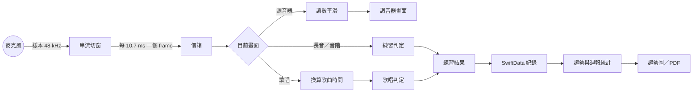
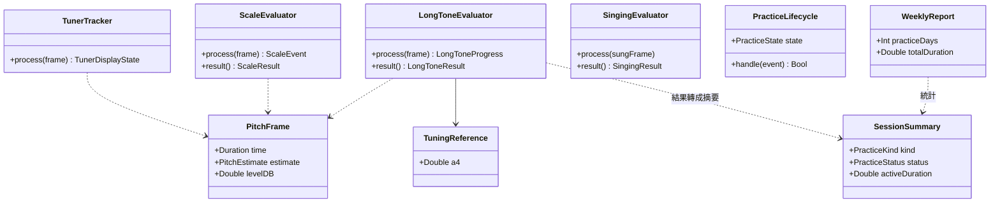
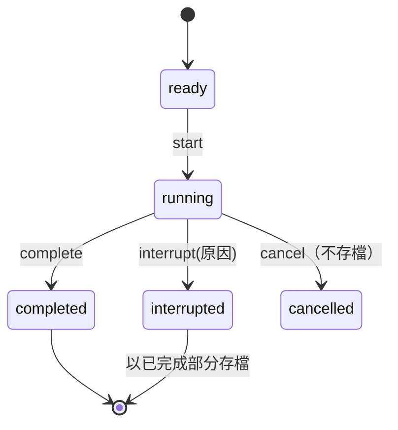
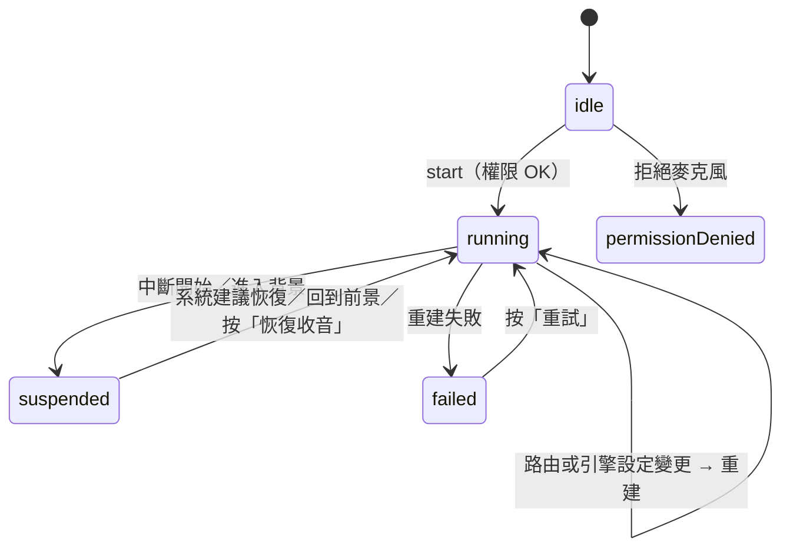

# 02　系統分析：領域、流程與狀態

本章從需求走到系統行為：先定義領域詞彙，再畫出業務流程、核心情境與狀態機，最後用追溯表把每條需求對應到程式碼。

---

## 2.1 領域詞彙

討論設計之前，先把名詞定義清楚。「音準」「準確率」「到位」如果理解不同，後面一定出錯。

### 需要的樂理

| 概念 | 定義 | 範例 |
|---|---|---|
| 八度 | 頻率加倍 | A4 = 442 Hz，A5 = 884 Hz |
| 半音 | 一個八度等比分成 12 份，相鄰半音頻率比 2^(1/12) | A4 → A#4 |
| 音名＋八度 | 科學音高記號，C4 為中央 C | C#5、B♭4 |
| MIDI 編號 | 每個半音一個整數，A4 = 69 | C4 = 60 |
| A4 基準 | A4 對應的頻率；本 App 預設 442 Hz，可設 415–466 | — |
| cents | 對數的音高偏差，1 個半音 = 100 cents | +10 cents = 偏高十分之一個半音 |

核心公式在 `Packages/PitchCoachKit/Sources/MusicTheory/NoteConverter.swift`：

```
小數 MIDI 值      = 69 + 12 · log₂(f / A4)
相對某音的 cents  = 1200 · log₂(f / 該音的頻率)
```

A4 = 440 Hz 時，442 Hz 是 A4 偏高 1200 · log₂(442/440) ≈ +7.85 cents，這正是驗收標準 AC-07 的案例。用 cents 而非 Hz，是因為人耳對音高的感受是對數的，「±10 cents 算準」在任何音域意義相同。

### 系統專用詞彙

| 詞彙 | 精確定義 |
|---|---|
| 分析窗 | 一次分析使用的最近 2,048 個樣本（48 kHz 下約 42.7 ms） |
| hop | 相鄰兩次分析的間隔，512 個樣本（約 10.7 ms） |
| frame | 一次分析的結果：時間戳＋估計頻率（或「無音高」）＋最近一個 hop 的電平 |
| clarity | 偵測器對「有明確週期」的信心，0–1 |
| 讀數 | 調音器畫面上的音名、cents、Hz，是多個 frame 平滑後的結果 |
| 在範圍內 | 有音高且相對目標音 \|cents\| ≤ 門檻（長音 10、音階 15、歌唱 25），含邊界 |
| 到位 | 音階練習中，在範圍內持續 ≥ 300 ms |
| 中斷 | 練習進行中因外部事件而提前結束，保留已完成的部分 |
| 歌曲時間 | 以「學生聽到歌曲第一拍」為 0 的時間，預備拍為負值 |

**frame 與讀數分開定義是關鍵：判定用 frame，畫面用讀數。**

> 📄 依據：`docs/ARCHITECTURE.md` §3.2、§6（Tracker 只負責顯示）、§7（評估器輸入帶時間戳的 frame）
> 🔍 推斷：分開的動機是讓判定不受平滑的延遲與慣性影響，並能用原始 frame 做精確測試。設計文件描述了分工，但沒有明寫這個理由。

---

## 2.2 主要業務流程

這張圖看系統的「主幹」：樣本 → frame → 判定 → 紀錄 → 統計。其他都是旁支。



兩個時間尺度在信箱交會：

| 時間尺度 | 誰處理 | 頻率 | 限制 |
|---|---|---|---|
| 樣本與 frame | 音訊 IO 執行緒 | 每約 5 ms 一次回呼 | 不能配置記憶體、不能等鎖（06 章） |
| 讀數、判定、畫面 | 主執行緒 | 每個畫面更新 | 一般運算，但不能卡住 |

---

## 2.3 核心使用情境

### 情境 A：長音練習

- **前置條件**：麥克風權限已允許；收音管線執行中；學生在長音練習頁選好目標音（例如 A4）。
- **主要步驟**：
  1. 學生按「開始」。系統等待第一個有音高的 frame。
  2. 第一個聲音出現時開始計時 10 秒，畫面顯示即時偏差與倒數。
  3. 滿 10 秒，計算 ±10 cents 時間比例、平均偏差、標準差、偏差曲線。
  4. 存成一筆「完成」的練習紀錄，顯示結果頁。
- **例外**：
  - 練習中來電、鬧鐘、Siri、其他 App 播放 → 標記「中斷：來電或其他 App 使用音訊」，以已完成的秒數計算並存檔。
  - 插拔耳機、藍牙斷線 → 標記「中斷：耳機連接或中斷」。
  - 進入背景 → 標記「中斷：App 進入背景」。
  - 還沒發出聲音就被中斷 → 沒有可保留的資料，不存檔。
  - 學生離開畫面 → 視為放棄，不存檔。

### 情境 B：歌唱練習

- **前置條件**：選好歌曲（或輸入合法的自訂旋律）、BPM、移調；收音管線執行中。
- **主要步驟**：
  1. 按「開始」，伴奏播放 4 拍預備拍。
  2. 第一拍被播放時，伴奏回報當下的系統時間；系統據此建立「歌曲時鐘」。
  3. 學生演唱期間，每個 frame 換算成歌曲時間，KTV 音高條即時顯示。
  4. 歌曲結束後逐音判定音準與節奏，計算正確率與最常唱不準的區段，存檔並顯示結果。
- **例外**：
  - 自訂旋律格式錯誤 → 即時顯示「第 n 個音符『…』：原因」，不能開始。
  - 移調後超出偵測範圍 → 顯示哪個音符超出，不能開始。
  - 演唱中被中斷 → 只判定已唱完的音符並存檔。
  - 演唱中音訊引擎被迫重建（伴奏播放器跟著消失）→ 標記「中斷：收音失敗」（📄 commit `eb260fb`）。

### 情境 C：產生週報

- **前置條件**：有練習紀錄。
- **主要步驟**：選日期區間 → 讀出紀錄並轉成值型別摘要 → 計算練習天數、總時數、長音／音階／歌唱統計、最常偏高與偏低的音 → 預覽 → 產生 PDF → 分享選單。
- **例外**：區間內沒有紀錄時顯示空的週報；PDF 繪圖環境建立失敗時顯示錯誤訊息。

---

## 2.4 領域模型

這張圖看兩件事：資料都是值型別；判定器只依賴 frame，不知道 frame 從哪裡來。



判定器不知道 frame 是麥克風產生的還是測試程式手寫的，這是能大量自動化測試的根本原因（09 章）。

---

## 2.5 狀態機

### 練習生命週期



程式幾乎是這張圖的直譯：

```swift
// Packages/PitchCoachKit/Sources/PracticeEngine/PracticeLifecycle.swift
public mutating func handle(_ event: PracticeLifecycleEvent) -> Bool {
    switch (state, event) {
    case (.ready, .start):              state = .running
    case (.running, .complete):         state = .completed
    case (.running, .cancel):           state = .cancelled
    case (.running, .interrupt(let r)): state = .interrupted(r)
    default:                            return false
    }
    return true
}
```

`default: return false` 一次處理了一整類問題：完成後又收到中斷、還沒開始就收到完成……一律忽略並回報「沒有轉換」。呼叫端以回傳值決定要不要存檔，所以同一次練習不會被存兩次。

「中斷後不續接」的理由：

> 📄 依據：`docs/ARCHITECTURE.md` §3.5「中斷後練習不續接（存為『中斷』），但調音器偵測會自動恢復」
> 🔍 推斷：10 秒長音被打斷 3 秒後再接著練 7 秒，兩段之間的條件不同，合併的結果沒有意義；存成「中斷」比假裝完整更誠實。

### 音訊管線



畫狀態機時最有用的檢查是「每個狀態收到每個事件會怎樣」。`suspended` 狀態原本只在調音器頁有出口（「恢復收音」按鈕），練習頁沒有；這個缺口是實機測試時才發現的（11 章踩坑 9）。

---

## 2.6 例外情境：事件 → 命令

所有外部事件與處理方式寫成一個純函式 `AudioInterruptionPolicy.commands(for:status:isSongPlaying:)`，位於 `PitchCoach/Audio/AudioSessionEvent.swift`：

| 事件 | 管線執行中 | 管線已暫停 |
|---|---|---|
| 中斷開始（來電、鬧鐘、Siri、其他 App 播放） | 標記中斷、暫停收音 | — |
| 中斷結束，系統建議恢復 | — | 重新啟動 |
| 中斷結束，系統未建議恢復 | — | 等使用者按「恢復收音」 |
| 接上耳機 | 標記中斷、重建引擎 | 標記中斷 |
| 拔掉耳機 | 標記中斷、**暫停伴奏**、重建引擎 | 標記中斷、暫停伴奏 |
| 媒體服務重置 | 標記中斷、重建引擎 | 標記中斷 |
| 引擎設定變更 | 重建；**歌唱伴奏播放中則標記中斷** | — |
| 進入背景 | 標記中斷、暫停收音 | — |
| 回到前景 | — | 重新啟動 |
| 管線尚未啟動 | 忽略 | 忽略 |

> 📄 依據：拔耳機時暫停伴奏，`docs/ARCHITECTURE.md` §3.5「依 iOS 慣例暫停伴奏，避免突然從喇叭放出聲音」；引擎設定變更時中斷歌唱，對話中使用者選擇「只中斷歌唱」（commit `eb260fb`）

把「發生什麼事 → 要做什麼」從「怎麼做」中分離，前者就能完全脫離 iOS 音訊系統做單元測試。這是 03 章「外殼也要盡量可測試」的例子。

---

## 2.7 需求追溯表

從需求直接跳到程式碼：

| 需求 | 主要實作 | 主要測試 |
|---|---|---|
| FR-01 偵測 | `Packages/PitchCoachKit/Sources/PitchDetection/MPMPitchDetector.swift`、`HarmonicFrequencyRefiner.swift` | `MPMPitchDetectorTests.swift`、`MPMPropertyTests.swift` |
| FR-02、FR-03、FR-04 讀數 | `Packages/PitchCoachKit/Sources/PracticeEngine/TunerTracker.swift` | `TunerTrackerTests.swift` |
| FR-05 A4 基準 | `Packages/PitchCoachKit/Sources/MusicTheory/TuningReference.swift`、`PitchCoach/App/AppSettings.swift` | `AppSettingsTests.swift` |
| FR-06 長音 | `Packages/PitchCoachKit/Sources/PracticeEngine/LongToneEvaluator.swift` | `LongToneEvaluatorTests.swift` |
| FR-07、FR-08 音階 | `Packages/PitchCoachKit/Sources/PracticeEngine/ScaleEvaluator.swift`、`Packages/PitchCoachKit/Sources/MusicTheory/MajorScale.swift` | `ScaleEvaluatorTests.swift` |
| FR-09 伴奏 | `Packages/PitchCoachKit/Sources/Accompaniment/` | `AccompanimentTests` |
| FR-10、FR-14 中斷與背景 | `PitchCoach/Audio/AudioSessionEvent.swift`、`Packages/PitchCoachKit/Sources/PracticeEngine/PracticeLifecycle.swift` | `AudioInterruptionPolicyTests.swift`、UI 測試 |
| FR-11 儲存 | `PitchCoach/Persistence/PracticeSessionRecord.swift` | `PracticeRecordTests.swift` |
| FR-12、FR-13 趨勢與週報 | `Packages/PitchCoachKit/Sources/PracticeEngine/PracticeAnalytics.swift`、`PitchCoach/Features/Report/WeeklyReportPDF.swift` | `PracticeAnalyticsTests.swift`、`WeeklyReportPDFTests.swift` |
| FR-15、FR-16 旋律 | `Packages/PitchCoachKit/Sources/SingingEngine/MelodyParser.swift`、`SongTimeline.swift`、`Songbook.swift` | `MelodyParserTests.swift`、`SongTimelineTests.swift` |
| FR-17 KTV 音高條 | `PitchCoach/Features/Singing/PitchRollView.swift` | UI 測試 |
| FR-18、FR-19、FR-20 歌唱判定 | `Packages/PitchCoachKit/Sources/SingingEngine/SingingEvaluator.swift`、`VibratoAnalyzer.swift`、`OnsetDetector.swift` | `SingingEvaluatorTests.swift`、`OnsetDetectorTests.swift`、`SingingSignalChainTests.swift` |
| FR-21 自由練習 | `Packages/PitchCoachKit/Sources/PracticeEngine/FreePracticeTracker.swift`、`PitchCoach/Features/Tuner/FreePracticeRecorder.swift` | `FreePracticeTrackerTests.swift` |
| FR-23 延遲校正 | `Packages/PitchCoachKit/Sources/SingingEngine/LatencyCalibration.swift`、`PitchCoach/Features/Singing/LatencyCalibrationView.swift` | `LatencyCalibrationTests.swift` |
| FR-24 恢復收音 | `PitchCoach/Features/Common/AudioStatusViews.swift` | `AudioUnavailableNoticeTests.swift` |
