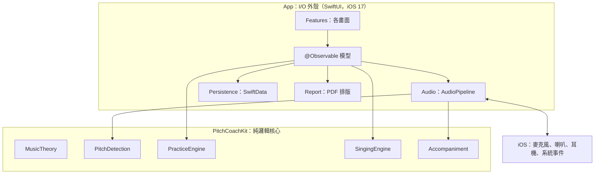
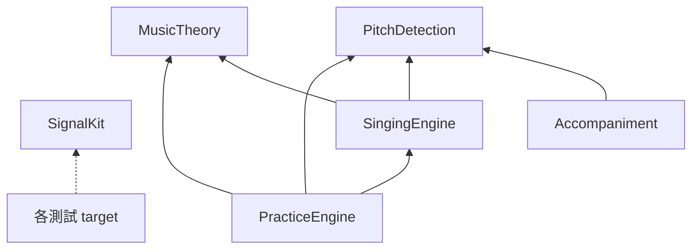

# 03　架構設計：模組切分與相依規則

本章說明系統怎麼被切開、各部分怎麼合作。整個架構可以濃縮成一句話：

> **所有「判定」與「統計」都在 Package 內，App 只負責 I/O（音訊、儲存、畫面、PDF）。**
>
> 📄 依據：`docs/ARCHITECTURE.md` §2.1；原始題目要求「核心邏輯放在獨立 Swift Package，可在 macOS 上 `swift test`」（NFR-04）

---

## 3.1 整體架構

這張圖看邏輯與 I/O 的分界：上半部是會碰到作業系統的外殼，下半部是不依賴 UIKit／SwiftUI 的純邏輯核心。



沒有後端、沒有第三方服務；唯一的外部系統是 iOS 本身（音訊硬體、路由、中斷事件）。

### 為什麼這條分界值得

| | Package（核心） | App（外殼） |
|---|---|---|
| 測試環境 | macOS `swift test`，149 個測試約 20 秒 | 要開 iOS 模擬器 |
| 輸入是否可控 | 完全可控：合成訊號、手寫 frame | 不可控：真實聲音、系統事件 |
| 出錯的後果 | 判定錯 → 學生得到錯的回饋，不容易察覺 | 通常是當機或顯示問題，容易察覺 |

最難驗證正確性的東西放在最容易測試的地方。這個分層的效果在後期很明顯：偵測器換演算法、新增整個歌唱模式，樂器模式的測試都照樣通過。

---

## 3.2 分層與模組職責

| 模組 | 一句話職責 | 相依 |
|---|---|---|
| `MusicTheory` | 頻率、音名、cents 與大調音階的換算 | 無 |
| `PitchDetection` | 樣本串流 → 帶時間戳的音高 frame；即時信箱 | 無（只用系統 Accelerate） |
| `SignalKit` | 可重現的測試訊號（正弦、泛音、白噪音、人聲） | 無，只出現在測試相依 |
| `Accompaniment` | 在 IO 執行緒即時合成伴奏，樣本精準 | `PitchDetection`（借用 `RealtimeMailbox`） |
| `SingingEngine` | 旋律、自訂格式、歌唱判定、時間對齊 | `MusicTheory`、`PitchDetection` |
| `PracticeEngine` | 讀數平滑、長音與音階判定、生命週期、統計 | `MusicTheory`、`PitchDetection`、`SingingEngine` |

這張圖看相依方向：沒有循環，底層不知道上層。



`Packages/PitchCoachKit/Package.swift` 的 target 宣告就是這張圖：

```swift
// Packages/PitchCoachKit/Package.swift
targets: [
    .target(name: "MusicTheory"),
    .target(name: "PitchDetection"),
    .target(name: "PracticeEngine", dependencies: ["MusicTheory", "PitchDetection", "SingingEngine"]),
    .target(name: "SignalKit"),
    .target(name: "Accompaniment", dependencies: ["PitchDetection"]),
    .target(name: "SingingEngine", dependencies: ["MusicTheory", "PitchDetection"]),
    .testTarget(name: "PitchDetectionTests", dependencies: ["PitchDetection", "SignalKit"]),
    // ...
]
```

相依規則：

1. **沒有循環**：Swift Package Manager 會強制。
2. **底層不知道上層**：`PitchDetection` 不知道「長音練習」存在。
3. **`SignalKit` 只在測試相依中**：正式 App 不帶測試訊號產生器。
4. **App 只用 public API**：例如 `HarmonicFrequencyRefiner` 是 `internal`，App 碰不到，換演算法不影響 App。

`PracticeEngine` 依賴 `SingingEngine`、而不是反過來，是因為週報統計要讀歌唱結果（`SessionSummary(singing:)`），歌唱判定本身不需要知道統計的存在。

> 📄 依據：新增 `SingingEngine` 而不併入 `PracticeEngine`，`docs/SINGING_MODE.md` D-S1「不讓那個模組再膨脹，而且歌唱判定的概念和樂器練習差很多」；`Accompaniment` 移進 Package，`docs/ARCHITECTURE.md` §2.1「合成邏輯（樣本精準的拍點、淡入淡出）值得在 macOS 上測試」

---

## 3.3 目錄結構

```
PitchCoach/
├── PitchCoach.xcodeproj         手寫的專案檔，使用資料夾同步群組（新增檔案不必改專案檔）
├── PitchCoach/                  App target
│   ├── App/                     進入點、分頁、使用者設定
│   ├── Audio/                   AudioPipeline、事件策略、IO 擷取、合成輸入（DEBUG）
│   ├── Features/                各畫面與其 @Observable 模型
│   │   ├── Tuner/ Practice/ Singing/ History/ Report/ Settings/ Accompaniment/
│   │   └── Common/              共用元件：指針、偏差曲線、收音狀態提示
│   └── Persistence/             SwiftData 紀錄、Repository、示範資料
├── PitchCoachTests/             App 單元測試
├── PitchCoachUITests/           UI 測試（合成訊號驅動）
├── Packages/PitchCoachKit/      純邏輯核心（Sources／Tests 各 6 個模組）
├── docs/                        設計文件、測試報告、實機驗收、本教學文件
├── scripts/                     截圖匯出、測試音產生
└── .github/workflows/ci.yml     CI
```

---

## 3.4 設計模式

### 純邏輯核心＋I/O 外殼（Functional Core, Imperative Shell）

核心型別幾乎都長這樣：值型別、輸入事件、輸出結果、沒有副作用。

```swift
// Packages/PitchCoachKit/Sources/PracticeEngine/LongToneEvaluator.swift
public struct LongToneEvaluator: Sendable {
    public init(target: Note, reference: TuningReference, duration: Duration = .seconds(10),
                tolerance: Double = 10, wrongNoteThreshold: Double = 50)
    public mutating func process(_ frame: PitchFrame) -> LongToneProgress
    public func result() -> LongToneResult
}
```

- 輸入是 `PitchFrame` 而不是「麥克風」：測試時直接手寫 frame。
- **時間由 frame 帶進來**，判定器裡沒有 `Date()` 或計時器。「10 秒到了沒」是比較 frame 的時間戳，測試不必真的等 10 秒，也不會因為電腦忙碌而結果不同。
- 用 `struct`：沒有共享的可變狀態。

外殼只負責接線（`PitchCoach/Features/Practice/LongTonePracticeModel.swift`）：

```swift
// PitchCoach/Features/Practice/LongTonePracticeModel.swift
func process(_ frame: PitchFrame) {
    guard phase == .running, var evaluator else { return }
    progress = evaluator.process(frame)                       // 純邏輯：判定
    self.evaluator = evaluator
    if progress == .finished, lifecycle.handle(.complete) {   // 純邏輯：狀態轉換
        finish(interruption: nil)                             // I/O：存檔、更新畫面
    }
}
```

外殼越薄，越不需要複雜的測試。

> 📄 依據：`docs/ARCHITECTURE.md` §7「所有評估器都是純值、決定性的狀態機：輸入帶時間戳的 frame，輸出進度事件與結果」
> 🔍 推斷：「Functional Core, Imperative Shell」這個名稱是本文件加上的，設計文件中沒有使用這個詞，但描述的是同一件事。

### 把外殼的決策也抽成純函式

App 層免不了處理作業系統事件。技巧是「決定要做什麼」寫成純函式，只把「實際去做」留給外殼：

| 決策（純函式，有單元測試） | 執行（外殼） |
|---|---|
| `AudioSessionEvent(notification:)`：系統通知 → 事件 | 註冊通知中心 |
| `AudioInterruptionPolicy.commands(for:status:isSongPlaying:)`：事件 → 命令 | 暫停、重建 AVAudioEngine |
| `VoiceProcessingGuard`：回音消除是否穩定 | 開關 voice processing |
| `AudioUnavailableNotice(state:)`：收音狀態 → 提示與按鈕 | SwiftUI 畫面 |
| `PracticeSessionRecord.summary`：紀錄 → 值型別 | SwiftData 查詢 |

這些決策加起來由 35 個 App 單元測試涵蓋，不必真的觸發來電或插拔耳機。

> 📄 依據：`docs/ARCHITECTURE.md` §3.5「App 層把系統通知轉成純值事件……可測試的純函式」；後兩項是開發後期以同樣模式加入（commit `eb260fb`、`4a590eb`）

### 觀察者（訂閱）模式

畫面出現時向 `AudioPipeline` 註冊 frame handler、消失時取消，`AudioPipeline` 不知道有哪些畫面。實作見 07 章 7.3 節。

### Repository

`PitchCoach/Persistence/PracticeRepository.swift` 包住 SwiftData 的寫入與查詢，並能把紀錄轉成 Package 的值型別 `SessionSummary`。紀錄與週報畫面則直接用 SwiftUI 的 `@Query` 取資料，同樣在轉成 `SessionSummary` 後才交給統計。不論哪條路，統計程式都完全不碰資料庫（05 章）。

---

## 3.5 橫切關注點

| 關注點 | 做法 | 位置 |
|---|---|---|
| 錯誤處理 | 不吞錯誤：存檔失敗顯示在結果頁；資料庫建立失敗直接終止並附原因；收音失敗進入 `failed` 狀態並顯示「重試」 | `LongTonePracticeModel.finish`、`PitchCoachApp.makeModelContainer()`、`AudioPipeline.restartNow()` |
| 具型別的錯誤 | `throws(MelodyParseError)`、`throws(SongTimelineError)`、`throws(TuningReferenceError)`，呼叫端知道會收到哪種錯誤 | `SingingEngine`、`MusicTheory` |
| 輸入驗證 | 設定值以 `TuningReference(clamping:)` 夾到合法範圍；自訂旋律由解析器逐個音符驗證 | `PitchCoach/App/AppSettings.swift`、`MelodyParser` |
| 日誌 | `os.Logger`（subsystem `PitchCoach`），記錄管線事件、收音失敗、回音消除退回 | `PitchCoach/Audio/AudioPipeline.swift` |
| 設定管理 | `AppSettings`（`@Observable`），存在 `UserDefaults`：A4 基準、延遲面板開關、學生姓名、各路由的延遲校正值 | `PitchCoach/App/AppSettings.swift` |
| 授權 | 沒有帳號系統；唯一的權限是麥克風，被拒時顯示說明與「前往設定」 | `PitchCoach/Features/Common/AudioStatusViews.swift` |
| 併發 | 判定與畫面在 MainActor；IO 執行緒只透過信箱與參數兩個元件交換資料 | 06 章 |
| 交易 | 每筆練習紀錄獨立 `save()`，沒有跨紀錄的交易需求 | `PracticeRepository.save(_:)` |

> 📄 依據：「禁止無聲吞掉例外」來自使用者的全域開發規範；資料庫建立失敗時終止的理由寫在程式註解「沒有資料庫就無法保存練習紀錄，直接終止並附上原因，比靜默失去資料好」（`PitchCoach/App/PitchCoachApp.swift`）

---

## 3.6 執行緒模型（概覽）

| 執行緒 | 跑什麼 | 規則 |
|---|---|---|
| 音訊 IO 執行緒 | 收樣本 → 切窗 → 偵測 → 推進信箱；合成伴奏 | 不配置記憶體、不等鎖 |
| 主執行緒（MainActor） | 每個畫面更新時取出 frame，交給 Tracker／Evaluator，更新畫面；處理系統通知 | 判定用的時間來自樣本位置，與何時取出無關 |

最後一欄是關鍵：**主執行緒晚一點取 frame，不會改變判定結果**，因為時間戳是在 IO 執行緒依樣本位置算好的。UI 卡頓不會變成判定錯誤。

> 📄 依據：`docs/ARCHITECTURE.md` §3.3 執行緒模型與「判定用的時間來自音訊樣本位置，與主執行緒取用的時間抖動無關」

細節（信箱設計、Swift 6 的隔離陷阱、引擎生命週期）在 06 章。

---

## 3.7 架構的演進

| 時機 | 調整 | 原因 | 是否破壞既有邊界 |
|---|---|---|---|
| M2 | 偵測器改為「MPM 粗估＋諧波精修」兩階段 | 實測 SNR 20 dB 誤差 8 cents，達不到驗收（📄 `docs/ARCHITECTURE.md` §4.5） | 否：`detect()` 介面不變 |
| M5 | 伴奏合成從 App 移進 Package | 值得在 macOS 上測試（📄 `docs/ARCHITECTURE.md` §2.1） | 否 |
| S2 | 新增 `SingingEngine` | D-S1 | 否：新模組 |
| S3 | `PitchFrame` 增加每 hop 的電平 | 起音偵測需要電平線索（📄 `docs/SINGING_MODE.md` §7.3、commit `fcf359f`） | 否：新欄位有預設值 |
| 實測後 | 新增 `VoiceProcessingGuard`、`AudioUnavailableNotice` | 模擬器與實機測試發現的問題（📄 commit `eb260fb`、`4a590eb`） | 否：都是新的純函式 |

每次調整都發生在既有邊界內。偵測器換演算法時 App 不用改；新增歌唱模式時樂器模式的測試全部照樣通過。

### 可以改進的地方

- **`AudioPipeline` 偏大（約 450 行）**：它同時處理 session 設定、引擎建立、事件分派、frame 分送、合成輸入。🔍 推斷：拆成「Session 設定」「引擎建立」「事件處理」三個型別會更好讀，但目前每一部分都不大，拆分的收益有限。
- **`SingingEngine` 的判定器保存整首的 frame**，結束時才逐音判定。歌曲很長時記憶體與計算量都隨長度線性成長（08 章 8.5 節有複雜度分析）。對兒歌長度沒有問題。
