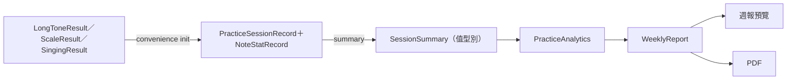
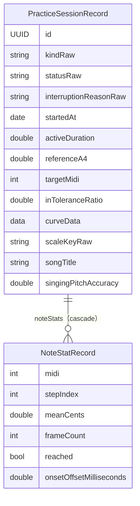

# 05　資料庫設計

PitchCoach 的資料全部存在裝置上，用 SwiftData（題目規定）。資料量很小：一次練習一筆紀錄，加上每個音一筆統計。設計上最值得注意的不是表結構本身，而是**儲存模型與計算模型的分離**。

---

## 5.1 整體設計

這張圖看資料怎麼從判定結果進到資料庫，再變成統計：寫入時從 Package 的結果建立紀錄，讀取時把紀錄轉回 Package 的值型別，統計完全不碰資料庫。



> 📄 依據：`docs/ARCHITECTURE.md` §9「App 把 Record 轉成 Package 的值型別 SessionSummary／NoteStat，所有統計在 Package 內計算」

好處：

- 統計邏輯（`Packages/PitchCoachKit/Sources/PracticeEngine/PracticeAnalytics.swift`）可以在 macOS 上用手寫的 `SessionSummary` 測試，不必建立資料庫。
- 資料庫欄位改變時，只有轉換函式要改，統計程式不受影響。
- 週報預覽與 PDF 共用同一個 `WeeklyReport` 值，數字只算一次，不會不一致。

代價：每次顯示紀錄頁都要讀出全部紀錄並轉換，無法用資料庫查詢做彙總。資料量只有數百筆，可以忽略。

---

## 5.2 ER 圖



---

## 5.3 資料表說明

模型定義在 `PitchCoach/Persistence/PracticeSessionRecord.swift`。

### `PracticeSessionRecord`：一次練習

| 欄位 | 型別 | 可空 | 說明 |
|---|---|---|---|
| `id` | `UUID` | 否 | `@Attribute(.unique)` |
| `kindRaw` | `String` | 否 | `longTone`／`scale`／`freePractice`／`singing` |
| `statusRaw` | `String` | 否 | `completed`／`interrupted` |
| `interruptionReasonRaw` | `String` | 是 | 中斷原因，例如 `audioInterruption`、`routeChange` |
| `startedAt` | `Date` | 否 | 開始時間，趨勢依它的當地日期分桶 |
| `activeDuration` | `Double` | 否 | 實際練習秒數（中斷時為已完成的部分） |
| `referenceA4` | `Double` | 否 | 當時的 A4 基準 |
| `targetMidi`、`inToleranceRatio`、`meanCents`、`standardDeviationCents` | — | 是 | 長音專用 |
| `curveData` | `Data` | 是 | 長音的偏差曲線：20 Hz 的 `Float32` 陣列，NaN 表示該區間無音高 |
| `scaleKeyRaw`、`startOctave`、`directionRaw`、`reachedSteps`、`totalSteps` | — | 是 | 音階專用 |
| `songTitle`、`singingPitchAccuracy`、`singingRhythmAccuracy`、`transposition` | — | 是 | 歌唱專用 |
| `noteStats` | `[NoteStatRecord]` | 否（可為空） | `@Relationship(deleteRule: .cascade)` |

### `NoteStatRecord`：一個音的統計

| 欄位 | 型別 | 可空 | 說明 |
|---|---|---|---|
| `midi` | `Int` | 否 | 音高 |
| `stepIndex` | `Int` | 是 | 音階的步驟或歌唱的音符索引；長音為 nil |
| `meanCents` | `Double` | 否 | 平均偏差 |
| `frameCount` | `Int` | 否 | 平均所用的 frame 數，作為加權平均的權重；歌唱沒唱的音為 0 |
| `reached` | `Bool` | 否 | 音階：是否到位；歌唱：是否唱準；長音：恆為 true |
| `onsetOffsetMilliseconds` | `Double` | 是 | 歌唱：實際起音 − 樂譜起音 |
| `session` | `PracticeSessionRecord` | 是 | 反向關聯 |

### 主鍵、外鍵、索引

- 主鍵：SwiftData 內部的持久化 ID；另以 `id: UUID` 加上唯一約束。
- 外鍵：`NoteStatRecord.session` 與 `PracticeSessionRecord.noteStats` 互為反向關聯，刪除練習時連帶刪除各音統計。
- 索引：沒有明確宣告。查詢只依 `startedAt` 排序或篩選。
  > 🔍 推斷：資料量只有數百筆，沒有加索引的必要；若日後資料量變大，`startedAt` 是第一個該加索引的欄位。

---

## 5.4 刻意的設計

### 列舉存成字串

```swift
// PitchCoach/Persistence/PracticeSessionRecord.swift
/// 一次練習的紀錄。列舉以 raw string 儲存（SwiftData 的 #Predicate 對自訂 enum 支援不穩定）。
@Model
final class PracticeSessionRecord {
    @Attribute(.unique) var id: UUID
    var kindRaw: String
    var statusRaw: String
    // ...
    var kind: PracticeKind { PracticeKind(rawValue: kindRaw) ?? .longTone }
    var status: PracticeStatus { PracticeStatus(rawValue: statusRaw) ?? .interrupted }
}
```

> 📄 依據：程式註解與 `docs/ARCHITECTURE.md` §9「SwiftData 的 #Predicate 對自訂 enum 支援不穩定，raw 值最可靠」

讀取時轉回列舉，遇到無法辨識的值給保守的預設（狀態預設為「中斷」）。新增練習種類（`freePractice`、`singing`）時 schema 完全不用改，只是 `kindRaw` 多了新的值。

### 單一資料表存放所有練習種類

四種練習共用一張表，各種類專用的欄位都是可空的。這是刻意的反正規化。

| 方案 | 優點 | 缺點 |
|---|---|---|
| **單一表＋可空欄位（採用）** | 查詢與排序一次完成；統計時只要一種轉換 | 欄位多、很多為空；無法用型別保證「長音一定有 targetMidi」 |
| 每種練習一張表 | 型別嚴謹 | 紀錄列表要合併多個查詢；SwiftData 的繼承支援有限 |

> 🔍 推斷：設計文件只列出了單一表的結構，沒有記載比較過其他方案。缺點中「無法用型別保證」由 convenience init 彌補：每種練習有自己的建構子（`init(longTone:)`、`init(scale:)`、`init(freePractice:)`、`init(singing:)`），只會設定該種類的欄位。

### 偏差曲線存成二進位欄位

長音的曲線每 50 ms 一點，10 秒是 200 個值。存成 `Float32` 陣列的 `Data`，NaN 代表「該區間沒有音高」。

```swift
// PitchCoach/Persistence/PracticeSessionRecord.swift
private static func encode(curve: [Double?]) -> Data {
    let values = curve.map { $0.map(Float32.init) ?? .nan }
    return values.withUnsafeBufferPointer { Data(buffer: $0) }
}
```

曲線只會整條讀出來畫圖，不會被查詢，所以不需要拆成獨立的資料表。用 NaN 表示「沒有資料」，而不是 0，因為「偏差 0」與「沒有聲音」是不同的意思；畫圖時 nil 的地方會斷開（`PitchCoach/Features/Common/DeviationCurveChart.swift` 以 `series` 分段）。

> 📄 依據：`docs/ARCHITECTURE.md` §9 欄位註解「[Float32]，20 Hz，NaN = 無音高」

### 關聯不保證順序

```swift
// PitchCoach/Persistence/PracticeSessionRecord.swift
/// 依步驟順序（長音只有一筆）。SwiftData 的關聯不保證順序。
var sortedNoteStats: [NoteStatRecord] {
    noteStats.sorted { ($0.stepIndex ?? 0) < ($1.stepIndex ?? 0) }
}
```

音階第 3 步與第 13 步可能是同一個音，順序必須靠 `stepIndex` 還原，不能依賴關聯陣列的順序。

### 歌唱的每音統計要過濾

```swift
// PitchCoach/Persistence/PracticeSessionRecord.swift  summary 中的節錄
// 歌唱只把有唱、且偏差在合理範圍的音列入各音偏差（與 SessionSummary(singing:) 一致）
noteStats: stats.filter {
    !isSinging || ($0.frameCount > 0 && abs($0.meanCents) <= SessionSummary.singingDeviationLimit)
}.map(\.stat),
```

歌唱紀錄保存每個音符（含沒唱的、偏差數百 cents 的），供細節頁顯示。但「各音平均偏差」與「最常偏高／偏低」統計不能被它們污染：唱低一個八度的音（−1200 cents）會把某個音的平均拉到毫無意義的值。所以轉成摘要時只保留有唱、且 \|偏差\| ≤ 100 cents 的音。

---

## 5.5 Schema 演進

專案沒有使用 `VersionedSchema` 或遷移計畫。

| commit | 變更 | 原因 |
|---|---|---|
| `3def6e8` | 建立兩個模型：共用欄位、長音、音階 | 📄 M6 練習紀錄 |
| `1c3490e` | 新增 `freePractice` 種類，**schema 不變** | 📄 決策 D13；因為種類存成字串，只是多了新值 |
| `00bda0a` | 新增歌唱欄位 `songTitle`、`singingPitchAccuracy`、`singingRhythmAccuracy`、`transposition`，以及 `NoteStatRecord.onsetOffsetMilliseconds` | 📄 歌唱模式 S5 |

> 🔍 推斷：新增的欄位全部是可空型別，SwiftData 的自動輕量遷移可以處理，所以不需要明確的遷移計畫。若日後要改欄位型別或拆表，就需要 `SchemaMigrationPlan`。

開發中有一個命名衝突值得記下：歌唱的曲名原本想命名為 `title`，與其他屬性衝突，改名為 `songTitle`（📄 開發對話中的修正紀錄）。

---

## 5.6 查詢與生命週期

### 查詢

畫面端用 SwiftUI 的 `@Query` 直接取得紀錄（`PitchCoach/Features/History/HistoryView.swift`、`PitchCoach/Features/Report/ReportView.swift`），依 `startedAt` 新到舊排序，再以 `records.map(\.summary)` 轉成值型別交給統計：

```swift
// PitchCoach/Features/Report/ReportView.swift
@Query(sort: \PracticeSessionRecord.startedAt, order: .reverse) private var records: [PracticeSessionRecord]
// ...
let report = PracticeAnalytics.weeklyReport(records.map(\.summary), interval: interval, calendar: calendar)
```

`PracticeRepository` 負責寫入，也提供依時間篩選的查詢（目前由測試使用）：

```swift
// PitchCoach/Persistence/PracticeRepository.swift
func records(since start: Date? = nil) throws -> [PracticeSessionRecord] {
    var descriptor = FetchDescriptor<PracticeSessionRecord>(sortBy: [SortDescriptor(\.startedAt, order: .reverse)])
    if let start {
        descriptor.predicate = #Predicate { $0.startedAt >= start }
    }
    return try context.fetch(descriptor)
}
```

查詢條件只有「某個時間之後」與依 `startedAt` 排序兩種。

**N+1 風險**：轉成摘要時會存取每筆紀錄的 `noteStats`，SwiftData 預設延遲載入關聯，等於每筆紀錄多一次讀取。🔍 推斷：以數百筆的規模影響不大；若變慢，可在 `FetchDescriptor` 設定 `relationshipKeyPathsForPrefetching`。

### 容器的生命週期

```swift
// PitchCoach/Persistence/PracticeRepository.swift
/// ModelContext 對 container 只是弱參照；持有 container 確保它在 repository 使用期間存活。
let container: ModelContainer
var context: ModelContext { container.mainContext }
```

這行註解背後是一次當機：只保留 context 時，container 可能先被釋放，之後存檔就當機（11 章踩坑 3）。

### 測試與示範資料

| 啟動參數 | 效果 | 位置 |
|---|---|---|
| `-uiTesting` | 用記憶體內的 `ModelContainer`，不污染真實紀錄 | `PitchCoach/App/PitchCoachApp.swift` |
| `-seedDemoData` | 放入 28 天示範紀錄（DEBUG 才編譯） | `PitchCoach/Persistence/DemoDataSeeder.swift` |

示範資料不是寫死的數字，而是用真正的判定器產生（餵合成 frame 給 `LongToneEvaluator` 等），所以截圖中的趨勢圖、週報都是「真實計算出的」結果。

> 📄 依據：`PitchCoach/Persistence/DemoDataSeeder.swift` 的註解「把合成的 frame 餵給真正的 LongToneEvaluator／ScaleEvaluator，紀錄的數字與正式邏輯完全一致」；歌唱紀錄同樣經過 `SingingEvaluator`
