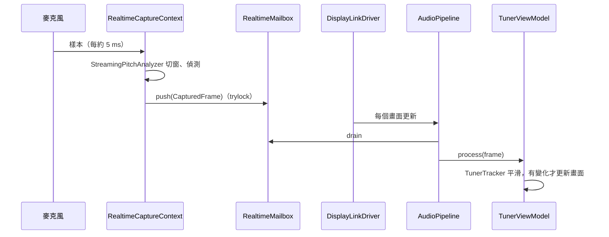
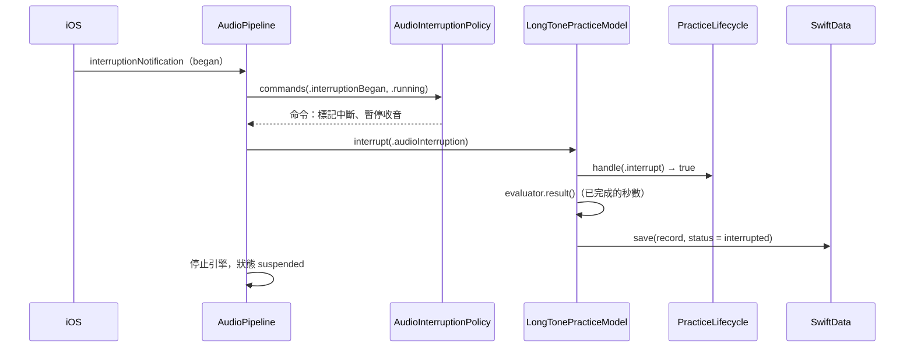
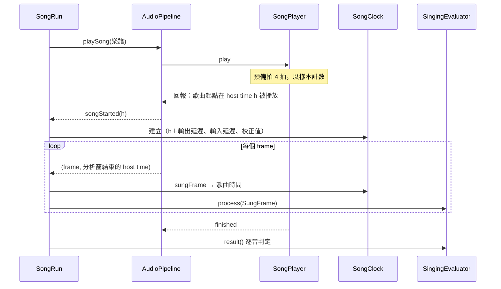
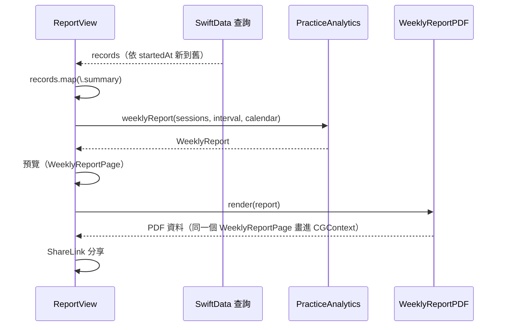
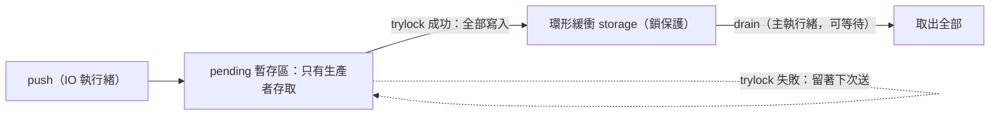

# 06　介面與資料流

PitchCoach 沒有 HTTP API，也沒有後端。本章改寫成三部分：

1. **輸入／輸出介面**：App 從哪裡拿資料、產出什麼，包括使用者可輸入的自訂旋律格式。
2. **核心流程的時序**：四條最能代表系統的流程。
3. **即時資料流**：音訊 IO 執行緒與主執行緒之間怎麼交換資料，這是本專案最需要小心的「介面」。

---

## 6.1 輸入與輸出

| 方向 | 介面 | 格式 | 位置 |
|---|---|---|---|
| 輸入 | 內建麥克風 | Float32 單聲道，48 kHz（依硬體），每約 5 ms 一批 | `PitchCoach/Audio/RealtimeCaptureContext.swift` |
| 輸入 | 自訂旋律文字 | `音名[#\|b\|♯\|♭]八度:拍數`，空白分隔，`R:拍數` 為休止符 | `Packages/PitchCoachKit/Sources/SingingEngine/MelodyParser.swift` |
| 輸入 | 使用者設定 | `UserDefaults`：A4 基準、學生姓名、延遲面板、延遲校正值 | `PitchCoach/App/AppSettings.swift` |
| 輸入 | 系統事件 | 音訊中斷、路由變更、媒體服務重置、引擎設定變更、前後景切換 | `PitchCoach/Audio/AudioSessionEvent.swift` |
| 輸入（DEBUG） | 啟動參數 | `-syntheticScenario`、`-uiTesting`、`-seedDemoData`、`-referenceA4` 等 | `PitchCoach/Audio/SyntheticInputSource.swift`、`PitchCoach/App/PitchCoachApp.swift` |
| 輸出 | 伴奏音訊 | 持續音、節拍器、歌曲提示音，經喇叭／有線／藍牙 A2DP | `Packages/PitchCoachKit/Sources/Accompaniment/` |
| 輸出 | 練習紀錄 | SwiftData（05 章） | `PitchCoach/Persistence/` |
| 輸出 | PDF 週報 | A4、向量，檔名 `PitchCoach_週報_<起日>_<迄日>.pdf`，經分享選單 | `PitchCoach/Features/Report/WeeklyReportPDF.swift` |

### 自訂旋律格式

這是使用者唯一能自由輸入的文字介面，所以規格與錯誤回報都要明確。

```
C4:1 D4:1 E4:2 R:1 F#4:0.5 Bb4:1.5
```

| 部分 | 規則 |
|---|---|
| 音名 | A–G，不分大小寫；`R` 為休止符 |
| 升降 | `#`、`b`，也接受 `♯`、`♭` |
| 八度 | 整數；音高須在 C2–C7 |
| 拍數 | 大於 0、不超過 16 的數字，可有小數 |
| BPM | 不在文字中，畫面上設定 |

錯誤一律回報「第幾個音符、哪個 token、什麼原因」：

```swift
// Packages/PitchCoachKit/Sources/SingingEngine/MelodyParser.swift
public struct MelodyParseError: Error, Equatable, Sendable {
    public enum Reason: Error, Equatable, Sendable {
        case empty, invalidNoteName(String), missingOctave, invalidOctave(String)
        case missingDuration, invalidDuration(String), outOfRange
    }
    /// 第幾個音符（從 1 起算，休止符也算一個）；空白輸入為 0。
    public let noteIndex: Int
    public let token: String
    public let reason: Reason
    // message 例：第 3 個音符「H4:1」：無法辨識的音名「H」（請用 A–G，或 R 表示休止符）
}
```

`parse` 宣告為 `throws(MelodyParseError)`，編譯器保證不會拋出其他型別的錯誤，畫面可以完整處理每一種情況（AC-20）。

> 📄 依據：`docs/SINGING_MODE.md` §3.2–3.3；休止符與 ♯／♭ 的支援是決策 D-S8

---

## 6.2 核心套件的公開介面

App 與核心之間的「API」是 Package 的 public 型別。以下是 App 實際使用的主要入口：

| 模組 | 入口 | 用途 |
|---|---|---|
| `PitchDetection` | `StreamingPitchAnalyzer.process(_:startingAt:emit:)` | 樣本 → `PitchFrame` |
| | `RealtimeMailbox.push(_:)`／`drain(_:)` | IO → 主執行緒 |
| `PracticeEngine` | `TunerTracker.process(_:)` | frame → 讀數 |
| | `LongToneEvaluator`、`ScaleEvaluator` 的 `process(_:)`／`result()` | 練習判定 |
| | `PracticeLifecycle.handle(_:)` | 練習狀態 |
| | `PracticeAnalytics.dailyMinutes`、`weeklyReport` 等 | 統計 |
| `SingingEngine` | `MelodyParser.parse(_:)`、`SongTimeline.init` | 旋律 → 時間軸 |
| | `SongClock.sungFrame(_:windowEndHostTime:)` | frame → 歌曲時間 |
| | `SingingEvaluator.process(_:)`／`result(through:)` | 歌唱判定 |
| `Accompaniment` | `SongPlayer.play(_:)`、`RealtimeParameter.set(_:)` | 伴奏控制 |

共同特徵：**輸入是值、輸出是值、時間由參數帶入**。沒有任何入口會自己讀麥克風、讀時鐘或寫檔案。

---

## 6.3 核心流程的時序

### 流程 1：調音器讀數

這張圖看一個 frame 怎麼跨越兩個執行緒：IO 執行緒只負責產生與推送，主執行緒以螢幕更新頻率主動來取。



### 流程 2：長音練習被中斷

這張圖看系統事件怎麼變成「中斷並保留已完成部分」。



### 流程 3：歌唱的時間對齊

這張圖看伴奏與收音怎麼在同一個時鐘上相遇（演算法細節在 08 章 8.6 節）。



### 流程 4：週報 PDF



---

## 6.4 即時執行緒的規則

iOS 以固定週期呼叫音訊回呼。IO buffer 設為 5 ms 時，每 5 ms 一定要交出或收下一批樣本，超時就會爆音、漏收。回呼內不能做執行時間無上限的事：

| 禁止 | 原因 |
|---|---|
| 配置或釋放記憶體 | 配置器可能拿全域鎖、向系統要記憶體頁 |
| 等待鎖、`DispatchQueue.sync`、`await` | 持有鎖的可能是低優先權執行緒（優先權反轉） |
| I/O、`print` | 時間不可預測 |

所以 `PitchDetection` 與 `Accompaniment` 的所有緩衝都在 `init` 配置：

```swift
// Packages/PitchCoachKit/Sources/PitchDetection/MPMPitchDetector.swift
/// 所有緩衝區在 init 時配置，`detect` 不配置記憶體，可在音訊 IO 執行緒呼叫。
/// 同一個實例不可同時被多個執行緒使用。
public final class MPMPitchDetector {
    // ...
    public init(configuration: PitchDetectorConfiguration) {
        // ...
        window = .allocate(capacity: windowSize)
        padded = .allocate(capacity: fftSize)
        autocorrelation = .allocate(capacity: fftSize)
        nsdf = .allocate(capacity: maxLag + 1)
        // FFT setup 也在 init 建立
    }
}
```

這種約定編譯器無法檢查，所以寫在型別的文件註解中。

> 📄 依據：`docs/ARCHITECTURE.md` §3.3「不配置記憶體、不鎖等待：所有緩衝預先配置……與主執行緒交換資料只用 OSAllocatedUnfairLock.withLockIfAvailable」

---

## 6.5 IO → 主執行緒：永遠不等待的信箱

IO 執行緒每 10.7 ms 產生一個 frame。`DispatchQueue.main.async` 每次都會配置；一般的鎖會讓 IO 執行緒等待。`Packages/PitchCoachKit/Sources/PitchDetection/RealtimeMailbox.swift` 的設計：



```swift
// Packages/PitchCoachKit/Sources/PitchDetection/RealtimeMailbox.swift
public func push(_ value: Element) -> Bool {
    if pendingCount == capacity {
        // 暫存區也滿了：丟掉最舊的暫存值
        pending.update(from: pending + 1, count: capacity - 1)
        pendingCount -= 1
        lock.withLockIfAvailableUnchecked { $0.dropped += 1 }
    }
    pending[pendingCount] = value
    pendingCount += 1

    let delivered = lock.withLockIfAvailableUnchecked { ring -> Bool in
        for index in 0..<pendingCount { write(pending[index], into: &ring) }
        return true
    } ?? false
    if delivered { pendingCount = 0 }
    return delivered
}
```

值得學的地方：

1. **生產者只用 trylock**，拿不到就返回。
2. **拿不到鎖不丟資料**：值留在生產者專屬的 `pending`，下次成功時一併送出。主執行緒只偶爾短暫持鎖，所以 frame 只會晚一點到。
3. **固定容量、覆蓋最舊**，並累計 `droppedCount`。對調音器而言最新的資料最重要。
4. **`placeholder` 參數**：`init` 時就用佔位值填滿 `storage`，`push` 只是覆寫既有元素，不會觸發配置。
5. **單一生產者、單一消費者**的約定讓 `pending` 不需要鎖，並寫在文件註解中。

「生產者拿不到鎖」很難自然重現。測試 `pushWhileConsumerHoldsLockIsDeferredNotLost` 用只給測試用的 `withLockHeldForTesting` 在持鎖期間呼叫 `push`，把競爭情況變成決定性的單元測試。

> 📄 依據：`RealtimeMailbox` 的型別註解「push 只用 trylock，拿不到鎖時把值暫存在生產者專屬的緩衝……IO 執行緒永遠不會等待鎖，也不配置記憶體」

---

## 6.6 主執行緒 → IO：沿用上次的值

使用者調整持續音的音高或節拍器的 BPM，IO 執行緒的合成器要讀到新值：

```swift
// Packages/PitchCoachKit/Sources/Accompaniment/RealtimeParameter.swift
public func set(_ value: Value) {               // 主執行緒：可以等待
    lock.withLockUnchecked { $0 = value }
}

public func readForRealtime() -> Value {        // IO 執行緒：只用 trylock
    if let current = lock.withLockIfAvailableUnchecked({ $0 }) {
        lastRead = current
    }
    return lastRead
}
```

拿不到鎖時沿用上次的值。參數晚 5 ms 生效人耳聽不出來，IO 執行緒則永遠不被擋住。

信箱與參數，就是整個 App 在即時執行緒與主執行緒之間的全部溝通方式。跨執行緒的介面越少、越固定，越容易確認它是對的。

### 為什麼主執行緒「拉」而不是被「推」

主執行緒用 `CADisplayLink`（`PitchCoach/Audio/DisplayLinkDriver.swift`）以螢幕更新頻率主動取資料：每個畫面更新只處理一次，不會因 frame 頻率（約 94 Hz）多做；IO 執行緒不必知道主執行緒存在；判定用的時間來自 frame 自己的時間戳，晚一點取不影響結果。

> 📄 依據：`docs/ARCHITECTURE.md` §3.2 引擎圖「MB -->|60 Hz 取出| VM」

---

## 6.7 Swift 6 的陷阱：closure 被推斷為 MainActor

`AudioPipeline` 是 `@MainActor` 類別。若在它的方法中建立音訊回呼 closure，Swift 6 會推斷該 closure **也隸屬 MainActor**；但 iOS 在 IO 執行緒呼叫它，執行期的隔離檢查失敗，App 立刻終止。

修正是在**非隔離**的環境建立回呼：

```swift
// PitchCoach/Audio/AudioNodeFactory.swift
/// 回呼必須在非隔離的環境中建立：若在 @MainActor 方法內寫 closure，Swift 6 會推斷它隸屬 MainActor，
/// 在 IO 執行緒執行時觸發隔離檢查而終止 App（M4 曾發生）。
enum AudioNodeFactory {
    static func sourceNode(format: AVAudioFormat, renderer: any RealtimeRenderer) -> AVAudioSourceNode {
        AVAudioSourceNode(format: format) { _, _, frameCount, audioBufferList in
            let buffers = UnsafeMutableAudioBufferListPointer(audioBufferList)
            guard buffers.count > 0, let data = buffers[0].mData else { return noErr }
            renderer.render(into: data.assumingMemoryBound(to: Float.self), frameCount: Int(frameCount))
            return noErr
        }
    }
}
```

`RealtimeCaptureContext.makeSinkNode()` 也是同樣的理由：它不是 MainActor 類別，在它的方法中建立的 closure 不會被推斷為 MainActor。

這個陷阱在開發後期又出現了一次：為了診斷歌唱判定，臨時在 `AudioPipeline` 加了一段錄音用的 tap closure，App 立刻當掉，修法完全相同（11 章踩坑 2）。**程式註解中的教訓下次仍可能忘記**；把建立即時回呼的地方集中在少數非隔離的工廠函式，讓錯誤的寫法不容易出現，才是比較可靠的防護。

### `@unchecked Sendable` 的紀律

`RealtimeMailbox`、`RealtimeParameter`、`RealtimeCaptureContext` 標成 `@unchecked Sendable`，等於關掉編譯器的檢查。所以：只用在少數集中處理跨執行緒的型別；文件註解寫明哪個成員由哪個執行緒存取；共享的可變狀態一律放在 `OSAllocatedUnfairLock(initialState:)` 裡，讓「只能在持鎖時存取」成為型別上的事實。

---

## 6.8 音訊引擎的生命週期

系統事件分三層處理，前兩層是有單元測試的純函式：


### 重建要合併、拆除要依序

接上藍牙耳機時可能先後收到好幾個通知，重建延遲 300 ms 執行並合併：

```swift
// PitchCoach/Audio/AudioPipeline.swift
/// 路由變更與引擎設定變更常常接連發生，合併成一次重建。
private func scheduleRestart() {
    pendingRestart?.cancel()
    pendingRestart = Task { [weak self] in
        // sleep 只會因取消而丟出錯誤，取消時由下一行結束
        try? await Task.sleep(for: .milliseconds(300))
        guard !Task.isCancelled else { return }
        self?.restartNow()
    }
}
```

拆除時，`engine.stop()` 返回後 IO 回呼才確定結束，之後才能釋放 `captureContext` 等回呼會用到的物件（程式註解即寫明此順序）。

> 📄 依據：debounce 300 ms，`docs/ARCHITECTURE.md` §3.5 狀態圖「依新格式重建節點（debounce 300 ms）」

### 不可信的事件：回音消除的無限重啟

`AVAudioEngineConfigurationChange` 的本意是「硬體格式改變，請重建」。但在 iOS 模擬器上，開啟 voice processing 的引擎啟動約 0.1 秒就自己停下並發出這個通知，照常重建就會每 0.45 秒循環一次，永不停止。`PitchCoach/Audio/VoiceProcessingGuard.swift` 在「啟動後 1 秒內自己停下」連續 2 次時，停用該路由的回音消除（11 章踩坑 6）。

任何自動重試都需要次數上限與退路；把判斷寫成純函式，就能用時間戳直接測試，不必真的觸發 iOS 的行為。

### 進入背景

不開背景音訊模式。進入背景時停止引擎（含伴奏），練習中則標記為中斷；回到前景時若先前在執行，自動重啟（📄 `docs/ARCHITECTURE.md` §3.6）。
