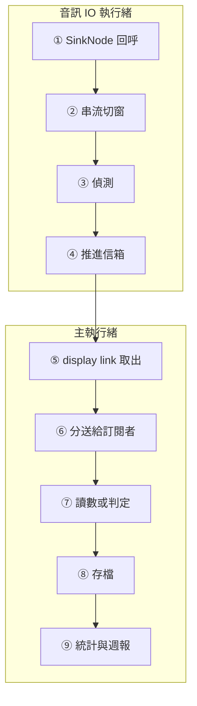

# 07　程式內容導讀

本章帶著實際讀一遍程式碼：先建議閱讀順序，再從啟動開始，追一個音訊 frame 從麥克風到畫面、到資料庫的完整生命週期，最後逐模組整理值得學的寫法與可以改進的地方。

---

## 7.1 建議的閱讀順序

| 順序 | 檔案 | 為什麼先讀 |
|---|---|---|
| 1 | `Packages/PitchCoachKit/Sources/MusicTheory/NoteConverter.swift` | 30 行，所有音高計算的基礎公式 |
| 2 | `Packages/PitchCoachKit/Sources/PracticeEngine/PracticeLifecycle.swift` | 最小的狀態機，看懂「純值、輸入事件、輸出結果」的寫法 |
| 3 | `Packages/PitchCoachKit/Sources/PracticeEngine/LongToneEvaluator.swift` | 典型的判定器，對照 `LongToneEvaluatorTests.swift` 的手算 fixture |
| 4 | `Packages/PitchCoachKit/Sources/PitchDetection/StreamingPitchAnalyzer.swift` | frame 從哪裡來、時間戳怎麼算 |
| 5 | `PitchCoach/Audio/RealtimeCaptureContext.swift` | IO 執行緒的入口 |
| 6 | `PitchCoach/Audio/AudioPipeline.swift` | 外殼的核心：session、引擎、事件、分送 |
| 7 | `PitchCoach/Features/Practice/LongTonePracticeModel.swift` | 外殼怎麼把核心接起來 |
| 8 | `Packages/PitchCoachKit/Sources/PitchDetection/MPMPitchDetector.swift`、`HarmonicFrequencyRefiner.swift` | 最難的部分，搭配 08 章 |
| 9 | `Packages/PitchCoachKit/Sources/SingingEngine/` | 歌唱判定與時間對齊，搭配 08 章 |

原則是**先讀純邏輯、再讀外殼、最後讀演算法**：純邏輯讀得懂，外殼就只是接線；演算法則需要 08 章的推導。

---

## 7.2 啟動

```swift
// PitchCoach/App/PitchCoachApp.swift
@main
struct PitchCoachApp: App {
    @State private var settings = AppSettings()
    @State private var pipeline = AudioPipeline()
    private let modelContainer = Self.makeModelContainer()      // ①

    var body: some Scene {
        WindowGroup {
            RootView()
                .environment(settings)                          // ②
                .environment(pipeline)
        }
        .modelContainer(modelContainer)
    }
}
```

① `makeModelContainer()` 依啟動參數決定用磁碟或記憶體內儲存（`-uiTesting`），DEBUG 下可放入示範資料（`-seedDemoData`）。建立失敗直接 `fatalError` 並附上原因，註解寫明「沒有資料庫就無法保存練習紀錄，直接終止並附上原因，比靜默失去資料好」。

② `AppSettings` 與 `AudioPipeline` 是全 App 唯一的實例，透過 SwiftUI 的 Environment 傳遞，各畫面以 `@Environment(AudioPipeline.self)` 取得。沒有使用 DI 容器；這個規模下 Environment 已經足夠。

```swift
// PitchCoach/App/RootView.swift
TabView { /* 調音器、練習、紀錄、設定 */ }
    .task { await pipeline.start() }                            // ③
    .onChange(of: scenePhase) { _, phase in
        // 只看背景／前景；下拉控制中心等 .inactive 不暫停
        switch phase {
        case .background: pipeline.handle(.appBackgrounded)     // ④
        case .active: pipeline.handle(.appForegrounded)
        default: break
        }
    }
```

③ App 一啟動就請求麥克風權限並開始收音；調音器分頁是第一個畫面，打開就能用。

④ 前後景切換也被轉成 `AudioSessionEvent`，和系統的音訊通知走同一個策略函式。只處理 `.background`／`.active`，是為了下拉控制中心（`.inactive`）時不中斷練習。

---

## 7.3 一個 frame 的生命週期

這張圖看 frame 經過的每一站，以及兩個執行緒的分界。



### ① IO 執行緒的入口

```swift
// PitchCoach/Audio/RealtimeCaptureContext.swift
func receive(timestamp: UnsafePointer<AudioTimeStamp>, frameCount: AVAudioFrameCount,
             bufferList: UnsafePointer<AudioBufferList>) {
    let time = timestamp.pointee
    guard time.mFlags.contains(.sampleTimeValid) else { return }
    // ... 取出 Float 樣本
    let bufferHostTime = time.mFlags.contains(.hostTimeValid) ? AVAudioTime.seconds(forHostTime: time.mHostTime) : 0
    process(samples, startingAt: Int64(time.mSampleTime), hostTime: bufferHostTime)
}
```

這裡取得兩種時間：`mSampleTime`（樣本在串流中的位置，用來算精確時間戳）與 `mHostTime`（系統時鐘，用來量延遲與歌唱的時間對齊）。兩者用途不同，不能互相取代：樣本位置精確但只在這條串流內有意義；host time 能和輸出端比較，但有抖動。

### ② 切窗

```swift
// Packages/PitchCoachKit/Sources/PitchDetection/StreamingPitchAnalyzer.swift
if samplesUntilNextFrame == 0 {
    let window = UnsafeBufferPointer(start: buffer + count - windowSize, count: windowSize)
    let windowEnd = samplePosition + Int64(offset)
    var rms: Float = 0
    vDSP_rmsqv(buffer + count - hopSize, 1, &rms, vDSP_Length(hopSize))     // ①
    emit(PitchFrame(time: duration(ofSamples: windowEnd), estimate: detector.detect(window),
                    levelDB: Double(20 * log10(max(rms, 1e-9)))))
    samplesUntilNextFrame = hopSize
}
```

每累積 512 個新樣本，取最近 2,048 個樣本分析一次。① 電平只算最近一個 hop，而不是整個窗：歌唱的起音偵測要靠它看「重新咬字」時短暫的音量下降，整個窗太長會把變化平均掉（📄 `PitchFrame.levelDB` 的註解）。

### ③ 偵測、④ 推進信箱

偵測演算法見 08 章；信箱的無等待設計見 06 章 6.5 節。

### ⑤ 主執行緒取出

```swift
// PitchCoach/Audio/AudioPipeline.swift  deliverFrames 的節錄
captureContext.mailbox.drain { captured in
    receivedFrameCount += 1
    if captured.frame.estimate != nil, captured.hostTime > 0 {
        latency.record(displayTime - captured.hostTime)                  // ①
    }
    for handler in frameHandlers.values { handler(captured.frame) }
    for handler in timedFrameHandlers.values { handler(captured.frame, captured.hostTime) }
}
```

① 延遲量測就在這裡：`displayTime` 是這一幀預計顯示的時間，減去分析窗結束的 host time，就是延遲面板上 P50／P95 的來源。量測寫在正式程式路徑上，實機驗收時打開設定就能看到，不需要另外的量測版本。

### ⑥ 訂閱

```swift
// PitchCoach/Features/Practice/LongTonePracticeView.swift
private func subscribe() {                       // onAppear
    model.save = { [modelContext] record in
        try PracticeRepository(container: modelContext.container).save(record)
    }
    let model = self.model
    subscriptions = [
        pipeline.addFrameHandler { frame in model.process(frame) },
        pipeline.addInterruptionHandler { reason in model.interrupt(reason) },
    ]
}

private func unsubscribe() {                     // onDisappear
    subscriptions.forEach {
        pipeline.removeFrameHandler($0)
        pipeline.removeInterruptionHandler($0)
    }
    subscriptions = []
    // 離開畫面視為放棄（不存檔）
    if model.phase == .running { model.cancel() }
}
```

畫面出現時註冊、消失時取消，`AudioPipeline` 不知道有哪些畫面。`save` closure 在這裡注入，因為 `modelContext` 只能從 SwiftUI 環境取得；模型本身因此不依賴 SwiftData，可以單獨測試。

### ⑦ 讀數或判定

```swift
// PitchCoach/Features/Tuner/TunerViewModel.swift
func process(_ frame: PitchFrame) {
    let next = tracker.process(frame)
    if next != display { display = next }
}
```

`if next != display` 省掉大量不必要的 SwiftUI 重繪：讀數沒變時不改 `@Observable` 屬性。練習頁則交給判定器與生命週期（03 章 3.4 節的節錄）。

### ⑧ 存檔

```swift
// PitchCoach/Features/Practice/LongTonePracticeModel.swift
private func finish(interruption: PracticeInterruptionReason?) {
    guard let evaluator else { return }
    let result = evaluator.result()
    // ...
    // 還沒開始發聲就被中斷：沒有可保留的資料
    guard result.analyzedDuration > .zero || result.statFrameCount > 0 else { return }
    guard let save else {
        saveError = "練習紀錄儲存失敗：尚未設定儲存位置。"
        return
    }
    do {
        try save(PracticeSessionRecord(longTone: result, startedAt: startedAt, reference: reference, interruption: interruption))
    } catch {
        saveError = "練習紀錄儲存失敗：\(error.localizedDescription)"
    }
}
```

存檔失敗不吞掉，顯示在結果頁；連「沒有注入 save」這種程式錯誤也有明確訊息。

### ⑨ 統計與週報

紀錄與週報畫面用 `@Query` 取紀錄，轉成 `SessionSummary` 交給 `PracticeAnalytics`（05 章 5.6 節）。

---

## 7.4 歌唱模式的分支

歌唱模式在 ⑥ 之後多了時間對齊，由 `PitchCoach/Features/Singing/SongRun.swift` 負責：

```swift
// PitchCoach/Features/Singing/SongRun.swift
func start() {
    subscriptions = [
        pipeline.addSongEventHandler { [weak self] report in self?.handle(report) },
        pipeline.addTimedFrameHandler { [weak self] frame, hostTime in self?.process(frame, hostTime: hostTime) },
    ]
    pipeline.playSong(timeline.playerScore(reference: reference))
}

private func handle(_ report: SongPlayer.Report) {
    switch report.event {
    case .songStarted:
        let sampleRate = pipeline.sampleRate ?? 48000
        // 學生聽到歌曲起點 = render 時間 ＋ iOS 回報的輸出延遲（藍牙約 150–250 ms）
        clock = SongClock(heardSongStartHostTime: report.hostTime + pipeline.outputLatency,
                          inputLatency: pipeline.inputLatency, calibrationOffset: calibrationOffset,
                          windowDuration: 2048 / sampleRate, hopDuration: 512 / sampleRate)
        phase = .singing
    case .finished:
        // ... 停止訂閱、逐音判定、回呼 onFinished
    }
}
```

`SongRun` 同時被歌唱練習與「延遲校正」畫面使用：校正只是一首「8 個 A4」的歌，`calibrationOffset` 傳 0。共用同一條判定路徑，讓校正量到的就是演唱時真正會遇到的誤差。

> 📄 依據：`docs/SINGING_MODE.md` §7.2「偵測每個提示音的起音，與預期時間比較」；`PitchCoach/Features/Singing/LatencyCalibrationView.swift` 以 `SongRun(timeline: LatencyCalibration.timeline(...), calibrationOffset: 0)` 建立

---

## 7.5 UI 測試的旁路：合成輸入

DEBUG 組態下，啟動參數 `-syntheticScenario <tuner|longTone|scale|singing>` 讓 `AudioPipeline` 不開麥克風，改由 `PitchCoach/Audio/SyntheticInputSource.swift` 產生訊號，**送進同一個 `RealtimeCaptureContext`**。偵測、判定、儲存與畫面都走正式路徑，所以 UI 測試能斷言「442.8 Hz、+3 ¢」這種精確的值（09 章）。

```swift
// PitchCoach/Audio/SyntheticInputSource.swift
enum SyntheticScenario: String {
    /// A4 +3 cents，穩定。
    case tuner
    /// A4 +4 cents，±8 cents、週期 3 秒的緩慢擺動。
    case longTone
    /// C 大調上行（C4–C5）循環，每音 0.6 秒，各音帶不同偏差。
    case scale
    /// 跟著 SongPlayer 的時間軸演唱（見 SyntheticSongScript）。
    case singing
}
```

代價是 UI 測試完全不經過 AVAudioEngine，這正是「回音消除無限重啟」沒被自動化測試抓到的原因（11 章踩坑 6）。

---

## 7.6 各模組整理

### MusicTheory

- **職責**：頻率、音名、cents、大調音階。
- **關鍵型別**：`TuningReference`、`Note`、`NoteConverter`、`MajorScale`。
- **值得學**：`TuningReference` 有兩個建構子：`init(a4:) throws` 給需要知道錯誤的地方，`init(clamping:)` 給設定頁等「一定要得到合法值」的地方。同一個驗證規則，依呼叫情境提供兩種失敗語意。
- **值得學**：`NoteConverter.reading` 的 [−50, 50) 半開區間，讓剛好 +50 cents 有唯一歸屬（測試 `exactlyPlus50CentsBelongsToUpperNote`）。

### PitchDetection

- **職責**：樣本 → frame；IO 與主執行緒之間的信箱。
- **關鍵型別**：`MPMPitchDetector`、`HarmonicFrequencyRefiner`（internal）、`StreamingPitchAnalyzer`、`RealtimeMailbox`。
- **值得學**：用已知恆等式校正（`r(0) = Σx²` 決定 FFT 縮放），不去背 vDSP 各格式的係數（08 章 8.1 節）。
- **可改進**：分析窗固定 2,048 個樣本，96 kHz 輸入時偵測不到最低音域（README 已知限制）；改成依時間決定窗長需要連帶調整 hop 與測試。

### PracticeEngine

- **職責**：讀數平滑、長音與音階判定、生命週期、自由練習、統計。
- **值得學**：`ScaleEvaluator` 只用 `holdStart`、`lastInTolerance` 兩個狀態變數就表達了「持續 300 ms、50 ms 內的空檔不重設」（08 章 8.4 節）。
- **值得學**：`PracticeAnalytics` 從外部注入 `Calendar`，時區相關的測試可以固定時區。
- **可改進**：🔍 `PracticeAnalytics.swift` 同時放了統計函式與各種 `SessionSummary` 的轉換建構子（約 340 行），拆成兩個檔案會更好找。

### SingingEngine

- **職責**：旋律、自訂格式、時間軸、歌唱判定、時間對齊、延遲校正。
- **值得學**：`OnsetDetector.onset(for:in:)` 回傳 `found`／`notSeparated`／`notFound` 三種結果，讓「量不到」成為型別的一部分，而不是用 `nil` 混在一起（08 章 8.5 節）。
- **值得學**：`SongTimeline` 以累計拍數換算每個音符的起訖時間，避免逐音累加的捨入誤差。
- **可改進**：`SingingEvaluator` 對每個音符都掃過全部 frame，複雜度 O(音符數 × frame 數)。兒歌長度沒有問題，長曲目時可以先依時間排序後用二分搜尋找區間。

### Accompaniment

- **職責**：持續音、節拍器、歌曲伴奏的即時合成。
- **值得學**：節拍器的 click 用指數衰減的噪音而不是正弦，沒有明確週期，漏進麥克風時不會被偵測器當成音高（📄 `docs/ARCHITECTURE.md` §8；測試 `clickIsNotDetectedAsPitch`）。
- **值得學**：`SongPlayer` 在 render 到第一個歌曲樣本的那一刻回報 host time，作為時間對齊的基準；時間都以樣本計數，測試能檢查「第 n 拍的第一個非零樣本剛好在第 n × 24,000 個位置」。

### App：Audio

- **職責**：AVAudioSession 與 AVAudioEngine 的生命週期、事件處理、frame 分送。
- **值得學**：系統事件 → 事件 → 命令的兩層純函式（06 章 6.8 節）。
- **可改進**：`AudioPipeline.swift` 約 450 行，同時處理 session、引擎、事件、分送與合成輸入。🔍 拆成幾個小型別會更好讀，但每一部分目前都不大。

### App：Features

- **職責**：各畫面與 `@Observable` 模型。
- **值得學**：`@ObservationIgnored` 標註判定器與生命週期，只有畫面需要的屬性會觸發重繪。
- **值得學**：KTV 音高條（`PitchCoach/Features/Singing/PitchRollView.swift`）用 `TimelineView`＋`Canvas` 每幀重繪，且必須把 `timeline.date` 傳進繪圖函式，否則 SwiftUI 判斷內容沒變而不重繪（11 章踩坑 5）。

---

## 7.7 程式風格與慣例

| 慣例 | 例子 | 理由 |
|---|---|---|
| 核心邏輯用值型別 | `struct LongToneEvaluator`、`struct TunerTracker` | 沒有共享可變狀態，測試不必擔心殘留 |
| 時間用 `Duration` | `.milliseconds(300)` | 精確的邊界比較（04 章 4.5 節） |
| 具型別的錯誤 | `throws(MelodyParseError)` | 呼叫端知道會收到哪種錯誤 |
| 不吞錯誤 | 存檔失敗顯示在畫面 | 📄 使用者的全域開發規範 |
| 即時程式預先配置 | `allocate` 在 `init`、`deallocate` 在 `deinit` | IO 執行緒不能配置記憶體 |
| 註解說明「為什麼」 | `// 用窗中心而非窗尾：……用窗尾會讓起音晚半個窗長（約 21 ms）` | 「做什麼」看程式就知道 |

最後一列的例子：`PracticeRepository` 中「ModelContext 對 container 只是弱參照；持有 container 確保它在 repository 使用期間存活」這行註解背後是一次當機（11 章踩坑 3）。沒有這行註解，下一個人很可能把 `container` 改成只存 `context`，重現同一個問題。
