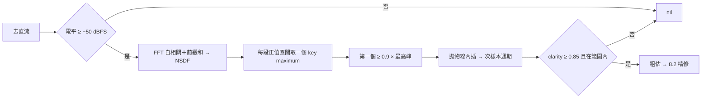
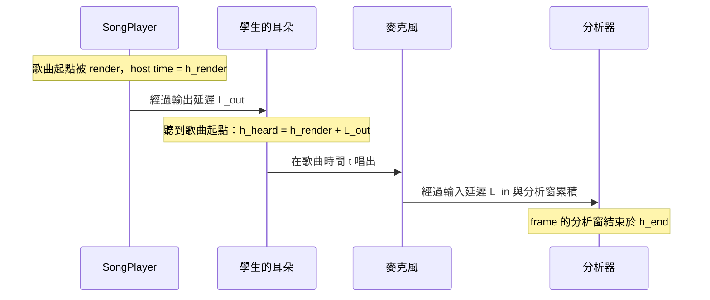

# 08　核心演算法

本章拆解專案中最有技術含量的六個部分：

| 節 | 演算法 | 位置 |
|---|---|---|
| 8.1 | 音高偵測（一）：MPM 粗估與防八度錯誤 | `Packages/PitchCoachKit/Sources/PitchDetection/MPMPitchDetector.swift` |
| 8.2 | 音高偵測（二）：諧波加權最小平方精修 | `Packages/PitchCoachKit/Sources/PitchDetection/HarmonicFrequencyRefiner.swift` |
| 8.3 | 串流切窗與精確時間戳 | `Packages/PitchCoachKit/Sources/PitchDetection/StreamingPitchAnalyzer.swift` |
| 8.4 | 讀數平滑與練習判定 | `Packages/PitchCoachKit/Sources/PracticeEngine/` |
| 8.5 | 歌唱判定：穩健統計、顫音、起音 | `Packages/PitchCoachKit/Sources/SingingEngine/` |
| 8.6 | 伴奏與收音的時間對齊 | `Packages/PitchCoachKit/Sources/SingingEngine/SongClock.swift`、`LatencyCalibration.swift` |

---

## 8.1 音高偵測（一）：MPM 粗估與防八度錯誤

### 問題

給 2,048 個樣本，估計基頻 f₀（65–2,100 Hz），或判斷「沒有明確音高」。例：一段 A4 的小提琴聲，二次泛音比基頻還強，要回報 442 Hz 而不是 884 Hz，誤差要小於 1 cent。

**輸入**：2,048 個 Float 樣本、取樣率（44.1 或 48 kHz）。**輸出**：`PitchEstimate`（頻率、clarity、電平）或 `nil`。

### 為什麼困難

1 cent 是頻率的 0.058%。48 kHz 下：

| 頻率 | 週期（樣本） | 1 cent 對應的週期變化 |
|---|---|---|
| 65 Hz | 738.46 | 0.43 個樣本 |
| 2,100 Hz | 22.86 | 0.013 個樣本 |

所以必須做次樣本內插。此外，最強的頻率常是泛音；週期 T 的倍數 2T、3T 也是週期；噪音會讓所有候選的相似度抖動。

### 正規化平方差函數（NSDF）

```
d(τ) = Σⱼ (xⱼ − xⱼ₊τ)² = m(τ) − 2r(τ)
n(τ) = 2r(τ) / m(τ) ∈ [−1, 1]
```

r(τ) 是自相關，m(τ) = Σ(xⱼ² + xⱼ₊τ²) 是重疊區段的能量。**對純正弦，在真實週期 T 處 d(T) = 0，n(T) 恰為 1**，與窗內週期數是否為整數無關（m 只算重疊部分）。這讓 MPM 在純正弦上沒有系統性偏差。峰值高度直接當作 clarity；clarity < 0.85 視為沒有音高。

> 📄 依據：`docs/ARCHITECTURE.md` §4.1「NSDF 對純正弦在 τ = T 處恰為 1……選 MPM 的主因：clarity 天然提供 FR-04 所需的『無明顯音高』判準」

### 步驟



### 實作重點

**FFT 自相關要補零**：FFT 算的是循環自相關，訊號要補到 ≥ W＋τ_max，避免尾端繞回。W = 2,048、τ_max = 1,024 → 4,096 點。

```swift
// Packages/PitchCoachKit/Sources/PitchDetection/MPMPitchDetector.swift
// 線性（非循環）自相關需要 fftSize ≥ windowSize + maxLag
var log2n = 0
while (1 << log2n) < windowSize + maxLag { log2n += 1 }
fftSize = 1 << log2n
// ...
// vDSP 的 FFT 縮放因子依格式而異；以 r(0) = Σx² 校正，不必記憶各種係數
var scale = energy / autocorrelation[0]
```

用已知恆等式（r(0) 必須等於 Σx²）當校正基準，比記住 vDSP 各格式的縮放係數更不容易出錯。

**前綴和讓 m(τ) 變成 O(1)**：P[k] = Σ_{j<k} xⱼ²，則 m(τ) = P[W−τ] + (P[W] − P[τ])。

### 選峰：一條規則防兩種八度錯誤

```swift
// Packages/PitchCoachKit/Sources/PitchDetection/MPMPitchDetector.swift  pickPeak 的節錄
var highest = -Double.infinity
for i in 0..<count { highest = max(highest, interpolate(at: keyMaxima[i]).value) }
let threshold = configuration.peakThreshold * highest          // k = 0.9
for i in 0..<count {
    let peak = interpolate(at: keyMaxima[i])
    if peak.value >= threshold { return (peak.lag, peak.value) }  // 第一個過門檻的
}
```

- **「第一個」防八度偏低**：週期訊號在 2T 的 n 值和在 T 幾乎一樣高；選「最高」會隨機落在 T 或 2T。
- **「k 門檻」防八度偏高**：x = sin(ωt) + a·sin(2ωt) 在 τ = T/2 時基頻反相、二次泛音同相，n(T/2) ≈ (a² − 1)/(a² + 1)。題目條件 a = 2 → 0.6 < 0.9，不會選到 T/2。要 a² ≥ 19（a ≥ 4.36）才會誤判。

> 📄 依據：`docs/ARCHITECTURE.md` §4.4 的推導「a = 2 → 0.6 < 0.9……要 a ≥ 4.4 才會誤判」

能推導出「失敗邊界」比只知道「測試通過」有價值：它告訴我們 k = 0.9 在題目條件下有約 2 倍的安全餘量。

歌唱模式加入時，母音共振峰可能讓第 5、6 泛音特別強，是當時最大的風險。先寫了 171 組人聲模擬測試，結果都沒有八度錯誤，偵測器不需要修改（📄 commit `21bab7e`、`docs/SINGING_MODE.md` D-S4「先寫人聲測試，失敗才加次諧波驗證」）。

**拋物線內插**：key maximum 在整數位置 i，以 (a, b, c) = (n[i−1], n[i], n[i+1]) 擬合，偏移 δ = ½(a − c)/(a − 2b + c)。

### 複雜度

- 時間：兩次 4,096 點實數 FFT 約 10⁵ 次運算；NSDF 與選峰各 O(W)。
- 空間：O(fftSize)，全部在 `init` 預先配置。

### 邊界條件

| 情況 | 處理 |
|---|---|
| 靜音（能量 0） | 直接回傳 nil |
| 電平 < −50 dBFS | nil，不浪費計算 |
| 直流偏移 | 先減平均值（測試 `dcOffsetDoesNotAffectEstimate`） |
| 最後一段正值區間到搜尋邊界都沒結束 | 最大值不在邊界上才算峰 |
| 超出 65–2,100 Hz（各放寬半個半音） | nil |
| 白噪音 | clarity 約 0.1–0.4，低於門檻 → nil |

### 替代做法

YIN（累積平均正規化差分，取第一個低於門檻的谷）是最常見的替代方案；設計文件選 MPM 的理由是 clarity 的語意與純正弦無偏（📄 `docs/ARCHITECTURE.md` §4.1）。FFT 峰值在 2,048 點下每格 23 Hz，解析度不足。

### 單靠 MPM 不夠

實作後量測（48 kHz）：SNR 20 dB 時低頻單一 frame 最差 **8 cents**，取 9 個 frame 中位數仍有 5.4 cents；多泛音高頻的性質測試最大 4.15 cents。原因是 NSDF 只看單一延遲的重疊段，噪音交叉項直接推動峰值；泛音讓峰變尖，拋物線內插偏差變大。於是改為兩階段：**MPM 只負責選對八度，頻率由 8.2 精修**。

> 📄 依據：`docs/ARCHITECTURE.md` §4.5「實作後實驗發現兩個問題……效率約為 CRLB 的 1/8」

---

## 8.2 音高偵測（二）：諧波加權最小平方精修

### 問題

給一個八度正確、但可能偏 10 cents 的粗估，求精確頻率。要求在 SNR 20 dB 下 < 3 cents，且對鋸齒波（弓弦振動的近似）沒有偏差。

### 想法

基頻 f 的週期訊號可寫成直流加 H 個諧波：

```
xⱼ ≈ c + Σₕ [aₕ cos(hωj′) + bₕ sin(hωj′)]，  h = 1…H，  j′ = j − (W−1)/2
```

固定 ω 時，係數是線性最小平方問題。擬合得越好，模型「解釋」的能量越多。所以頻率估計 = 使投影能量 J(ω) = pᵀG⁻¹p 最大的 ω（p 是樣本與各基底的內積，G 是基底之間的 Gram 矩陣）。

- 對 H 以內的週期訊號，真實頻率處殘差為 0 → 沒有內插偏差（純正弦實測 0.001 cent）。
- 用到窗內所有樣本與所有諧波 → 白噪音下接近最大概似估計。

### 權重：sine 窗

每個內積乘上 w(j′) = cos(πj′/W)：

| 權重 | 鋸齒波 65 Hz 偏差 | SNR 20 dB 最差 |
|---|---|---|
| 矩形 | **9.43 cents** | 1.62 |
| Hann | 0.28 | 2.66 |
| **sine（採用）** | **0.11** | **1.93** |

矩形權重下，H 以外的泛音（鋸齒波一路到 Nyquist）洩漏進模型；Hann 洩漏最小但有效窗長短，噪音誤差逼近門檻；sine 窗旁瓣以 1/k² 衰減、雜訊等效頻寬 1.23，兩者兼顧。

> 📄 依據：`HarmonicFrequencyRefiner` 的型別註解與 `docs/ARCHITECTURE.md` §4.5 的變體比較表

### 讓它快到能在 IO 執行緒跑

直接算 Gram 矩陣是 O(W·H²)。兩個數學性質把它降到可忽略：

1. **以窗中心為原點、權重對稱 → cos 欄與 sin 欄正交**，Gram 矩陣分成兩個獨立區塊。
2. **Gram 元素有封閉解**。積化和差後，所有元素都可寫成 Kw(kω) 的加減，而

```
Kw(θ) = Σ w(j′) cos(θj′) = ½[K(θ + π/W) + K(θ − π/W)]，  K(θ) = sin(Wθ/2) / sin(θ/2)
```

K 是 Dirichlet kernel。每次評估只要算 2H＋1 個 Kw 值查表：

```swift
// Packages/PitchCoachKit/Sources/PitchDetection/HarmonicFrequencyRefiner.swift  energy 的節錄
for k in 0...(2 * harmonics) { kernelTable[k] = weightedKernel(Double(k) * omega) }
// cos 區塊：[1, C₁…C_H]；C_a·C_b = ½[Kw((a−b)ω) + Kw((a+b)ω)]，1·C_a = Kw(aω)
let nc = harmonics + 1
for row in 0..<nc {
    for col in 0...row {
        gram[row * nc + col] = col == 0
            ? kernelTable[row]
            : 0.5 * (kernelTable[row - col] + kernelTable[row + col])
    }
}
var total = quadraticForm(size: nc, rhs: cosProjection)
```

其他技巧：

- **內積 p**：第 h 諧波的相量 e^{ihωj′} 由基底 e^{iωj′} 逐元素複數乘法遞推，三角函數只算一次（`vvsincos`）。
- **pᵀG⁻¹p 用 Cholesky**：G = LLᵀ，則 pᵀG⁻¹p = ‖L⁻¹p‖²，不必求反矩陣。對角元素 ≤ 0（數值上奇異）時回傳 0，讓搜尋避開。

### 搜尋：Brent 法，分兩段

J(ω) 在真實頻率附近平滑單峰，離遠了有旁瓣。用 Brent 法（黃金分割＋拋物線內插，不需導數）以 cents 為變數搜尋，容許誤差 0.002 cent。高次諧波的主瓣很窄，從偏 10 cents 的起點直接用全部諧波可能落在旁瓣，所以分兩段：

1. 只用「主瓣半寬 ≥ 25 cents」的諧波，搜尋 ± min(12, 0.4 × 主瓣半寬) cents。
2. 用全部諧波（最多 16 個、低於 0.45 倍取樣率），在第一段結果 ± min(4, 0.4 × 主瓣半寬) cents 精修。

sine 窗主瓣半寬 1.5 個頻率格（48 kHz、2,048 點約 35 Hz）。換算成基頻的 cents，第一段能用的諧波數隨頻率而變：

| 基頻 | 基頻主瓣半寬 | 第一段諧波數 | 第二段諧波數 |
|---|---|---|---|
| 65 Hz | 748 cents | 16 | 16 |
| 262 Hz | 218 cents | 9 | 16 |
| 1,000 Hz | 60 cents | 2 | 16 |
| 2,100 Hz | 29 cents | 1 | 10 |

> 📄 依據：`refine(_:coarseFrequency:)` 的文件註解說明兩階段的理由

### 複雜度

- 每次評估 J(ω)：內積 O(W·H)，約 2×10⁵ 次運算；Gram 與 Cholesky O(H³)，約 10³。
- Brent 每段約 20 次評估，兩段約 40 次 → 每次偵測約 10⁷ 次運算。實測 MPM＋精修約 0.27 ms（M 系列 Mac，release），每 10.7 ms 一次，可留在 IO 執行緒（📄 `docs/ARCHITECTURE.md` §4.5）。
- 空間：O(W＋H²)，預先配置。

### 邊界條件與替代做法

- 粗估離真值太遠（> 搜尋半寬）會收斂到錯的峰；MPM 的粗估誤差約 10 cents，第一段的寬搜尋涵蓋它。
- 替代做法：只用拋物線內插（量測不足）、頻譜峰值內插、相位聲碼器（phase vocoder）。🔍 後兩者文件中沒有比較記錄。

---

## 8.3 串流切窗與精確時間戳

### 問題

偵測器一次處理一個窗；真實樣本則是一批一批、大小不定地到達（約 240 個）。要每 512 個新樣本輸出一個 frame，而且時間戳精確到能做 300 ms 的整數比較。

### 做法

- **線性緩衝、容量兩個窗長**：寫滿時把最近一個窗長搬到開頭。「最近 2,048 個樣本」永遠是連續記憶體，可以直接交給 vDSP，不必處理環形緩衝的繞回。
  > 🔍 推斷：程式註解只描述了做法；選線性而非環形的理由是本文件推測。搬移成本平均每個樣本一次，可以接受。
- **時間戳 = 分析窗最後一個樣本之後的位置**，取樣率為整數時以 128 位元整數運算換算成 `Duration`（04 章 4.5 節）。
- **不連續時重設**：樣本位置與上一批結尾接不上（引擎重啟）就清空緩衝，避免把兩段不相干的聲音拼成一個窗。

```swift
// Packages/PitchCoachKit/Sources/PitchDetection/StreamingPitchAnalyzer.swift
public func process(_ samples: UnsafeBufferPointer<Float>, startingAt samplePosition: Int64, emit: (PitchFrame) -> Void) {
    if let expected = expectedPosition, expected != samplePosition {
        reset()
    }
    // ... 每累積 hopSize 個新樣本 emit 一個 frame
    expectedPosition = samplePosition + Int64(samples.count)
}
```

### 複雜度與不變性

- 時間：每個樣本攤銷 O(1)（不含偵測）；空間：2W 個 Float。
- 不變性測試 `arbitraryChunkSizesProduceIdenticalFrames`：同一段訊號一次餵入，或以 1、37、256、1000、4096 個樣本交錯餵入，產生的 frame 必須完全相同。這保證 IO buffer 大小改變時結果不變。

---

## 8.4 讀數平滑與練習判定

本節沒有典型的演算法，而是把文字規則精確實作成狀態機。

### 調音器讀數（`TunerTracker`）

| 機制 | 規則 | 解決的問題 |
|---|---|---|
| 起音確認 | 連續 2 個有效 frame 才顯示 | 雜音閃出讀數 |
| 保持與釋放 | 連續 8 個無效 frame 才回到「—」 | 換弓、換氣時閃爍 |
| 中位數濾波 | 最近 3 個 frame 取中位數 | 單一 frame 的八度跳動 |
| 雙重遲滯 | \|c\| > 65 立即換音；50 < \|c\| ≤ 65 持續 100 ms 才換 | 在兩個音名邊界來回跳 |
| 指數移動平均 | 時間常數 50 ms，換音或起音時重設 | 指針顫動 |

> 📄 依據：`docs/ARCHITECTURE.md` §6 的機制表

中位數對少數極端值不敏感：69.02、57.01（八度錯誤）、69.03 的平均是 65.02，中位數是 69.02。

EMA 以時間常數而非固定 α 計算：

```swift
// Packages/PitchCoachKit/Sources/PracticeEngine/TunerTracker.swift
private mutating func smooth(toward pitch: Double, at time: Duration) {
    let elapsed = lastTime.map { (time - $0).timeInterval } ?? 0
    let alpha = 1 - exp(-elapsed / configuration.smoothingTimeConstant.timeInterval)
    smoothedPitch += alpha * (pitch - smoothedPitch)
}
```

α = 1 − e^(−Δt/τ) 讓平滑程度只依時間而定，frame 間隔變了也一樣。🔍 推斷：文件只寫了「EMA（τ ≈ 50 ms）」，用時間常數的理由是本文件的解讀。

**平滑只用在顯示**；長音、音階、歌唱的判定一律用原始 frame。

### 長音（`LongToneEvaluator`）

逐行對應決策 D4（01 章）：

```swift
// Packages/PitchCoachKit/Sources/PracticeEngine/LongToneEvaluator.swift  process 的節錄
if startTime == nil {
    guard frame.frequency != nil else { return .waitingForSound }   // 第一個有音高的 frame 才計時
    startTime = frame.time
}
let elapsed = frame.time - startTime!
if elapsed >= duration { isFinished = true; return .finished }
frameCount += 1                                                     // 分母：全部 frame
let cents = frame.frequency.map { NoteConverter.cents(frequency: $0, relativeTo: target, reference: reference) }
if let cents {
    voicedCount += 1
    if abs(cents) <= tolerance + boundaryEpsilon { inToleranceCount += 1 }       // ±10，含邊界
    if abs(cents) <= wrongNoteThreshold + boundaryEpsilon { statistics.add(cents) /* ... */ }
}
```

**`boundaryEpsilon = 1e-9`**：測試產生「剛好 +10 cents」的頻率再算回 cents，可能得到 10.000000000000002，`<= 10` 會判錯。10⁻⁹ cent 遠小於任何有意義的差，卻能吸收浮點往返誤差；測試同時檢查 10.01 不算，確保容許值沒有改變規則（📄 `Packages/PitchCoachKit/Sources/PracticeEngine/Support.swift` 的註解）。

**Welford 線上統計**：每一步只累加「與目前平均的偏差」，避免 E[x²] − (E[x])² 在平均遠大於標準差時的災難性抵消，也不必保存所有資料。🔍 推斷：程式註解只寫「以 Welford 演算法累計」，選它的理由是本文件的說明。

### 音階到位（`ScaleEvaluator`）

規則：在範圍內（\|c\| ≤ 15）持續 ≥ 300 ms 到位；範圍外的空檔若距**上一個在範圍內的 frame** ≤ 50 ms 不重設；只在在範圍內的 frame 上到位。

```
時間(ms)   0    50   100  150  200  250  300
在範圍內   ■ ■ ■ ■ □ □ ■ ■ ■ ■ ■ ■ ■ ■
           ↑t₀        └空檔≤50┘        ↑ t − t₀ ≥ 300 → 到位
```

只用兩個狀態變數就表達了整條規則：

```swift
// Packages/PitchCoachKit/Sources/PracticeEngine/ScaleEvaluator.swift  process 的節錄
let inTolerance = cents.map { abs($0) <= tolerance + boundaryEpsilon } ?? false
if inTolerance {
    if holdStart == nil { holdStart = frame.time }
    lastInTolerance = frame.time
    if frame.time - holdStart! >= holdDuration {           // Duration 的精確比較
        reached[index] = true
        moveToNextStep()
        return isFinished ? .finished : .advanced(from: index, to: index + 1)
    }
} else if let last = lastInTolerance, frame.time - last > gapTolerance {
    holdStart = nil
    lastInTolerance = nil
}
```

「偏差最大 3 音」把上下行中同一個音以 frame 數加權合併，排序的第二鍵（偏差相同時依音高）讓結果決定性。

### 自由練習（`FreePracticeTracker`）

停頓 ≤ 5 秒計入演奏時間；停頓 > 60 秒結束一段；少於 30 秒不記錄（📄 決策 D13）。同樣是輸入 frame、輸出結果的純值型別，不必真的等 60 秒就能測。

### 趨勢與週報（`PracticeAnalytics`）

| 細節 | 做法 | 理由 |
|---|---|---|
| 分桶 | 依開始時間的**當地日期**，`Calendar` 由呼叫端注入 | 測試可固定時區驗證跨午夜 |
| 區間 | 半開區間 [start, end) | 相鄰兩週不重複計算 |
| 長音準確率趨勢 | 只用完成的練習 | 📄 D8：中斷的練習時間短，比例會失真 |
| 各音平均偏差 | 含中斷練習，frame 數加權 | 已完成的部分也是有效資料 |
| 最常偏高／偏低 | 加權平均超過 ±5 cents，且出現在至少 2 次練習中，各取前 3 | 📄 D10：避免單次偶發 |

### 複雜度

每個 frame O(1)；`TunerTracker` 的中位數只對 3 個值排序。統計函式對紀錄數線性。

---

## 8.5 歌唱判定：穩健統計、顫音、起音

### 每個音符的音高

```swift
// Packages/PitchCoachKit/Sources/SingingEngine/SingingEvaluator.swift  evaluate 的節錄
let trim = note.duration * options.trimFraction                    // 頭尾各 15%
let middle = inNote.filter { $0.time >= note.start + trim && $0.time < note.end - trim }
// 中段有效 frame 太少（短音符或只唱了頭尾）時改用整個音符期間
let analyzed = middle.count >= 3 ? middle : inNote
let cents = analyzed.map { self.cents(for: $0.frequency!, target: note.pitch) }
let vibrato = middle.count >= 12
    ? VibratoAnalyzer.analyze(times: analyzed.map { $0.time.timeInterval }, cents: cents, compensation: windowGain)
    : nil
let deviation = vibrato?.centerCents ?? Self.median(cents)
```

**滑音（AC-16）**：前 20% 從 −100 線性滑到 0 cents。去掉的 15% 涵蓋 −100 到 −25；剩下 15%–20% 這段只占中段的 5/70 ≈ 7%，中位數不受影響（📄 `docs/SINGING_MODE.md` §4.2）。先去掉已知會被污染的部分，再用對極端值不敏感的統計量。

**容許八度：先折算每個 frame，再統計**。偏差先折算到最近的八度（±1 個八度內）。若偵測器在同一個音符內於兩個八度間跳動（−1190 與 +10 cents），先取中位數會得到無意義的中間值（📄 `docs/SINGING_MODE.md` §4.3）。

### 顫音（`VibratoAnalyzer`）

±60 cents、5.5 Hz 的顫音，0.6 秒音符的中段只有約 2.3 個週期；非整數週期時中位數會偏向多出來的半個週期，偏差可達數 cents，超過 AC-15 的 5 cents。所以擬合：

```
c(τ) ≈ α + β·τ + a·cos(2πfτ) + b·sin(2πfτ)       （τ 以中段中點為原點）
```

α 是中心音高（趨勢線在中點的值，不受週期數影響），βτ 去除緩慢漂移。固定 f 時解 4×4 正規方程；f 在 3–9 Hz 以 0.05 Hz 粗搜尋，再以黃金分割精修。這和 8.2「固定 ω 解線性問題、外層搜尋 ω」是同一種結構：可分離的非線性最小平方（separable nonlinear least squares）。

判定為顫音須同時滿足：擬合解釋 ≥ 50% 的變異、半幅度 ≥ 15 cents、涵蓋 ≥ 1.5 個週期、中段 ≥ 12 個 frame。否則回到中位數。

**量測系統本身會抹平顫音**：分析窗 42.7 ms 約是 5.5 Hz 顫音週期的 1/4，窗內音高被平均，60 cents 會量成約 55 cents。補償的做法是為窗建模：以最小平方估計頻率，近似對瞬時頻率做加權平均，權重核 k(t) = ∫_{|t|}^{W/2} u·w(u) du（w 為 sine 窗）；振幅響應 G(f) = |Σ k(t) cos(2πft)| / Σ k(t)，量到的幅度除以 G(f) 還原。

> 📄 依據：`docs/SINGING_MODE.md` §5、決策 D-S5；`VibratoAnalyzer.windowGain(windowDuration:)` 的文件註解

為量測系統建立模型再反推真實值，在顫音速度改變時仍然正確；調一個經驗係數只在調參的速度正確。

### 起音偵測（`OnsetDetector`）

搜尋範圍 = 樂譜起點 ± min(250 ms, 與前後音符間隔的一半)。三種線索依可靠度取用，各取離樂譜時間最近的候選：

| 順序 | 線索 | 情況 | 判斷 |
|---|---|---|---|
| 1 | 發聲起點 | 換氣後起音 | 無音高 ≥ 40 ms 後出現音高 |
| 2 | 音高穿越 | 連唱換音 | 穿過前後兩音的中點；換音時常有 1–3 個無音高 frame，容許 ≤ 80 ms 空檔並內插 |
| 3 | 電平上升 | 同音重複時重新咬字 | 局部最低點後 60 ms 內上升 ≥ 6 dB，取上升過中點的時間 |

> 📄 依據：`docs/SINGING_MODE.md` §7.3、D-S6；空檔容許值從 30 ms 改為 80 ms 是開發中的修正：換音時分析窗同時包含兩個音，會出現 1–3 個沒有音高的 frame（開發對話紀錄；`OnsetDetector` 的型別註解）

線索 3 是 `PitchFrame` 增加「最近一個 hop 的電平」的原因；整個窗的電平太粗，短暫的音量下降會被平均掉。

**線索都不存在時：「沒有分開唱」**。學生把「C C」連成一個長音時三種線索都不存在。原本的退回規則「取搜尋範圍內第一個接近目標音的 frame」會取到前一個音的 frame：一般速度判成「提早約 250 ms」，很快時反而判成「準時」，兩者都不是量到的。

```swift
// Packages/PitchCoachKit/Sources/SingingEngine/OnsetDetector.swift  onset 的節錄
if let time = nearest(voicingOnsets(in: window), to: note.start) { return .found(time) }
if index > 0, notes[index - 1].pitch != note.pitch,
   let time = nearest(pitchCrossings(from: notes[index - 1].pitch, to: note.pitch, in: window), to: note.start) {
    return .found(time)
}
if let time = nearest(levelRises(in: window), to: note.start) { return .found(time) }
if index > 0, notes[index - 1].pitch == note.pitch, isContinuouslyVoiced(across: note.start) { return .notSeparated }
// ... 其餘情況才用退回規則
```

> 📄 依據：對話中使用者貼上的程式碼審查意見與決定（「標『沒有分開唱』，不計入」）；commit `cd38059`

演算法沒有足夠資訊時，**回報「不知道」比回報一個看似合理的錯誤答案好**。退回規則是所有正常線索都失敗時才執行的程式碼，最容易藏著錯誤的假設。

### 節奏判定與正確率

起音差 ≤ ±80 ms 準時，否則提早或延遲。音準正確率分母為全部音符（沒唱算不準）；節奏正確率分母為量得到起音的音符（沒唱算不準時，「沒有分開唱」不計入）。

### 最常唱不準的音高區段

以連續 5 個半音（例如 C4–E4）為寬度滑動，找「不準比例」最高、至少含 3 個音的區段（📄 D-S10）。「至少 3 個」避免只出現一次的高音因唱錯一次就成為最弱區段。

### 複雜度

`SingingEvaluator` 保存整首的 frame（F 個），結束時對每個音符（N 個）掃描 frame：O(N·F)。起音偵測對每個音符也是 O(F)。顫音分析每個音符約 121 次 O(n) 的擬合（n 為該音的 frame 數）。30 秒的歌 F ≈ 2,800、N ≈ 40，約 10⁵ 次運算，不是瓶頸。長曲目時可先依時間排序再用二分搜尋找每個音符的區間。

### 結果

| 驗收 | 實測 | 門檻 |
|---|---|---|
| AC-15 顫音（男、女、童聲） | 中心 ≤ 0.05 cent、速度 5.500 Hz、幅度 60.03–60.08 cents | < 5 / ±0.5 Hz / ±10 |
| AC-18 起音（〈小星星〉開頭 7 個音） | 最大誤差 7.0 ms | < 30 ms |

（📄 `docs/TEST_REPORT.md` §4.2）

---

## 8.6 伴奏與收音的時間對齊

### 問題

學生跟著伴奏唱。要判定「準時」，必須知道學生**聽到**某個音符的時刻。伴奏樣本交給音訊系統後還要經過輸出延遲（喇叭約 10 ms、藍牙約 150–250 ms）；學生的聲音到麥克風後還要經過輸入延遲與分析窗累積。不處理的話，用藍牙耳機唱歌會被系統性地判定為延遲約 200 ms。

### 共同時鐘

輸出端與輸入端都換算到 host time（系統單調時鐘）：



```swift
// Packages/PitchCoachKit/Sources/SingingEngine/SongClock.swift
public func sungFrame(_ frame: PitchFrame, windowEndHostTime: Double) -> SungFrame {
    // 用窗中心而非窗尾：分析窗反映的是過去一整個窗長的聲音，用窗尾會讓起音晚半個窗長（約 21 ms）
    let center = windowEndHostTime - windowDuration / 2
    let levelCenter = windowEndHostTime - hopDuration / 2
    return SungFrame(time: songTime(center), frequency: frame.frequency, levelDB: frame.levelDB, levelTime: songTime(levelCenter))
}

private func songTime(_ hostTime: Double) -> Duration {
    .nanoseconds(Int64(((hostTime - inputLatency - heardSongStartHostTime - calibrationOffset) * 1e9).rounded()))
}
```

- **用窗中心**：用窗尾會吃掉 AC-18 一大半的 30 ms 預算（📄 `docs/SINGING_MODE.md` §7.1）。
- **音高與電平用不同的中心**：音高來自整個 2,048 樣本的窗，電平來自最後 512 個樣本，各自的中心不同。

### 延遲校正

iOS 回報的藍牙延遲是估計值，可能差數十 ms，足以讓 ±80 ms 的判定失準（📄 D-S2）。`LatencyCalibration` 讓伴奏當完美的範唱：

1. 以目前的路由播放 8 個 A4（90 BPM，每個半拍、間隔半拍，預備拍 2 拍）。
2. 喇叭直接被麥克風收到；藍牙時把耳機貼近手機底部的麥克風。
3. 用 8.5 的同一套起音偵測，與樂譜時間比較。
4. 至少偵測到 5 個時取中位數，依「埠類型＋裝置 UID」儲存為該路由的校正值。

提示音本身是準時的，量到的偏移就是 iOS 回報值之外尚未補償的部分。中位數讓一兩個沒偵測好的提示音不影響結果。

### 實機結果（AC-19）

iPhone 15 Pro Max、AirPods Pro，各 3 次（畫面顯示的是尚未套用校正值的殘餘偏移）：

| 路由 | iOS 回報的輸出延遲 | 殘餘偏移 | 校正值 |
|---|---|---|---|
| 內建喇叭 | 10 ms | +21～+39 ms | +24、+24、+33 ms |
| AirPods Pro | 176 ms | +52～+57 ms | +57、+55、+55 ms |

- 不校正時殘餘誤差也都在 ±80 ms 內，兩種路由的節奏判定一致。
- 藍牙實際延遲約 176＋55 ≈ 230 ms，iOS 少算約 55 ms；喇叭少算約 25 ms。兩者不同，所以校正必須依路由分別儲存。
- 偏移在 21／26、52／57 ms 之間交替，相差約 5.3 ms，等於電平分析的子區塊（256 樣本），是起音偵測的時間解析度；整首沒有漂移，表示時鐘換算正確。

（📄 `docs/TEST_REPORT.md` §5.3）

### 邊界條件與替代做法

- 偵測到的提示音少於 5 個（環境太吵、音量太小）→ 不採用，提示使用者調大音量。
- 沒有校正過的路由只用 iOS 回報的延遲。
- 替代做法：只用 iOS 回報的延遲（📄 D-S2 的替代方案；實機量測顯示會差 25–55 ms）。
- 🔍 潛在問題：校正值是常數，若某副耳機的延遲隨時間漂移，校正會逐漸失準。目前沒有偵測機制。

---

## 8.7 已知限制

| 限制 | 說明 |
|---|---|
| 分析窗固定 2,048 樣本 | 96 kHz 時短於 65 Hz 的兩個週期；目前固定 48 kHz 內建麥克風，不會發生 |
| 電平門檻 −50 dBFS | 實機上 30 cm 外的測試音只有 −43～−47 dBFS，餘量不大 |
| 微弱、衰減中的訊號 | 回授測試中曾觀察到提示音衰減時被讀成 1/2～1/5 的次諧波，原因未確認 |
| 只處理單音 | 雙音、和弦結果不可預期 |

（📄 README 已知限制、`docs/TEST_REPORT.md` §7）
