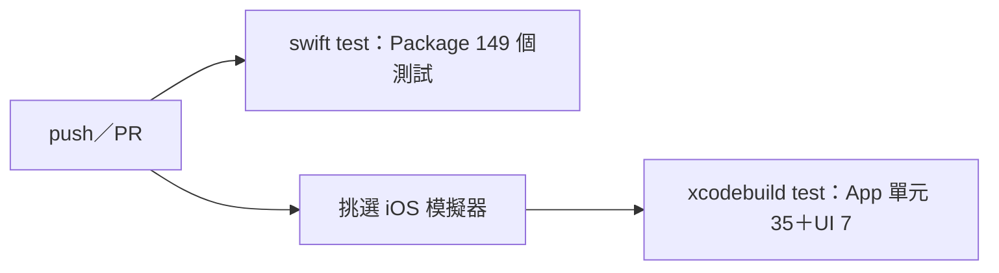

# 10　部署與環境設定

本章的目標：在一台新的 Mac 上把專案跑起來，包括模擬器、實機與 CI。PitchCoach 沒有後端、資料庫伺服器或外部服務，也沒有任何密碼或金鑰。

---

## 10.1 環境需求

| 項目 | 需求 | 開發時使用的版本 |
|---|---|---|
| macOS | 能執行 Xcode 16 以上的版本 | macOS 27.0.1 |
| Xcode | 16 以上（Package tools 6.0、資料夾同步群組） | Xcode 27.0（27A266a） |
| Swift | 6.0 以上 | Swift 6.4 |
| iOS | 17 以上的模擬器或實機 | iPhone 18 Pro 模擬器（iOS 27.0）、iPhone 15 Pro Max（iOS 27.0.1） |
| Python 3 | 只有測試音腳本需要，只用標準函式庫 | — |

> 📄 依據：README「執行方式」與「開發與測試環境」

---

## 10.2 本機啟動

```sh
# 1. 取得程式碼
git clone https://github.com/hn83320589/PitchCoach.git
cd PitchCoach

# 2. 核心邏輯的測試（macOS，不需模擬器）
swift test --package-path Packages/PitchCoachKit

# 3. 用 Xcode 開啟，選 iPhone 模擬器後按 ⌘R
open PitchCoach.xcodeproj
```

第一次在模擬器執行時，App 會詢問麥克風權限，按「允許」。模擬器的麥克風就是 Mac 的麥克風，喇叭就是 Mac 的喇叭，所以可以對著 Mac 唱歌或播放測試音。

不想用 Xcode 介面時，也可以用命令列建置並測試：

```sh
xcodebuild test -project PitchCoach.xcodeproj -scheme PitchCoach \
  -destination 'platform=iOS Simulator,name=iPhone 18 Pro' -derivedDataPath build/DerivedData
```

---

## 10.3 在 iPhone 上執行

> 📄 依據：實機驗收時的實際操作過程（開發對話），整理於 `docs/DEVICE_TESTING.md`「準備」

1. **iPhone**：設定 → 隱私權與安全性 → 開發者模式，打開後重新開機。這個選項要先用線接過 Mac、開過 Xcode 才會出現。
2. **Xcode**：點左側最上方的專案 → target **PitchCoach** → **Signing & Capabilities**：
   - **Team**：選自己的 Apple ID，免費的 Personal Team 即可。
   - **Bundle Identifier**：repo 中是佔位值 `com.example.PitchCoach`，改成自己的（例如 `tw.<yourname>.PitchCoach`），全世界不可重複。
3. 用傳輸線接上 iPhone、解鎖、按「信任這部電腦」，在 Xcode 上方的執行目標選它，按 ⌘R。
4. 免費帳號第一次會被擋：iPhone 的 設定 → 一般 → VPN 與裝置管理 → 信任自己的開發者帳號。
5. App 內：設定 → 確認 A4 = 442 Hz；需要量測時打開「顯示延遲資訊」。

Team 與 Bundle ID 的修改會寫進 `PitchCoach.xcodeproj/project.pbxproj`。這是個人環境設定，不要 commit；需要還原時用 `git checkout PitchCoach.xcodeproj/project.pbxproj`。免費帳號簽的 App 7 天後失效，重新執行即可。

---

## 10.4 設定項

### 使用者設定（`UserDefaults`，`PitchCoach/App/AppSettings.swift`）

| 鍵 | 型別 | 用途 | 預設值 | 必填 |
|---|---|---|---|---|
| `referenceA4` | `Int` | A4 基準，寫入時夾在 415–466 | 442 | 否 |
| `showsLatencyOverlay` | `Bool` | 調音器下方顯示延遲、輸入電平、輸入／輸出埠 | false | 否 |
| `studentName` | `String` | PDF 週報標題的學生姓名 | 空字串 | 否 |
| `latencyCalibrations` | `[String: Double]` | 歌唱的延遲校正值（秒），鍵為「埠類型:裝置 UID」 | 空 | 否 |

### 專案設定

| 項目 | 位置 | 說明 |
|---|---|---|
| 麥克風使用說明 | `project.pbxproj` 的 `INFOPLIST_KEY_NSMicrophoneUsageDescription` | 「PitchCoach 需要使用麥克風偵測你演奏的音高。」測試 `InfoPlistTests.swift` 確認它存在 |
| Bundle Identifier | `project.pbxproj` | 佔位值 `com.example.PitchCoach`，實機時改成自己的 |
| Development Team | `project.pbxproj` | 空白，實機時選自己的 |
| 部署目標 | App iOS 17.0；Package `platforms: [.iOS(.v17), .macOS(.v14)]` | — |

### 啟動參數（DEBUG 組態）

| 參數 | 作用 |
|---|---|
| `-syntheticScenario <tuner\|longTone\|scale\|singing>` | 以合成訊號取代麥克風 |
| `-uiTesting` | SwiftData 用記憶體內儲存 |
| `-seedDemoData` | 放入 28 天示範紀錄（需搭配 `-uiTesting`） |
| `-referenceA4 <Hz>`、`-showsLatencyOverlay <YES\|NO>`、`-studentName <名字>` | 經 `UserDefaults` 的參數網域覆寫設定 |

在 Xcode 的 Scheme → Run → Arguments 加上這些參數，就能在模擬器上不用麥克風看到各畫面。

---

## 10.5 輔助腳本

```sh
# 產生實機驗收用的 A4 測試音（預設 442 Hz、30 秒，輸出到 build/）
python3 scripts/make-test-tone.py 442 60

# 跑 UI 測試並把截圖匯出到 docs/screenshots/
scripts/export-screenshots.sh "iPhone 18 Pro"
```

測試音的音色是基音加遞減泛音（近似弓弦），用另一支手機或電腦播放，作為音訊路由比對的音源。

---

## 10.6 建置與 CI

`.github/workflows/ci.yml`，每次 push 到 `main` 與每個 pull request 執行：



- 兩個 job 都跑在 `macos-15`。
- 模擬器在執行時從最新的 iOS runtime 挑第一台 iPhone；UDID 以環境變數 `SIMULATOR_UDID` 傳給 `xcodebuild`。

> 🔍 推斷：專案沒有設定 App Store 或 TestFlight 的發布流程，`docs/` 與 commit 中也沒有相關紀錄；目前的「部署」只到建置、測試與實機安裝。

---

## 10.7 常見錯誤與排除

以下都是開發過程中實際遇到的狀況。

| 症狀 | 原因 | 排除方式 |
|---|---|---|
| Xcode 按 Run 時顯示 `Unable to resolve module dependency: 'SingingEngine'` | Xcode 自己的建置快取（家目錄下 Library/Developer/Xcode/DerivedData）過期，增量建置狀態沒跟上新增的模組；程式碼本身沒問題，乾淨建置與 CI 都通過 | Product → Clean Build Folder（⇧⌘K）；仍不行就 File → Packages → Reset Package Caches；最後手段是關閉 Xcode 後刪掉該專案的 DerivedData 資料夾 |
| `scripts/export-screenshots.sh` 找不到新模組 | 同上，腳本原本用 Xcode 預設的建置快取 | 腳本已改用 `-derivedDataPath build/DerivedData`（📄 commit `20d89ba`） |
| Signing 顯示「Your team has no devices from which to generate a provisioning profile」 | 免費帳號只能產生綁定特定裝置的憑證，帳號下還沒有登記裝置 | 接上 iPhone 並選為執行目標，按 Try Again 或直接執行 |
| 「<裝置名稱> needs to be unlocked to enable development services」 | 第一次啟用開發服務時 iPhone 是鎖定的 | 解鎖到主畫面並保持亮著，按 Retry；必要時暫時關閉自動鎖定 |
| 免費帳號安裝後無法開啟 | iPhone 尚未信任開發者帳號 | 設定 → 一般 → VPN 與裝置管理 → 信任 |
| 終端機 `open -a Simulator` 顯示找不到應用程式 | 模擬器 App 在 Xcode 套件內，不在 `/Applications` | 從 Xcode 執行任一模擬器目標，或 Xcode → Open Developer Tool → Simulator |
| iOS 27 模擬器用 `simctl privacy grant` 無法預先授予麥克風權限 | 模擬器版本行為 | 第一次執行時手動按「允許」（📄 README 已知限制） |
| Xcode 主控台出現「Debug session ended with code 9」 | 命令列（`xcodebuild test` 或 `simctl`）在 Xcode 除錯中重新安裝或終止了同一個 App | 不是 App 當機；避免同時用 Xcode 與命令列操作同一台模擬器 |
| 命令列 `xcodebuild test` 在測試主程式當機後停在「Restarting after unexpected exit」 | 測試主程式意外結束後 xcodebuild 等待重啟 | 中止指令重新執行；腳本中可偵測這行訊息後主動結束 |
| 連藍牙耳機時調音器顯示「—」 | 測試音傳到 iPhone 麥克風時太小聲（實測 −60.6 dBFS，低於門檻 −50 dBFS） | 看延遲面板的「輸入電平」，調大音源音量或拉近距離；面板的輸入／輸出埠可確認仍是內建麥克風收音 |
| 延遲校正時 AirPods 的聲音跑回 iPhone 喇叭 | AirPods 的自動入耳偵測：耳機離開耳朵時切回喇叭 | 設定 → 藍牙 → AirPods 旁的 ⓘ → 關閉自動入耳偵測，測完再打開 |

> 📄 依據：以上各列皆為開發對話中實際發生並排除的狀況；DerivedData 一列另見 `docs/TEST_REPORT.md` §7 #3
